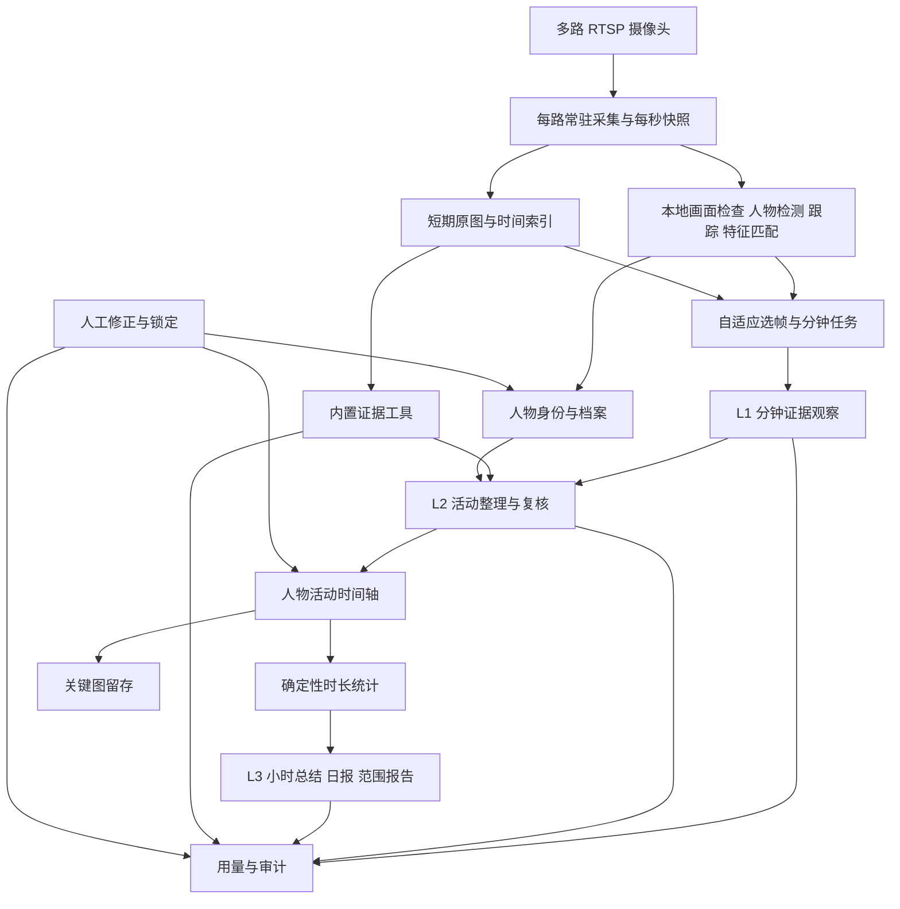

# 摄像头 AI 总结工作台 · 产品需求文档

文档日期：2026-10-26；文档性质：完整产品实现与验收依据。

产品形态：单账户、自托管、以摄像头证据为基础的活动记录工作台。界面与报告语言：简体中文；默认时区：Asia/Shanghai。

快速导航：[产品范围](#scope) · [采集](#capture) · [三层 AI](#ai-layers) · [人物识别](#identity) · [时间轴](#timeline) · [存储清理](#retention) · [审计](#audit) · [页面流程](#workbench) · [默认设置](#defaults) · [验收](#acceptance)

<a id="scope"></a>

## 1. 产品目标与范围

### 1.1 产品目标

持续接入 RTSP 网络摄像头，每秒保存一张抓拍图，在本地筛选值得分析的画面，再通过三层 AI 将画面转化为可追溯的个人活动时间轴、小时总结、日报和自动人物档案。

系统需要回答的核心事实是：**某个人，在什么时间段，做了什么可观察到的活动，持续多久，这个判断依据哪些画面。** 用户通过浏览时间轴、筛选记录和查看报告获取这些信息。

单用户表示只有一个管理账户；画面里出现的多个人都需要记录，每个人拥有独立的活动时间轴和自动归档的档案。摄像头按路独立管理，添加摄像头不需要修改代码。

### 1.2 成功场景

以下为一小时的验收样例，时间区间采用左闭右开规则：

| 时间 | 人物 A 的活动 | 时长 |
| --- | --- | --- |
| 16:00–16:20 | 书写 | 20 分钟 |
| 16:20–16:30 | 使用手机 | 10 分钟 |
| 16:30–16:31 | 书写 | 1 分钟 |
| 16:31–16:41 | 使用手机 | 10 分钟 |
| 16:41–16:45 | 整理桌面 | 4 分钟 |
| 16:45–17:00 | 未在可用摄像头画面中出现 | 15 分钟 |

小时报告应保留上述顺序，汇总为书写 21 分钟、使用手机 20 分钟、整理桌面 4 分钟、未出现 15 分钟，并能跳转到对应活动和仍在保留期内的证据。不能将中间的一分钟书写平滑掉，也不能把离开画面的 15 分钟补写成书写。

没有画面证据或用户修正时，采用“书写”“使用手机”等可观察名称，不擅自判断正在写哪门作业、用手机做什么。用户可以将特定记录更名为“写作业”，但这不改变底层证据。

### 1.3 已确认的功能边界

| 项目 | 完整产品要求 |
| --- | --- |
| 部署 | Windows 原生运行、Linux 原生运行、Docker Linux 容器运行；无 GPU 可用 |
| 容量定位 | 单路摄像头可在约 4 核 CPU、2～3 GB 可用内存、约 10 GB 可用磁盘的环境下采用受控配置运行；多路按资源准入 |
| 视频来源 | 可增删、启停和配置的 RTSP 网络摄像头；每路独立 |
| 抓拍 | 默认每秒一张，全天、定时、手动三种采集模式 |
| AI | 三层逻辑职责，均通过可配置的 OpenAI 兼容接口调用；各层可独立配置模型 |
| 活动 | AI 决定可观察活动，支持稳定分类、短活动、并行标签及人工修正 |
| 人物 | 所有可检测人物自动建档；同一路跟踪，跨时段及跨路身份关联；各人独立时间轴 |
| 报告 | 小时总结、日报、自选时间范围报告；基于结构化活动统计 |
| 审计 | 本机完整调用与变更追踪、证据关联、篡改检测、查询与导出 |
| 留存 | 原始抓拍图默认 3 小时，事件关键图默认 90 天，活动和档案长期保留，审计元数据默认 365 天；设置中可修改 |
| 故障积压 | 不要求自动补完全部历史积压；恢复后优先当前时段，历史未完成部分明确留痕，可手动重分析仍有证据的区间 |
| 访问 | 本机使用体验；用户自行管理域名、反向代理等部署设施，产品提供必要的监听地址和代理信任配置 |
| 查询 | 时间、人物、摄像头、活动、状态等结构化筛选；不提供自然语言聊天查询 |
| 导出 | 报告、活动明细、审计记录和可选证据包 |
| 通知 | 工作台内的故障、预算、存储、报告完成通知；可配置行为时长提醒，默认关闭 |

不纳入本产品的能力：录音、语音转写、电脑屏幕截图、当前应用采集、日历和笔记接入、联网搜索、当前即接入的外部 HTTP/MCP 工具、画面遮挡与人物排除功能、多账户协作、独立的异地备份或对象存储系统、自然语言问答。内置分析工具必须采用可扩展适配接口，这项要求属于完整产品本身。

### 1.4 需求解释与约束优先级

1. 用户确认的范围优先于默认建议；本文件不依据仓库原有实现或文档。
2. “原图”指采集时生成的母版抓拍图，保留原始时间与来源关系；不是原始视频流或无损视频录像。保存分辨率和编码质量明确展示，AI 派生图不能覆盖母图。
3. “每秒采集”与“每秒调用 AI”独立。密集分析时使用每秒图像，但按时间窗口批量调用。
4. 原图过期后不能凭模型记忆重建真实画面。关键图仍存在时，只能进行覆盖该证据范围的有限复核。
5. “长期保留”表示没有按时间自动过期，不代表有限磁盘可以无限保存；容量不足时执行第 13 节的策略。
6. 积压策略按“不强制补完历史、优先恢复当前记录”执行；不能把未分析时段标成已完成。
7. 数据保留期、费用上限和证据真实可用性优先于后台任务继续执行；任何降级都必须在界面和审计中可见。

## 2. 术语与不可破坏的业务规则

### 2.1 术语

| 术语 | 定义 |
| --- | --- |
| 抓拍槽位 | 某一路摄像头某一秒的预期采样位置；成功、缺失、暂停等状态明确 |
| 母版抓拍图 | 抓拍槽位成功生成的保存图片，简称原图 |
| 派生图 | 为分析生成的缩放图、局部裁剪、带编号标注的工作副本 |
| 关键图 | 从原图或派生图中选择、独立延长保留期的事件证据 |
| Track | 同一路摄像头内一段连续的人物运动轨迹，不等于长期人物身份 |
| Person | 长期人物档案实体，可关联多条轨迹与多路摄像头 |
| 第一层／L1 | 分钟证据观察层，产生可追溯的初步观察 |
| 第二层／L2 | 活动整理层，调用工具复核，形成用户主时间轴的活动片段 |
| 第三层／L3 | 报告层，解释结构化统计，生成小时总结、日报和范围报告 |
| 活动片段 | 某个人在一个时间区间内的主活动、并行标签及相关证据 |
| 分析任务 | 一个可持久化、可重试、可跳过的处理单元 |
| 请求尝试 | 实际向服务商发出的一次请求；重试是新的请求尝试 |
| 修订 | 对观察、身份关系、活动或报告生成的新记录，不覆盖历史内容 |
| 覆盖状态 | 说明该时间段是否采集、是否有可用证据、是否分析完成 |

### 2.2 核心不变量

- 所有内部绝对时间保存为 UTC，界面和报告按 Asia/Shanghai 展示；时区是可配置的报告规则。
- 时间区间统一为 `[start_at, end_at)`，相邻片段在边界上不重复计时。
- 一个摄像头的任务错误不能造成其他摄像头停止；停止整机服务或全局资源不足除外。
- 已知人物在同一时间的规范主时间轴最多有一个主活动；并行活动放入独立标签轨，不重复计算主活动总时长。
- 不同人的活动可以同时发生；多个人的时长相加可能超过自然时间，界面须标为“人分钟”。
- 同一个人在多路摄像头中同时出现时，人物汇总按时间并集去重；摄像头各自保留观察和证据。
- 没有证据、采集失败、AI 未完成、人物未出现、活动无法判断是不同状态，不能混用。
- L1 初步结论不能伪装成 L2 结果；L2 结果不能伪装成人工确认结果。
- 人工锁定的字段不能被自动分析覆盖；自动重分析产生可比较的新修订。
- 模型不得引用未提供或工具未返回的证据编号；时间边界不能超出可用证据范围而不声明估计。
- 原图清理不得自动删除活动、人物或审计记录；证据链接改为“已到期”，保留必要元数据。
- 请求重试不保证供应商只计费一次；本地业务去重与远端计费必须分开处理。
- 统计由程序计算，报告中的数值从统计结果引用；不接受模型自行修改时长以凑满一小时。

## 3. 总体处理架构



本地视觉模块使用 CPU 上可运行的轻量检测、跟踪与特征模型，不作为第四层生成式 AI。它提供“值得检查的变化”和身份关联证据，不独立编造语义活动。

### 3.1 组件与职责

| 组件 | 责任 | 资源与故障边界 |
| --- | --- | --- |
| Web 工作台 | 预览、时间轴、人物、报告、设置、用量、审计、通知 | 关闭浏览器不影响采集与分析 |
| 应用 API | 单账户鉴权、查询、配置、修订和导出 | 不直接执行长时间分析 |
| 摄像头采集器 | RTSP 连接、解码、秒级采样、时间戳、健康检查 | 每路独立连接和有界缓冲 |
| 本地视觉工作器 | 人物框、跟踪、身份候选、变化评分 | 共用模型，限制线程、批量和队列 |
| 调度器 | 持久任务、优先级、预算预约、超时、重试、过期 | 崩溃后恢复，不重复提交已完成业务结果 |
| AI 网关 | 各层模型配置、能力适配、请求、响应校验、用量 | 不依赖服务商保存会话 |
| 工具执行器 | 注册、参数校验、范围校验、证据返回 | 有限循环、有限数据量、有限时间 |
| 活动与报告服务 | 合并活动、处理修订、统计、报告版本关系 | 原子更新当前修订指针 |
| 留存管理器 | 到期清理、引用计数、空间配额、临时文件回收 | 与任务读取协调，不突破保留策略 |
| 审计写入器 | 调用、配置、数据变更与清理留痕 | 追加写入、串行链式摘要 |

### 3.2 落地技术约束

- 采用单机应用架构，默认不要求安装 Redis、PostgreSQL、独立向量数据库或消息中间件。
- 建议实现组合为：Python 应用服务与工作器、FFmpeg 解码、CPU 推理运行时、SQLite WAL、文件系统证据存储、TypeScript Web 界面。工程可以替换等价组件，但必须满足全部行为和验收约束。
- SQLite 使用单写入协调、有界事务、忙等待与索引；原图二进制不写入关系数据库。
- 任务队列、租约、幂等键、预算预约和修订指针保存在数据库中，不能只存在进程内存。
- 模型只加载一次并复用；本地推理默认一个并发任务、最多两个计算线程，AI 请求默认全局两个并发。
- 不在本机运行大型语言模型；所有生成式分析通过已配置的 OpenAI 兼容服务完成，服务本身可以位于任何用户配置的地址。
- 分辨率和源视频帧率影响解码开销。将输出降到每秒一张不代表无需解码其余视频帧，资源准入需测量实际负载。
- 默认数据、密钥、日志、模型与程序路径明确分开；程序升级不清空用户数据。

CPU 推理运行时需要显式限制线程和线程池，避免每个模型会话各自占满 CPU。线程设置依据运行时的正式接口实现。[ONNX Runtime 线程管理](https://onnxruntime.ai/docs/performance/tune-performance/threading.html)

<a id="capture"></a>

## 4. 摄像头接入、采集与健康状态

### 4.1 摄像头管理

摄像头配置包括：名称、RTSP 地址、独立保存的认证信息、启用状态、TCP/UDP 传输偏好、连接与读取超时、采集计划、抓拍分辨率与质量、保留策略覆盖项、可选的相邻摄像头关系。

必须支持：添加、连接测试、查看测试帧、编辑、启停、归档、重新连接、查看故障与最近采集时间。归档摄像头停止新采集，保留历史记录；不自动删除证据或报告。

连接测试只验证连接和返回测试帧，只有用户启动采集或启用采集计划后才建立持续采集任务。测试操作、结果和临时图片留存均受审计与临时文件策略约束。

摄像头之间不混用认证、轨迹编号、窗口游标和错误计数。URL 中的密码不得出现在前端回显、错误信息、审计或普通日志中。

### 4.2 采集行为

- 默认每秒一个槽位，按单调时钟调度；记录采集 UTC 时间、源 PTS（若存在）、采集会话编号和每会话序号。
- 每秒选择最接近该槽位的最新有效帧，避免从滞后的解码队列补存旧画面。
- 默认抓拍母图长边上限 1280 像素、JPEG 质量 80；可设置为保留源分辨率或调整质量，界面明确当前实际尺寸。不同尺寸的效果需由接入检查呈现。
- 不论是否检测到变化，采集启用时都保留每秒原图；允许底层内容去重，但每个槽位必须有独立时间索引和正确的引用计数。
- 原图、索引及文件摘要采用临时写入后原子提交；部分写入或解码失败不产生可用帧记录。
- 一秒内无有效新帧时记录缺失槽位，禁止复制上一张图冒充新采集。
- 摄像头帧时间持续推进但像素相同，可以是真实静止画面；不能仅凭图片相同判断冻结。
- 源时间戳不推进、读取超时或解码停止时记录疑似冻结或断流。无法确定是否冻结时显示“新鲜度存疑”，触发连接检查。
- 不回填断流时并不存在的图片。重连开启新的采集会话，序号重置不造成时间索引冲突。
- 定时停止、用户暂停、断流和磁盘保护分别记录原因。

### 4.3 采集控制

| 操作 | 保存图像 | 本地人物处理 | 云端 AI | 时间轴 |
| --- | --- | --- | --- | --- |
| 正常运行 | 开启 | 开启 | 按策略执行 | 持续更新 |
| 暂停采集 | 停止 | 不产生新观察 | 已开始的历史任务可结束 | 记录采集暂停区间 |
| 暂停 AI | 继续 | 继续，受资源限制 | 不提交新付费请求 | 显示 AI 暂停及待处理区间 |
| 采集计划外 | 停止 | 停止 | 完成允许的已有任务 | 显示计划外区间 |
| 预算硬上限 | 继续 | 继续 | 停止新付费请求 | 显示预算暂停 |
| 磁盘保护 | 受保护策略限制 | 仅处理可持久化的帧 | 不提交无法可靠记录的新请求 | 显示存储异常 |

已发到服务商的请求可能无法取消，暂停时必须记录这些请求的实际完成或未知状态及费用。恢复 AI 不等于自动重放全部暂停期间的数据。

### 4.4 连接与状态机

摄像头状态：`DISABLED → CONNECTING → RUNNING`；失败时转 `RECONNECTING`，持续失败转 `ERROR`；用户暂停为 `PAUSED`；资源保护为 `RESOURCE_BLOCKED`。`STALE` 是新鲜度异常标志，可附加在已连接状态上。

重连采用带随机抖动的退避，默认 2、5、15、30、60 秒，之后保持最多 60 秒间隔。认证失败或地址格式错误直接提示修正，避免无意义高频重试。状态恢复时发出一次恢复事件。

## 5. 本地变化检查与自适应选帧

### 5.1 输入信号

本地模块结合以下信号输出“疑似需要进一步分析”，各信号的原始值、阈值与配置摘要可审计：

- 全局亮度变化与背景差异，用于识别开关灯、曝光调整和镜头变化。
- 自动检测的人物区域变化，而非要求用户绘制区域。
- 人物出现、消失、轨迹交叉、遮挡和身份候选变化。
- 人物上身、手部附近及邻近桌面区域的局部视觉变化。
- 按需运行的轻量物体检测或外观特征差异，例如手机候选出现；局部检测失败不能阻止定时 AI 检查。
- L1/L2 低置信度、相互矛盾、活动切换与证据不足的反馈。
- 固定间隔的语义检查；即使本地认为静止，也不能无限延续历史活动。

画面变化评分采用由模型与预处理定义的统一量纲，阈值需要在测试集上校准；不能把任意模型的相似度直接解释成概率。

### 5.2 选帧模式

| 模式 | 默认行为 | 进入条件 | 退出条件 |
| --- | --- | --- | --- |
| 平稳检查 | 每 10 秒取一张代表图，包含窗口两端附近的图，通常每分钟 6～8 张 | 无新增变化或不确定性 | 新变化、人物事件、语义矛盾 |
| 密集观察 | 变化区间按每秒一张，补取触发前 30 秒；可按需回查更早画面 | 疑似活动切换、身份冲突或模型要求 | 至少 20 秒无新变化，且当前活动判断稳定 |
| 周期复核 | 在平稳模式的代表帧外，默认每 5 分钟补查一段 10 秒连续图 | 到达复核周期 | 复核完成或升级密集观察 |
| 人工复核 | 对用户选定的可用时间区间按需取图 | 用户重分析请求 | 任务完成或达到预算与范围限制 |

以上数量均为默认可配置策略。模式针对每路摄像头维护，人物局部变化决定额外取图；多人同帧共用全景图，必要时增加局部裁剪，避免每个人重复发送完整全景。

### 5.3 密集观察的约束

1. 进入密集观察不丢弃历史原图，先补查触发前区间，再继续获取之后的每秒图像。
2. “每秒一张”表示证据粒度，模型请求仍按窗口打包；默认每个请求最多 20 张图，受服务商配置的实际限制约束。
3. 同一分钟的全部 60 张可拆成多组，组间必要的少量重叠只用于连续性，合并时去重。
4. 持续书写等长期运动不能仅因“仍在动”让系统永久全量上传；语义稳定后可回到代表帧检查，并记录模式切换依据。
5. 已疑似发生新活动时，不能仅为省费用而悄悄吞掉证据请求；受到预算或资源限制时，输出“待复核／证据不足”。
6. 模型表示不确定不等于无限追加图片。最多使用本任务的工具轮次、图片数量、时间和费用额度。
7. 自动选帧至少保留首尾、变化前后和必要的均匀时间样本；不能只选最清晰的一张后推断整分钟。
8. 拼图只可用作浏览缩略图；正式识别保留可区分的时间与独立图像索引，不把压缩成拼图视为固定的省 token 保证。

图像数量、尺寸和细节选项会影响实际用量，而且不同模型的处理方式不同；不能仅依靠名为 `low` 的参数认定费用更低。适配器应按具体模型能力处理。[OpenAI 图像输入与计费说明](https://developers.openai.com/api/docs/guides/images-vision)

### 5.4 漏检防护与评估

- 固定语义检查与周期复核独立于本地运动阈值运行。
- 原图存在期间，L2 可以发现与 L1 不一致的证据并重新检查相关区间。
- 评估集必须包含“静坐阅读转使用手机”“持续书写”“开关灯”“屏幕亮度变化”“短暂拿起手机”等案例。
- 统计抽帧比例、密集模式占比、追加图像量、活动召回和边界误差；只有在质量约束成立时才能报告节省率。
- 本地漏检后没有其他证据触发复查，仍可能漏掉短事件。因此精度作为有标注数据上的验收目标，不承诺所有真实场景绝无漏检。

<a id="ai-layers"></a>

## 6. 三层 AI 的职责与输出契约

### 6.1 第一层：分钟证据观察

默认按自然分钟分窗；开始或停止时不足一分钟的片段也须形成部分窗口。只有实际获取的图像参与分析，缺失槽位单独说明。

输入包括：摄像头和窗口标识、按时间排序的图像编号、图像时间、自动人物框及 Track 编号、必要的上一段状态摘要、缺失与质量信息。不把其他时间的大量历史描述重复拼入每个请求。

输出必须包含：

| 字段 | 说明 |
| --- | --- |
| `window_id / camera_id` | 可验证的窗口与摄像头编号 |
| `observed_range` | 本次实际观察覆盖范围 |
| `observations[]` | 按 Track 或未知人物组织的可见行为 |
| `candidate_activity` | 可观察活动名称、规范分类候选、并行标签 |
| `change_points[]` | 疑似切换时刻或时间范围 |
| `evidence_ids[]` | 支持结论的已提供图片与裁剪编号 |
| `uncertainty_reasons[]` | 遮挡、模糊、采样稀疏、身份冲突等 |
| `needs_review[]` | 建议 L2 回查的时间和原因 |
| `brief` | 用于临时时间轴的简短中文描述 |

L1 可以观察同一帧中的多个人，但不能自行更改长期 Person 关联。无法对应本地轨迹的人物输出临时引用，交由身份服务检查。

L1 拆分请求合并时按时间和证据编号去重。任何子请求失败，窗口状态为部分完成，不能输出整分钟已经完整分析的标志。

### 6.2 第二层：活动整理

默认每 5 分钟整理一次，可配置 1～30 分钟。使用完整 L1 观察、覆盖信息、人物映射、相关关键图和上一窗口末尾的活动。对窗口前后默认各读取最多 60 秒上下文；需要更长回查时使用工具并遵守权限和预算。

L2 必须完成：

1. 识别每个人的活动变化，而非只生成一段五分钟摘要。
2. 对疑似边界、短活动、多人混淆和低置信片段调用工具检查。
3. 将同一活动跨窗口延续为连续片段，同时保留各窗口来源。
4. 输出主活动、并行标签、起止时间、边界不确定范围、证据与简短依据。
5. 保留一段明确发生的短活动，即使前后活动相同。
6. 将证据不足、人物未出现、采集缺口和未分析部分保持为明确状态。
7. 对已有记录提出修订，提交时经过时间合法性、身份一致性和人工锁定检查。

人物进出、明确活动切换、L1 大范围不确定可触发提前整理。同一摄像头自动提前触发默认最多每 60 秒一次，已排队任务合并待处理范围，防止重复消费。

输出采用结构化活动，不允许只返回散文。每次 L2 结果必须提供基础观察版本和身份映射版本，迟到结果在提交前检查是否已经过时。

### 6.3 第三层：小时总结、日报与范围报告

默认自然整点形成小时区间；每日按 00:00 切分。小时结束 2 分钟后生成报告；次日 00:10 生成前一日的日报，允许设置不同日界和发布时间。等待上限为可配置值，不能因一个失败窗口永久阻塞报告。

数据来源为当前有效的 L2 活动与程序计算的统计；L1 只有在 L2 尚未完成时以“初步记录”身份参与，并与正式统计分开。L3 可通过受控工具查看活动、报告来源和现存证据；发现矛盾时标记或请求重分析，不能越过 L2 直接无痕修改活动。

小时报告、日报和范围报告至少包含：

- 总体描述与按时间排序的关键活动变化。
- 每个人的活动分布、主活动时长、并行标签时长、切换次数。
- 人物未出现、活动未知、采集缺失、AI 未处理的时间及覆盖比例。
- 支持结论的活动与证据入口；证据到期时显示到期状态。
- 报告状态、来源修订、生成时间和最后修订时间。
- 相关分析用量与费用状态，不包含与本报告无关的请求。

日报不能只把小时报告文字再次压缩。其数值必须回到活动数据计算，小时报告只作可引用的叙述材料。

### 6.4 结构化活动示例

```json
{
  "person_id": "person_0001",
  "camera_ids": ["camera_01"],
  "start_at": "2026-10-26T08:30:00Z",
  "end_at": "2026-10-26T08:31:00Z",
  "primary_activity": {"category_id": "writing", "label": "书写"},
  "secondary_tags": [],
  "boundary_uncertainty_seconds": {"start": 3, "end": 4},
  "evidence_ids": ["evidence_a", "evidence_b"],
  "evidence_quality": "sufficient",
  "activity_confidence": "high",
  "identity_confidence": "high",
  "source_stage": "L2",
  "source_window_ids": ["window_01"],
  "base_revision": 7,
  "explanation": "连续画面显示人物持笔在纸面书写。"
}
```

自报置信度不能单独决定自动身份合并或业务真伪；系统结合证据覆盖、模型输出一致性和经过校准的规则给出展示等级。

### 6.5 输出校验与失败处理

- 校验 JSON 结构、字段类型、枚举、引用存在性、时间范围和主体归属。
- 对不存在的证据引用、负时长、跨摄像头错误引用或人为制造的未知身份判定为无效输出。
- 允许一次有预算限制的结构修复请求；修复后仍失败则任务失败，保留上一个有效结果。
- 服务商拒绝、截断输出和工具参数错误分别记录，不自动解释为“无活动”。
- 保存服务商返回的原始响应与规范化结果；不要求取得模型内部思维过程。
- 从画面或 OCR 中出现的“指令”只视为被观察内容，不能改变系统提示、工具权限或凭据使用方式。

<a id="identity"></a>

## 7. 人物检测、同一人识别与自动档案

### 7.1 身份识别的分工

身份识别由本地身份服务完成，生成式 AI 负责活动解释。系统采用三个互补层次：

| 层次 | 方法与用途 | 不能单独据此做的判断 |
| --- | --- | --- |
| 同一路连续跟踪 | 人物检测框、运动预测、空间关系、外观特征，维护 Track | 轨迹编号不能直接当作跨天身份 |
| 稳定身份匹配 | 清晰人脸检测、关键点对齐、本地特征向量、候选库检索、多帧验证 | 单张模糊脸或单一高相似分数不能直接合并人物 |
| 外观辅助匹配 | 人体外观、衣着与短时间连续性，帮助遮挡后续接轨迹 | 同样衣服不能证明是同一个人；换衣不能证明是新人物 |

特征匹配采用模型定义的向量距离。轻量人脸模型和人体重识别模型可以生成用于相似性比较的特征；具体阈值必须结合目标数据校准，不沿用文档中的公开测试成绩作为本产品精度。[人脸特征模型说明](https://docs.openvino.ai/2023.3/omz_models_model_face_reidentification_retail_0095.html)、[人体特征模型说明](https://docs.openvino.ai/2023.3/omz_models_model_person_reidentification_retail_0288.html)

连续跟踪可采用检测关联类算法，结合低置信但与已有轨迹一致的检测减少短暂遮挡造成的断轨。真实低帧率输入必须单独验证，不能直接采用高帧率公开结果作为保证。[ByteTrack 原始论文](https://www.ecva.net/papers/eccv_2022/papers_ECCV/html/315_ECCV_2022_paper.php)

### 7.2 自动身份流程

1. 每秒抓拍进入轻量人物检测；本地过载时人物推理可降频，原图采集保持独立，并记录身份观察的实际频率。
2. 发现新的人物轨迹即自动建立临时 Person 和临时观察，允许进入独立时间轴；默认连续三次有效观测后将轨迹标为稳定，才可进一步更新长期身份特征。短暂只出现一次的人物也保留临时档案，并标为“未确认人物观察”，不因轨迹未稳定而丢弃记录。
3. 同一路正在连续跟踪的人物优先保持 Track 身份；遮挡后恢复需通过空间、时间与外观门控，不能仅匹配最近位置。
4. 有足够清晰的人脸时做质量检查和对齐，提取特征，检索已有 Person 的代表特征。
5. 自动关联必须满足经校准的匹配阈值、第一候选与第二候选的区分度、至少两张不同采样时刻的支持证据，以及无已知身份冲突。
6. 条件不满足时自动建立临时 Person，使用“人物 0001”等名称。无需用户预先上传人脸或逐个注册。
7. 后续获得更清晰证据时可将临时档案关联到稳定档案，并创建可撤销的身份修订；已有人为锁定的关系只生成建议。
8. 仅有衣着和身体外观时可辅助同会话、短时重连；跨天或长期身份合并必须有更强证据。无法确认就保持独立档案与候选关系。
9. 身份服务返回 Person、身份置信等级和依据；活动模型只能使用该映射，发现冲突时提出复核请求。

### 7.3 冲突与防止错误传播

- 同一路同一时刻的两个独立可见人物，默认不能归为同一 Person；镜面、屏幕或照片中的重复人物需要标记为疑似反射／显示内容，不能作为独立真实人物的确定证据。
- 两路摄像头的同时出现不自动视为冲突，因为视野可能重叠。只有配置了互斥位置且存在不可能的转移时间时，才能据此否定关联。
- 相似外观、背影、口罩、强遮挡、低分辨率时降低身份等级；不能用活动习惯反过来作为确定身份的依据。
- 新匹配不能立即污染已有特征库。只有稳定跟踪、质量通过且身份无冲突的样本可更新代表特征。
- 每个人默认最多保留 10 组高质量代表特征，按质量和角度多样性更新，记录来源与模型版本。临时外观特征默认 24 小时到期。
- 换特征模型时向量空间不能混用。旧、新特征分开标记，使用仍存在的图片重新计算；没有可用图片的档案保留身份与历史，等新观察补充特征。
- 对错误合并支持拆分指定轨迹和时间段，撤销错误映射并重建相关人物活动和统计。
- 不承诺无脸、全遮挡、换装且缺少连续性时仍能确定是同一个人。此时保留匿名活动的事实比错误合并更重要。

### 7.4 档案内容

每个档案包含：系统编号、可编辑显示名与别名、代表头像或默认头像、稳定／临时／待复核状态、首次与最近出现时间、出现过的摄像头、关联轨迹数、活动时间轴、常见活动及时间分布、相关报告、人工备注、身份合并拆分历史。

自动档案摘要只根据历史活动和出现记录生成。事实注明统计范围和数据覆盖情况，不从外表推断性格、职业或与活动无关的身份属性。

代表头像纳入关键图容量与保留规则；图像到期后显示默认头像并保留档案。长期代表特征属于档案数据，独立于原图 3 小时保留期；设置页面明确说明。

### 7.5 人物操作

支持重命名、备注、查看候选关联、确认或撤销关联、合并档案、按轨迹或时间段拆分档案、锁定身份关系。合并前展示受影响的记录、冲突时段与报告数量，提交后可查看修订结果。

档案修订不修改原始检测与历史模型响应，而是更新当前身份映射。重算不能重复计费已足以用确定性规则修正的数据；只有需要重新看图时才创建付费分析任务。

<a id="timeline"></a>

## 8. 活动时间轴、分类与精度

### 8.1 时间轴的主数据

主时间轴以当前有效 L2 活动为主，按以下优先级填充每个时间子区间：

`人工修正且锁定的结果 > 有效 L2 结果 > L1 初步结果 > 明确的处理中或覆盖缺口`

优先级按区间计算，不能因为五分钟中的一段完成 L2 就隐藏其他四分钟的 L1 或待处理状态。L1 与 L2 在同一时间段不会形成两个重复计时条目。

用户可切换“显示第一层初步结果”或“仅显示整理结果”；后一模式对未完成部分仍显示处理进度，不展示空白而使用户误以为无人活动。

### 8.2 时间轴状态

| 维度 | 状态 | 用户可见含义 |
| --- | --- | --- |
| 分析阶段 | 第一层识别中 | 当前分钟正在收集或分析 |
| 分析阶段 | 第一层初步结果 | 有观察结果，尚未经过活动整理 |
| 分析阶段 | 第二层整理中 | 正在合并观察或回查证据 |
| 分析阶段 | 第二层结果 | 当前可用的活动整理结果 |
| 结果修订 | 人工修正 | 用户修正过，显示锁定状态 |
| 结果修订 | 待更新／更新失败 | 来源发生变化，报告或记录仍引用旧结果 |
| 覆盖 | 人物未出现 | 可用观察中没有该人物，不推测其在画面外的活动 |
| 覆盖 | 活动未知 | 人物可见，但无法可靠识别活动 |
| 覆盖 | 采集缺失／暂停 | 没有相应图像来源 |
| 覆盖 | 未分析／已跳过 | 有过或仍有图像，但 AI 未完成 |
| 证据 | 完整／稀疏／部分过期／已到期 | 说明可回看的证据能力，独立于活动是否已有结果 |

界面使用文案、图标和样式共同区分状态，不仅依靠颜色。人物身份置信与活动置信分别显示。

### 8.3 分类规则

- 内置基础分类包括书写、阅读、使用电脑、使用手机、整理物品、饮食、交流、行走、休息、其他可见活动和无法判断。
- 这些分类用于稳定筛选和统计，不能限制 AI 输出新的合理活动名称。新增名称先作为标签，经过规范化匹配后关联或新建分类。
- “看手机”“操作手机”等归入同一规范分类，保留原始标签；“手机放在桌上”不能直接归为使用手机。
- 用户可以重命名、合并分类或修改一条记录的分类。分类变更有生效范围：仅此记录、指定时间范围、所有关联记录；全量操作须展示影响数。
- 分类的历史名称与当前名称都可追溯，报告标注生成时使用的分类修订。
- 主要活动只能有一个；并行标签可有多个。边吃饭边看手机可记为“饮食”主活动、“使用手机”并行标签，并在手机总使用时长中按区间并集计算。

### 8.4 活动边界与短活动

1. 原始观察保存秒级时间；默认主时间轴突出持续至少 10 秒的活动，更短的明确活动在展开详情中可见。
2. 10 秒阈值是展示与聚合阈值，不能删除底层短活动。可配置为 5～60 秒。
3. 持续 60 秒的明确不同活动必须单独成段，无论前后是否为同一种活动。
4. 仅在相邻片段的身份、主活动、来源质量和连续性一致时才可合并；任何已知不同活动或采集缺口均阻止直接合并。
5. 小于 5 秒的暂时遮挡可以标为推定连续，但保留证据缺口和估计标志；统计同时保留直接观察与推定覆盖量。
6. 稀疏采样只能确定变化发生在两个观察点之间时，以这个区间作为边界不确定范围；补查到秒级图像后缩小范围。
7. 默认精度目标为可辨识活动的边界误差中位数不超过 5 秒、P95 不超过 10 秒；它是标注测试集上的目标，不能通过隐藏困难样本达成。
8. 时长计算使用当前规范边界；报告中估计边界影响较大的片段标记“约”，导出包含边界范围。

### 8.5 跨窗口与跨摄像头

每个分析任务有一个负责写入的核心时间区间，额外读取的前后上下文只用于判断。需要修正相邻窗口时创建显式边界修订，携带受影响区间与基础修订号，不能直接把上下文重复插入。

跨摄像头人物总时间轴保留全部来源。多个摄像头对同一活动提供支持时合并证据；相互矛盾且证据无法判定时保留候选和冲突状态，不随机选择一个结果。摄像头页面仍可独立浏览自己的观察轨。

## 9. 修订、统计与报告一致性

### 9.1 修订传播


- 自动结果提交采用乐观并发控制，基础修订不一致时重新对齐或放弃提交，不能覆盖更新的人为修改。
- 同一人物、同一区间的批量编辑在一个业务事务中生效；用户不会看到一半合并、一半未合并的活动。
- 人工锁定支持按记录或关键字段锁定：人物、活动、开始结束时间。重新分析与人工结果并排比较，由用户选择是否替换锁定字段。
- 报告重算默认合并 30 秒内连续修正，避免每改一个字段就重新调用 L3。统计立即重算，叙述可短暂显示待更新。
- 预算不足时更新结构化统计并将叙述标为过期，不能用旧文字搭配新数字冒充完整的新报告。
- 修改报告时区、日界或分类规则，历史报告保留原始口径；用户明确选择重建范围后产生新报告。

### 9.2 统计定义

| 指标 | 计算规则 |
| --- | --- |
| 采集覆盖率 | 成功取得有效新帧的槽位数 ÷ 应采集槽位数；计划外单列，不混入正常运行分母 |
| 分析覆盖率 | 至少有相应阶段有效结果的时间并集 ÷ 有效采集时间；L1、L2 分别展示 |
| 人物可见时长 | 该人物在所有可用摄像头中的可见区间并集；推定连续部分单列 |
| 主活动时长 | 当前有效主活动区间裁剪到统计范围后的时长之和 |
| 标签时长 | 主活动或并行标签命中指定标签的区间并集 |
| 活动切换次数 | 相邻确定活动的主分类变化次数；未知或缺口前后的切换单独标记 |
| 人物未出现时长 | 有可用摄像头覆盖但未观察到该人物的区间；不能等同于确定不在现场 |
| 未分析时长 | 有可用采集覆盖但没有目标阶段结果的时间并集 |
| 证据可回看率 | 有至少一份仍可访问证据的活动数 ÷ 当前范围内活动数 |

一小时的单人主时间轴中，各主活动与互斥覆盖状态之和必须等于该小时的展示范围；并行标签、多人统计和多摄像头观察不参与这个等式的重复加总。

### 9.3 报告状态和导出

报告状态包括：生成中、可用但存在缺口、完整、待更新、更新失败。“完整”要求应采时段均已有有效 L2 或人工记录，且没有采集缺失或待处理区间；已经分析但活动无法判断的区间可保留为未知，所以完整不表示所有活动都确定无误。仍含 L1 初步结果、采集缺失或未处理区间时使用“可用但存在缺口”。

支持报告导出为 Markdown、HTML、PDF，活动明细导出为 CSV 和 JSON，审计导出为 JSONL 和 CSV，可选证据包导出为 ZIP。导出记录范围、时区、筛选条件、当前修订号与生成时间。

PDF 通过独立的受限进程按需渲染，结束释放内存；不能为报告导出常驻一个占用大量内存的浏览器。空间不足时导出任务应失败并说明所需空间，不影响正常采集。

证据包包含仍存在的图片、时间和来源清单、摘要校验值、缺失或到期图片的说明。到期图片不会被声称已包含。导出链接需要登录，默认 24 小时到期，下载和失败均审计。

## 10. 内置工具与适配接口

### 10.1 内置工具清单

| 工具 | 主要用途 | 限制与结果 |
| --- | --- | --- |
| `list_frames` | 查询时间段内可用抓拍图及其质量 | 返回时间和证据索引，分页，不返回任意磁盘路径 |
| `get_frames` | 取得指定时间或编号的图像 | 限制数量、尺寸、总字节；明确缺失图 |
| `get_dense_sequence` | 在变化边界附近按每秒取图 | 必须在允许的相机与时间范围内 |
| `crop_frame` | 查看人物、手部、桌面等局部 | 使用归一化坐标，返回裁剪到母图的映射；不能生成不存在的细节 |
| `compare_frames` | 比较前后画面及局部变化 | 返回算法差异、时间与参数，不直接等同于活动变化 |
| `get_observations` | 查询 L1 观察及其版本 | 默认本窗口及相邻上下文 |
| `get_person_context` | 查询轨迹、身份候选和必要人物上下文 | 不返回密钥和无关内部数据 |
| `get_activities` | 查询邻接活动及锁定字段 | 限定范围、分页，保留修订编号 |
| `get_coverage` | 查询采集和分析缺口 | 返回缺口原因与可复核程度 |
| `get_activity_statistics` | 获取确定性时长和覆盖统计 | L3 使用，不能改写数字 |
| `request_visual_review` | 用可用画面复核指定疑点 | 复用 L1 视觉能力；作为父任务子调用计费和审计 |
| `propose_reanalysis` | 提出需要再次分析的区间 | 由调度器检查预算、证据和去重后执行，禁止递归任务环 |

L2 默认允许以上与活动相关的工具。L3 默认允许统计、活动、覆盖和受限证据查询；改变活动只能通过显式修订或重分析流程。

### 10.2 适配契约

每个工具适配件声明：稳定名称、接口版本、中文说明、参数 JSON Schema、结果 Schema、是否只读、适用层级、可访问的数据范围、最大结果大小、超时、资源或模型费用类型、审计字段。

注册与执行规则：

- 内置工具和添加的工具使用同一注册接口；可通过安装受信任实现与配置启用，无需修改 L2 核心编排。
- 当前交付内置工具即可；不要求提供外部 HTTP/MCP 连接器、工具市场或联网搜索。
- 工具调用由服务器执行器校验，不将模型生成的函数名直接映射成任意代码或 shell 命令。
- 模型不能直接操作数据库写入、删除证据或修改配置；业务写入由应用验证后的提交接口处理。
- 默认单个 L2 任务最多 6 轮工具交互、12 次工具调用、120 张不重复图像，另受总 token、字节和费用上限约束。
- 相同参数、相同源数据修订的只读结果可在本任务内复用；跨修订或文件到期后不能误用旧缓存。
- 一个工具失败时返回类型化错误及是否可重试，不把错误字符串当作真实观察内容。
- 父子任务构成无环调用关系，最大嵌套深度默认 2；视觉复核不能再递归请求同一复核。
- 子调用既计入发起层的业务成本，又可按实际执行模型查看，但总账只计一次。

## 11. OpenAI 兼容接口与模型配置

### 11.1 配置模型

每层配置包括：服务商显示名、Base URL、API Key 引用、模型名称、自定义请求头引用、超时、最大输出 token、图像尺寸策略、每次图片上限、上下文与请求字节上限、温度等受支持参数、请求并发和速率限制、计费规则、已授权备用模型顺序。

基础协议采用 OpenAI Chat Completions 的消息、图像输入与工具调用结构。模型名称由用户填写或从服务商枚举接口选择；不能以枚举失败推断模型不可用。

接入测试验证可用文本输出、至少两张图像的输入、响应格式、工具行为和用量返回。测试会实际调用服务商并计入“连接测试”用量，界面在按钮旁说明。

### 11.2 能力适配

| 能力差异 | 必须采用的处理 |
| --- | --- |
| 支持原生工具调用 | 使用函数工具并验证名称、参数与结果 |
| 只有普通文本接口可表达工具意图 | 使用严格的结构化动作协议与应用侧校验模拟工具循环；无效动作不执行 |
| 支持 JSON Schema 输出 | 启用结构约束，同时保留应用校验 |
| 仅支持 JSON 文本 | 使用输出约定、解析校验和最多一次格式修复 |
| 图片上限较低 | 有序分组请求并在 L1 合并，不丢掉图像时间关系 |
| 不接受某参数 | 按能力配置移除并记录适配行为，不能静默改用另一收费模型 |
| 不返回 usage | 记录未知及独立估算，不能填 0 冒充实际用量 |
| L2 所选模型不能直接看图 | 工具通过配置的 L1 视觉模型返回带证据的复核结果，L2 保留工具判断过程 |
| 服务商不支持某类图像输入 | 优先使用 base64 数据 URL；仍不兼容时明确测试失败与原因 |

OpenAI 兼容是接口形状的要求，不等于所有服务商能力、计费字段和图像限制完全一致；产品必须通过适配和可见的能力检查处理差异。

### 11.3 请求管理

- 三层使用独立任务和最小必要上下文，不靠一个无限增长的聊天会话维持记忆。
- 提示词、输出 Schema、模型参数与工具集合均有修订号；每次调用记录实际使用的快照摘要。
- API Key 只在服务器侧使用，前端只看到“已配置”和最后若干识别字符。
- 默认最多 3 次请求尝试；明确认证或参数错误不自动重试。网络中断且可能已经计费的请求最多自动补试一次，并标为计费不确定。
- 429 遵守可获得的 `Retry-After`，同时受任务新鲜度上限约束；退避不应占用活动执行线程。
- 备用模型仅来自用户配置的顺序，在能力、预算与范围允许时使用；记录切换前后的模型，不自动购买或启用未配置服务。
- 响应晚于任务取消或已提交更新修订时，只保存请求结果与费用，不覆盖当前活动。
- 不依赖图像公网 URL；如用户专门配置了签名 URL 传输，则限定有效期和范围，普通证据链接保持登录访问。

## 12. 用量统计、费用与预算控制

### 12.1 请求账本

每一次实际请求尝试独立记录：请求 ID、服务商请求 ID（若有）、父任务和父请求、发起层、执行模型、摄像头与窗口、请求起止时间、首响应时间（若有）、响应状态、重试原因、图像数、输入字节、输入与输出 token、缓存及推理 token 明细、价格快照、实际或估算费用、计费确认状态。

计费状态包括：`REPORTED`（有服务商返回用量）、`ESTIMATED`（系统估算）、`UNKNOWN`（无法可靠确定）、`RECONCILED`（人工或可用账单对账后确认）。`REPORTED` 表示用量来自返回值，不代表已经与供应商最终账单完全一致。

失败、超时和连接测试同样入账。不能把无 usage 的失败请求算成免费，也不能把一次任务的多次重试合并成一次计费。

### 12.2 计费计算

在服务商按输入、缓存输入和输出 token 计费，且缓存 token 已包含在输入 token 中时：

`估算费用 = (输入 token - 缓存输入 token) × 普通输入单价 + 缓存输入 token × 缓存单价 + 输出 token × 输出单价`

单价统一转换为每 token 的内部精度后计算，显示时再格式化。若图像或工具单独计费，适配器按该服务商规则计算；已包含在输入中的图像 token 和已包含在输出中的推理 token 不得重复叠加。

服务商报告的输出用量可能包含可见文本以外的生成开销，因此不能仅通过最终输出字符串估算实际输出 token。[OpenAI token 统计说明](https://developers.openai.com/api/docs/guides/token-counting)

价格按请求时快照保存。更改当前价格不会静默重写历史费用；重算历史估算必须有操作记录。不同币种分开汇总，只有配置了带生效时间的汇率才显示换算值，并标明是换算估计。

### 12.3 用量页面

支持按日、月、自选时间、层级、模型、摄像头、任务类型、成功／失败、计费确定性筛选，展示：

- 请求数、重试数、成功率、时延分布、输入输出 token、缓存命中量。
- 发送图片数量、密集模式比例、追加复核的调用量。
- 确认用量对应费用、估算费用、未知计费请求数。
- L1、L2、L3、连接测试、人工重分析、报告重生成的费用构成。
- 当日／当月已消费、已预约、预算剩余与触发事件。

财务日统计按请求发起时间归属；活动报告的分析成本按关联请求集合归属，两种口径明确区分。被多个报告引用的同一请求在总账中只计一次。

### 12.4 预算执行

- 默认启用用量记录，日预算和月预算未填写时不设金额限制。
- 可设置软提醒和硬上限；软提醒默认在已配置预算的 80% 触发一次。
- 付费请求派发前原子预约预算，覆盖估计输入和最大输出费用；不能由两个并发任务各自看到相同余额而同时超额派发。
- 请求完成后将预约转为实际或估算费用。结果未知时保留可能费用，不直接全部释放。
- 已处于未知计费状态的预算预约必须能在用量页查看与人工对账调整，不能永久无说明地占用。
- 达到硬上限停止新付费请求，采集和本地人物处理继续；任务标为预算暂停并遵守历史新鲜度与证据到期规则。
- 用户可以调整预算或明确执行一次超预算任务，界面展示估计范围并记录预算例外。
- 预算是本地派发控制；若服务商价格或计费信息不完整，不能保证最终账单绝不超额。严格预算模式在无法计算合理上界时阻止该模型的新请求并给出明确原因。
- 单任务还具有工具次数、图像量、最大 token 和执行时长上限，防止一个困难片段消耗全部预算。

<a id="retention"></a>

## 13. 文件留存、容量与清理

### 13.1 默认留存表

| 数据类型 | 默认保留规则 | 到期行为 |
| --- | --- | --- |
| 母版抓拍图 | 采集时间起 3 小时 | 删除到期的原图引用；仍被关键图保留规则引用的物理对象继续保存 |
| 事件关键图与代表头像 | 采集时间起 90 天 | 清理到期图像，活动或档案保留到期说明 |
| 非关键的 AI 派生图 | 不晚于母图到期；执行中的短租约除外 | 清理图像，保留必要输入摘要 |
| 未被活动引用的逐秒槽位与帧索引 | 24 小时 | 保留分钟覆盖汇总与摘要，清理细粒度索引 |
| L1 完整结构化观察 | 30 天 | 清理完整观察；被 L2 引用的必要结论、引用和摘要保留 |
| L2 活动、人物档案、身份修订、报告 | 长期 | 无按时间自动清理；仍受总容量约束 |
| 长期人物代表特征 | 随人物档案，数量受限 | 更新代表集时审计来源；不无限累积 |
| 临时人体外观特征 | 24 小时 | 自动清理，不能再作为长期身份依据 |
| AI 完整文本请求与响应、工具详细结果 | 30 天 | 清理正文，保留摘要、用量和关联关系 |
| 审计元数据与请求账本 | 365 天 | 按分段规则到期清理，保留段摘要与清理记录 |
| 已结束任务的详细执行信息 | 30 天 | 核心状态、错误分类和审计关系按审计规则保留 |
| 普通诊断日志 | 7 天，另有大小上限 | 轮转清理；不能混作审计账本 |
| 导出文件 | 24 小时 | 链接失效并清理导出文件 |
| 失败写入和无人持有的临时文件 | 最多 1 小时 | 校验无活动租约后清理 |

以上期限全部可在设置中调整。引用关系不能无限延长图片留存：关键图截止时间根据采集时间和保留策略计算，查看图片或重复引用不会重新起算 90 天。

图片到期与元数据到期是两件事。活动可长期存在，但只能显示当前还存在的证据。UI 不允许把“历史上有证据”显示成“现在仍可完整重放”。

### 13.2 关键图选择

- L2 确认活动时，默认选择 1～3 张有代表性的证据，覆盖主要活动和关键边界；避免为每个秒级观察复制图片。
- 同一张全景图支持多个人或多个片段时共享物理对象；每个引用保留自己的主体与裁剪信息。
- 避免关键图只有模糊、背影或遮挡画面；没有更好证据时保留质量标志。
- 原图到期前完成关键图提升；任务晚到且原图已不存在时不能创建虚假关键图。
- 多次 L2 修订可复用相同图像。关键图取消引用不等于立即提前删除，按有效保留策略处理。

### 13.3 空间预算

默认数据目录目标上限为 8 GB（十进制），并为宿主磁盘保留至少 1 GB 安全空闲；安装依赖、模型和容器镜像的空间另行检测并展示。如果初始可用空间不足，给出可用的有效数据预算，不宣称所有默认期限都能满足。

有效容量上限按 `min(用户配置上限, 当前受管理数据占用 + 宿主当前空闲 - 安全余量)` 计算，负值按零处理。不能只用“当前空闲减安全余量”作为总上限，否则本应用每写入一份数据就会错误地再次缩减自身预算。

推荐的可调整容量分配为：原图约 4 GB、长期关键图约 1.5 GB、数据库与审计正文约 1.5 GB、导出与临时空间约 1 GB。分配是用于准入和保护的预算，不意味着启动时预占这些磁盘块。共享图像对象只按物理字节计一次，数据库 WAL 与临时文件必须计入实际占用。

容量估算使用实际采集后的平均图片字节数：

`原图稳态空间 ≈ 摄像头数量 × 每秒图数 × 保留秒数 × 平均每张字节数`

单路每秒一张、保留 3 小时，共 10,800 张。平均每张 100 KB 时约 1.08 GB，300 KB 时约 3.24 GB；加入更多摄像头、关键图和审计会继续增长。系统显示预计保留能力及实际最早可回看时间。

### 13.4 清理与降级顺序

清理器默认每分钟运行，接近阈值时立即触发。顺序如下：

1. 清理无租约的到期临时文件、导出文件和轮转日志。
2. 清理到期原图、派生图和关键图引用，引用计数为零后回收物理文件。
3. 清理按各自规则到期的细粒度索引、正文和审计分段；数据库回收采用有界方式，避免大规模维护阻塞采集。
4. 使用量达到有效预算 80% 时发出预警与容量预测。
5. 达到 90% 时暂停新的大体积导出和非必要派生文件；关键图分区已满时停止新增长期关键图，活动标为“仅短期证据可用”。
6. 清理到期数据后仍无法为原图和必要元数据分配空间，或宿主安全余量不足时，暂停受影响采集，记录 `storage_blocked`，通知用户。恢复到 85% 以下且安全余量足够后自动恢复。

不为保持运行而删除尚未到期的原图、关键图或长期活动。原图 3 小时、关键图 90 天是期望保留策略，实际容量无法容纳时显示不满足情况，并通过准入或暂停控制处理，不能静默缩短期限。

10 GB 内无法保证任意数量摄像头、任意事件密度以及无限长期历史同时存在。添加摄像头或延长保留期时必须展示测算影响；这属于运行约束，不改变任何功能是否实现。

### 13.5 清理并发与可审计性

- 文件读取使用有界租约，默认最长 120 秒；到期文件只可短暂延迟清理以完成已开始的读取，不能由积压任务无限保留。
- 任务派发前检查证据是否会在执行期限内过期，必要时优先运行或明确拒绝；不把整段历史复制到临时目录绕过保留策略。
- 物理文件删除前持久化清理意图，记录对象摘要、引用、到期原因和数量；完成后写结果。进程中断可安全继续。
- 清理失败、文件占用、权限错误有独立告警和退避；不能把删除失败标成释放成功。
- 请求快照只保存图片编号、摘要、尺寸、顺序和转换参数，不在审计日志中重复保存大段 base64。
- 原图、派生图和关键图使用内容摘要关联；过期后留有可解释的元数据，不能借摘要声称可恢复图像。
- 保留期变短时，保存设置前展示将到期的数据类别、估计数量和最早时间；确认该设置变更后由清理器执行。延长保留期不能恢复已经清理的数据。

## 14. 持久任务、积压与恢复

### 14.1 任务优先级

| 优先级 | 任务 | 原则 |
| --- | --- | --- |
| P0 | 采集持久化、必要审计、空间保护、健康检查 | 本地保障工作，不能被模型调用阻塞 |
| P1 | 当前 L1、当前 L2、即将到期且已获准的证据复核 | 优先保持当前时间轴可用 |
| P2 | 到点小时／日报、受影响的最新报告更新 | 在 P1 之外获得有界服务机会，避免永久饥饿 |
| P3 | 用户手动重分析、历史范围报告、导出 | 显示排队原因，可由用户调整优先级 |

优先级只影响派发，不随意终止已开始的收费请求。跨摄像头使用公平调度，每路最多一个同阶段活动任务，防止一路持续运动占满全部模型额度。

### 14.2 状态与幂等

任务状态：`WAITING_INPUT`、`QUEUED`、`RUNNING`、`WAITING_RETRY`、`PAUSED_BUDGET`、`COMPLETED`、`PARTIAL`、`FAILED`、`SKIPPED_STALE`、`EXPIRED_EVIDENCE`、`CANCELLED`。

任务幂等键至少包括摄像头／人物范围、核心时间区间、层级、输入修订集合、分析配置修订和显式重分析意图编号。相同任务重复派发不能创建重复活动；用户明确重分析可以创建独立运行，但提交遵守修订规则。

执行租约默认 120 秒，每 15 秒心跳续租；执行总时长分别受 L1、L2、L3 任务上限约束。租约到期后重新取得任务前，先检查是否已经存在成功提交，防止进程崩溃导致重复业务结果。

### 14.3 恢复策略

- 服务恢复后立即重连已启用摄像头，建立当前分钟任务，不等待历史队列清空。
- 默认只允许自动追赶最近 5 分钟、仍有证据且预算可用的分析；更早的未开始任务标为历史跳过，不要求全部补算。
- 已开始但状态不确定的请求先记为待核对，避免恢复过程无条件重复发送。
- 被跳过、缺图或预算暂停的时间段继续显示相应原因，后续报告带上覆盖缺口。
- 用户可以手动选择仍有原图或关键图的时间段重分析；只有关键图时展示“有限证据复核”，不承诺秒级完整恢复。
- 原图已经清理的旧任务结束为 `EXPIRED_EVIDENCE`；它不阻塞后续窗口和报告。
- 恢复时默认补生成最近一个未生成的完整小时报告和最近一天日报；更早报告可从已有活动数据按需生成。是否需要重看图由可用数据决定。

### 14.4 有界重试与异常处理

| 异常 | 行为 |
| --- | --- |
| RTSP 断流 | 独立重连，标记采集缺口 |
| API 认证失败 | 暂停该配置，提示修正；不重复消耗重试额度 |
| 速率限制 | 按服务商提示退避，并应用本地并发／速率限制 |
| 请求超时 | 标为结果和费用可能未知，按第 11 节限制补试 |
| 返回格式不合格 | 一次结构修复，仍失败则保留原有有效结果 |
| 工具取图时过期 | 返回缺失原因，L2 输出部分结果或待复核 |
| 本地人物推理过载 | 降低本地推理频率、记录身份质量下降，保留抓拍优先级 |
| 数据库写入失败 | 停止需要可靠落账的新收费任务，采集进入受控阻塞而非内存无限缓存 |
| 程序崩溃 | 恢复租约、临时文件和清理意图；显示异常终止后的覆盖缺口 |
| 审计无法写入 | 进入只读或受限运行，停止不可审计的新关键变更与收费请求 |

<a id="audit"></a>

## 15. 生产级审计与本机安全

### 15.1 审计目标

对任意一段活动，能够说明：谁或哪个组件在何时生成或修改它；使用了什么摄像头、图像、提示词、模型和工具；发生过哪些失败、重试与替代；为什么选择这些帧；对应费用是否确定；当前结论与历史结论有什么不同。

审计用于可追溯性、问题定位和变更检查。它不等于模型内部思维记录，也不等于在原图到期后仍能够完整重放历史。

### 15.2 必须记录的事件

| 类别 | 审计内容 |
| --- | --- |
| 账户与访问 | 登录成功／失败、会话撤销、敏感配置查看、证据详情访问、导出下载 |
| 摄像头 | 新增、编辑、启停、连接测试、断流、重连、异常新鲜度 |
| 采集与选帧 | 分钟级采集汇总、缺口、选帧清单、模式切换、实际采样率、策略修订 |
| 模型调用 | 任务和请求 ID、服务商／模型、完整文本输入输出的留存引用、参数、图像顺序与摘要、用量、异常 |
| 工具调用 | 工具与接口版本、经过脱敏的参数、结果摘要／正文引用、耗时、权限校验和错误 |
| 人物 | 建档、候选匹配、自动关联、冲突、代表特征更新、人工合并拆分与锁定 |
| 活动与报告 | 创建、修订、当前版本变更、来源、统计口径、人工字段锁定 |
| 系统配置 | 修改前后值或敏感字段摘要、操作者、生效时间、影响范围 |
| 存储 | 清理计划与结果、到期范围、文件摘要、空间不足、关键图无法提升 |
| 预算 | 预约、结算、未知费用、阈值触发、人工例外与对账 |

连续预览不对每一张画面单独写审计；按预览会话记录开启、结束与必要的周期汇总。每秒抓拍也使用分钟汇总和摘要，避免审计本身造成不可控增长。

### 15.3 审计字段与关联

公共字段包含：`audit_id`、`sequence`、`occurred_at`、`actor_type`、`actor_id`、`action`、`resource_type`、`resource_id`、`trace_id`、`task_id`、`request_id`、`parent_id`、`result`、`reason_code`、`before_digest`、`after_digest`、`payload_ref`、`prev_hash`、`record_hash`、`schema_revision`。

业务修订与审计事件采用同一数据库事务或可靠事务发件箱提交；不能业务已经改变而没有相应审计事件。原始响应保存、规范化结果与提交结果分别留痕。

图片证据记录母图摘要、派生参数、裁剪坐标、实际发送图摘要、采样时间与发送顺序。文本提示完整快照在其保留期内可查看，过期后仍可确认当时使用的版本摘要。

### 15.4 完整性与篡改检测

- 审计记录追加写入，不提供修改历史审计正文的产品接口。
- 使用稳定规范化序列化和链式摘要，按固定时间或大小分段；每段有起止序号、前段摘要、终段摘要与本机密钥签名或 HMAC。
- 应用启动时验证最近未封口段，后台定期验证已封口段；用户可以发起完整验证或验证导出包。
- 正常到期清理整段审计正文时，保留段检查点和明确的到期清理记录，不把合法清理误报成无解释的链断裂。
- 审计正文按更短期限过期时，链覆盖正文摘要；校验“摘要链仍一致”与“正文仍可重放”分别显示。
- 本机密钥轮换保留验证旧分段所需的信息，并记录生效边界。
- 没有外部独立锚点时，本机管理员若同时控制数据库、日志和密钥，仍可能重写全部历史。因此本产品提供应用层防改写与本地篡改检测，不宣称抵御拥有整机权限的完全重写。

### 15.5 凭据与访问

- 单账户登录，无注册、多租户和复杂角色管理；初次设置建立管理员凭据，密码只保存安全哈希。
- 原生运行默认监听环回地址；Docker 在容器内部监听可用地址，默认发布端口绑定宿主环回地址，用户可显式修改。
- 提供反向代理所需的公开 Base URL、受信代理范围和安全 Cookie 配置；不自动管理域名或证书。
- API Key、RTSP 密码等敏感配置加密保存，解密密钥与数据库分离，利用系统凭据设施或受限本机密钥文件／挂载密钥。普通导出默认不包含凭据。
- 状态修改接口有会话、CSRF 和参数校验；证据文件不放在无鉴权公开静态目录。
- 只允许访问用户配置的 RTSP 和 AI 服务地址；工具只通过受控索引读取证据，不能接收任意本地文件路径。
- 用户配置的局域网摄像头和本地兼容 API 是合法目标，不使用一刀切的内网禁用规则；地址来源、协议与跳转边界必须受控。
- 屏幕或画面中的文字不能驱动系统调用 shell、读取密钥、改变预算或扩大工具权限。
- 此处的凭据脱敏不属于画面遮挡功能，不改变用户确认的影像处理范围。

<a id="workbench"></a>

## 16. 工作台页面与用户流程

### 16.1 信息架构

导航包括：工作台、摄像头、人物、报告、任务、用量、审计、设置。通知入口全局可见。所有页面保持当前日期和主要筛选条件，并允许通过链接回到某个活动或报告修订。

桌面端以时间轴和证据为主；手机端采用单列和可展开详情，保留启停、查看、修正与设置能力。默认简体中文、24 小时制，时间显示不能只有相对时间而无实际时刻。

### 16.2 工作台

页面组成：

1. 顶部状态：采集是否运行、AI 是否运行、当前排队数量、最新完成时间、预算与磁盘异常。
2. 摄像头选择与预览：每路名称、最新画面时间、连接状态；预览复用已采集帧，默认每秒更新一次，不为每个浏览器另开 RTSP 连接。
3. 人物选择：全部人物或指定人物，显示临时档案和身份待复核标记。
4. 主时间轴：按人物分轨，能够缩放到分钟与秒级细节，支持日期范围拖动和定位到当前时间。
5. 活动详情：开始结束、主活动、并行标签、边界误差、识别阶段、人物映射、简短依据、证据图片和修订入口。
6. 覆盖提示：缺失、跳过、预算暂停和证据到期以独立状态显示，不用普通空白替代。

多人物总览不能把所有人的活动堆成一个混合时间条。摄像头筛选影响显示来源，人物跨摄像头总览保持去重规则。

详情可按时间逐张翻看保存图片，提供每秒步进和关键图模式。这里是抓拍序列回看，不宣称是连续完整录像。原图到期后仅显示仍可用关键图。

### 16.3 摄像头页面

列表展示名称、状态、最近帧、当前实际尺寸、计划、保存用量、有效回看起点、采集覆盖率和分析延迟。支持添加、测试、启动、暂停、修改计划、暂停 AI、重连及归档。

添加成功后展示连接测试结果与资源测算。测算失败不自动开启摄像头。多路总负载超出安全范围时允许保存配置，但启动需给出具体资源阻塞原因，不能使已有摄像头集体崩溃。

### 16.4 人物页面

人物列表可按名称、临时／稳定状态、最近出现和摄像头筛选。档案页展示头像、时间分布、活动统计、独立时间轴、关联轨迹、身份候选和人工备注。

合并／拆分使用专门的对比流程：展示两组代表图、时间重叠、相关摄像头及受影响活动；提交后显示新映射与重算进度。存在同一路同一时刻冲突时阻止无条件合并，要求用户选择具体应归属的轨迹。

### 16.5 报告页面

日历与列表切换，按小时、日、自选范围查看；可筛选人物和摄像头。报告正文旁展示活动分布与时间轴，点击一条叙述能够定位到支持它的活动。

页面必须显示：统计范围、覆盖比例、状态、生成时间、最后更新、来源修订和待更新原因。旧修订可查看、比较及导出，不能误当成当前报告。

### 16.6 任务与用量页面

任务列表展示阶段、时间范围、队列位置或阻塞原因、已用时、重试次数、父子任务、可用证据期限和当前费用。允许取消未派发任务、在证据允许时重新执行、查看跳过原因。

用量页面使用第 12 节口径，支持从费用汇总展开到单个请求，再跳到关联窗口。人工重分析按钮在提交前显示图片数量与费用估计是否可用。

### 16.7 审计页面

按时间、事件类型、主体、摄像头、人物、模型、Trace ID、结果筛选。提供活动到证据、请求、工具和修订的完整关联视图。

原始模型响应与规范化结果并排查看；正文或图片到期时显示剩余元数据和到期原因。完整性校验显示通过、异常或缺少可验证正文，不能将三种状态合为“通过”。

### 16.8 通知

- 默认仅在工作台内通知，不接入外部邮件、短信、Webhook 或消息平台。
- 必须通知：持续断流、AI 凭据错误、预算阈值、存储预警与暂停、审计异常、报告生成失败及恢复。
- 报告完成作为普通通知，不持续打断操作。
- 同一持续故障按资源与原因合并，只在首次、严重程度变化及恢复时通知；默认不每分钟重复弹窗。
- 行为时长提醒默认关闭，可设置人物、活动分类、持续阈值和冷却时间，例如连续使用手机达到 15 分钟。
- 行为提醒默认基于 L2 结果，因此可能晚于真实活动数分钟；若用户开启基于 L1 的提前提醒，必须标为初步判断。
- 记录被修正后，已发出的提醒保留并注明判断已更新，不伪装历史上未发生过提醒。

### 16.9 关键操作流程

| 流程 | 必须完成的步骤与可见结果 |
| --- | --- |
| 首次设置 | 建立账户 → 配置数据目录 → 配置三层模型／复用配置 → 接入测试 → 添加摄像头 → 用户启动采集 |
| 日常回看 | 选择日期和人物 → 浏览时间轴 → 查看具体活动 → 展开图像证据或到期说明 |
| 修正误判 | 选择活动 → 调整名称／边界／身份 → 预览影响 → 保存锁定 → 统计更新、报告标记待更新 |
| 复核片段 | 选择区间 → 检查证据可用性和费用 → 创建任务 → 查看新旧结果差异 → 按锁定规则提交 |
| 修改留存 | 选择新期限 → 查看容量与到期影响 → 保存 → 清理器执行 → 查看清理结果 |
| 故障恢复 | 展示原因 → 用户修正配置或资源恢复 → 当前任务恢复 → 历史缺口保持可见 |

<a id="defaults"></a>

## 17. 设置与默认参数

### 17.1 默认值表

| 设置 | 默认值 | 可配置范围或约束 |
| --- | --- | --- |
| 时区 | Asia/Shanghai | 使用明确的时区标识，改变历史口径需显式重建 |
| 抓拍间隔 | 1 秒 | 本产品目标为每秒一张；可配置更低采样频率并显示精度变化 |
| 采集模式 | 手动启用后的全天采集 | 全天／时间计划／手动会话；安装完成不自动开启 |
| 母图长边 | 1280 像素 | 可设源分辨率或其他受资源允许的值 |
| JPEG 质量 | 80 | 50～95；影响保真与容量，修改仅作用于新帧 |
| L1 窗口 | 60 秒 | 与采集分钟索引一致 |
| 平稳检查间隔 | 10 秒 | 1～60 秒；保持窗口边界与周期复核样本 |
| 密集采样间隔 | 1 秒 | 不能高于实际已保存的采样密度 |
| 密集回查前段 | 30 秒 | 0～120 秒；更长回查通过工具按需执行 |
| 密集模式退出稳定期 | 20 秒 | 5～120 秒，并需语义稳定 |
| 周期复核 | 每 5 分钟补查 10 秒连续图 | 周期与片段长度可调，遵守全局预算 |
| L2 核心窗口 | 5 分钟 | 1～30 分钟 |
| L2 相邻上下文 | 前后各最多 60 秒 | 后方尚未发生时不可虚构，后续窗口补充修订 |
| L2 提前触发冷却 | 60 秒 | 合并重复触发，不能无限排队 |
| 主时间轴短活动阈值 | 10 秒 | 5～60 秒，只影响聚合展示 |
| 小时报告时间 | 小时结束后 2 分钟 | 可配置，来源不齐时带缺口生成 |
| 日界 | 00:00 | 可设置固定本地时刻 |
| 日报发布时间 | 次日 00:10 | 采用自定义日界时默认在统计日结束 10 分钟后 |
| 报告修订去抖 | 30 秒 | 合并连续变更，统计即时更新 |
| 原图保留 | 3 小时 | 修改前展示对复核跨度和容量的影响 |
| 关键图保留 | 90 天 | 受实际容量约束，无自动提前淘汰未到期图像 |
| 请求响应正文保留 | 30 天 | 元数据和正文期限独立 |
| 审计元数据保留 | 365 天 | 按分段清理 |
| 数据目录目标上限 | 8 GB | 实际空间不足时降低可写预算并提示 |
| 宿主安全空闲 | 1 GB | 可调整，不能由导出或后台复制侵占 |
| 空间预警／保护阈值 | 80%／90% | 写入失败或安全余量不足时立即保护 |
| 空间恢复阈值 | 85% 以下 | 防止暂停与恢复频繁抖动 |
| 清理周期 | 60 秒 | 到阈值立即清理到期对象 |
| 文件读取租约上限 | 120 秒 | 不能无限延长留存 |
| 全局 AI 请求并发 | 2 | 受模型、内存、预算和服务商限制共同约束 |
| 本地视觉推理并发 | 1 | 模型会话复用，线程默认最多 2 |
| 单请求图片上限 | 20 张 | 使用服务商上限与本配置的较小值 |
| 单请求总图像字节上限 | 20 MB | 编码后请求总字节也需单独校验 |
| L1／L2／L3 默认最大输出 | 2048／4096／4096 token | 按能力与任务配置，不超过服务商限制 |
| 单次 API 超时 | 60 秒 | 各层可覆盖为更长值，受任务总时长限制 |
| L1／L2／L3 总任务时长上限 | 180／300／300 秒 | 含工具与重试；超时输出部分或失败状态 |
| 自动请求尝试上限 | 3 次 | 计费不确定的补试最多 1 次 |
| L2 工具预算 | 6 轮、12 次、120 张不重复图片 | 任一上限达到即结束追加，声明剩余不确定性 |
| 自动追赶历史范围 | 最近 5 分钟 | 更早任务跳过，手动复核单独授权 |
| 日／月金额上限 | 不限额 | 用户填写后生效，严格预算需有效价格规则 |
| 预算软提醒 | 已配置额度的 80% | 同一周期同一阈值只提示一次 |
| 行为提醒 | 关闭 | 用户选择人物、分类、阈值与冷却 |
| 导出文件保留 | 24 小时 | 到期不可下载 |

### 17.2 配置生效

- 所有设置保存前做类型、边界和相互依赖校验，展示影响；不能接受负保留期、负预算、空模型或无效计划。
- 全局设置可被明确允许的每摄像头设置覆盖；界面展示最终有效值及其来源。
- 采样、选帧和保留策略对新数据立即生效；运行中任务保留自己的配置快照，必要的撤销和重建记录为新任务。
- 修改 RTSP 地址需重连该路；修改模型不阻塞采集，下一次派发使用新模型。
- 若原图保留期短于常规分析和复核跨度，要求选择同步缩短窗口或明确接受有限证据复核，不能静默保持互相矛盾的设置。
- 修改提示词、分类或身份模型不会自动重算全部历史；用户可选定范围重算，费用和证据限制保持可见。
- 敏感凭据不进入普通配置导出；导入配置后对缺失凭据显示未配置。

## 18. 核心数据实体与保存约束

### 18.1 实体清单

| 实体 | 关键字段与关系 |
| --- | --- |
| `Camera` | ID、名称、RTSP 配置引用、状态、计划、有效设置修订、最近帧时间 |
| `CaptureSession` | 相机、启动／结束时间、源时间基、序号、重连原因 |
| `FrameSlot` | 相机、会话、预期秒位、实际采集时间、PTS、成功／缺失状态、对象引用、质量 |
| `MediaObject` | 内容摘要、文件位置、字节数、尺寸、编码、写入状态、物理引用计数 |
| `EvidenceReference` | 对象、母图来源、裁剪／缩放参数、保留类别、到期时间、可用状态 |
| `CoverageMinute` | 相机、分钟、应采槽位、成功与缺失位图、暂停原因、覆盖摘要 |
| `ObservationWindow` | 层级、核心区间、上下文范围、输入修订集合、当前观察修订、状态 |
| `ObservationRevision` | 结构化 L1 内容、证据引用、模型请求关联、父修订、正文保留期限 |
| `Track` | 相机、会话、首次／末次出现、连续性、身份映射修订 |
| `TrackObservation` | Track、时间、人物框、质量、特征引用、短期保留状态 |
| `Person` | ID、显示名、别名、临时／稳定状态、首次／末次出现、头像引用、备注 |
| `IdentityLink` | Track、Person、有效区间、匹配依据、特征模型修订、置信等级、锁定与撤销关系 |
| `PersonFeature` | Person、特征类型、模型与预处理修订、向量、质量、来源摘要、保留规则 |
| `Activity` | 稳定 ID、人物、当前有效修订指针、规范时间区间、来源相机集合 |
| `ActivityRevision` | 标签、边界范围、证据与来源观察、阶段、解释、人工锁定字段、前一修订 |
| `ActivityCategory` | 稳定分类 ID、显示名称、别名、合并关系、分类修订 |
| `Report` / `ReportRevision` | 类型、范围、时区与日界、人物／摄像头筛选、统计快照、文字、来源修订、状态 |
| `Job` / `JobAttempt` | 幂等键、层级、输入、状态、优先级、租约、重试、截止时间、跳过原因 |
| `AIRequestAttempt` | 请求与父任务、模型快照、输入输出引用、状态、时间、usage、计费状态 |
| `ToolInvocation` | 父请求、工具与版本、参数摘要、结果引用、耗时、状态、派生任务 |
| `UsageLedger` | 请求唯一引用、价格快照、币种、费用、估算标志、对账修订 |
| `BudgetReservation` | 预算周期、请求／任务、预约额度、结算状态、未知费用占用 |
| `ConfigurationRevision` | 配置类别、非敏感快照、凭据引用、摘要、操作者、生效时间 |
| `AuditEvent` / `AuditSegment` | 公共审计字段、链式摘要、分段检查点、签名信息、到期状态 |
| `Notification` | 类型、资源、去重键、级别、首次／末次时间、已读与恢复状态 |
| `ExportJob` | 范围、格式、来源修订、文件引用、估计大小、状态、到期时间 |

### 18.2 一致性约束

- 抓拍槽位按相机、采集会话与序号唯一，另检查相机实际时间轴冲突；系统时间回退不能覆盖旧图。
- 同一任务的成功业务提交唯一；请求尝试可以多个，用量账本每个实际请求尝试只有一条主记录。
- 图片的内容摘要与引用分离，删除一个引用不会破坏其他合法引用。
- 活动与报告修订不可原地覆盖；当前有效指针在校验后原子切换。
- 图片或 L1 正文到期时保留被活动引用的最小来源快照，避免外键级联删除长期活动。
- 人物合并使用别名／映射关系，保持历史人物 ID 可解析；拆分通过新映射修订实现。
- 计算统计时使用一致的数据快照，避免同一页的总数来自新修订而明细来自旧修订。
- 原图文件与数据库之间采用可恢复提交流程；开机扫描仅修复记录明确指向的孤立临时对象，不任意遍历或删除用户其他目录。
- 索引围绕相机＋时间、人物＋时间、任务状态＋可执行时间、Trace ID、保留类别＋到期时间建立；旧细粒度数据按保留规则压缩或清理。

### 18.3 时间与重启

进程内的采样间隔、退避和超时使用单调时钟；记录、窗口归属和报告使用 UTC 时间。记录宿主时间跳变事件，并建立新的采集时间基。摄像头自身错误时间不能直接改变工作台日期。

检测到宿主 UTC 时间异常大幅跳变时，暂停按时间到期的破坏性清理，待时间基重新确认后恢复，避免时钟误设为未来导致所有证据瞬间到期。磁盘安全保护继续生效。

重启后从持久游标恢复当前窗口，部分窗口按实际覆盖处理。任何跨日活动在展示中可以保持连续，在日报统计中按日界裁剪，不复制成两段完整时长。

## 19. 应用接口与错误契约

接口以 `/api` 为前缀，JSON 字段采用稳定命名；接口 Schema 可独立修订。下表约束业务能力，实际路径可在实现时按一致风格组织，但不得省略相应操作。

| 接口／资源 | 行为与结果 |
| --- | --- |
| `POST /auth/login`、`POST /auth/logout` | 单账户会话与撤销；登录失败限速 |
| `GET /system/status` | 采集、分析、存储、审计、队列和资源的汇总状态 |
| `GET/POST /cameras` | 列表与添加，返回有效配置及连接状态 |
| `PATCH /cameras/{id}` | 修改配置，带预期配置修订号 |
| `POST /cameras/{id}/test` | 连接测试，返回测试任务与临时证据引用 |
| `POST /cameras/{id}/actions` | 启动、暂停采集、暂停 AI、恢复、重连、归档 |
| `GET /cameras/{id}/preview` | 已采集的最新图与真实采集时间，不能返回伪实时缓存 |
| `GET /timeline` | 按人物、摄像头、区间、分类、阶段返回规范时间轴与覆盖状态 |
| `GET /activities/{id}` | 当前修订、来源与证据可用性 |
| `POST /activities/{id}/revisions` | 更名、改边界、改身份、标签与锁定，使用乐观并发控制 |
| `POST /activity-operations` | 有界的拆分、合并和分类调整，原子提交 |
| `GET /persons`、`GET /persons/{id}` | 档案、统计、轨迹、身份候选和时间轴入口 |
| `POST /identity-operations` | 命名、合并、拆分、撤销映射和锁定 |
| `GET /evidence/{id}` | 鉴权后读取证据或返回明确到期原因；支持缩略图 |
| `GET /reports`、`GET /reports/{id}` | 报告列表、当前结果、历史修订及覆盖信息 |
| `POST /report-runs` | 自选范围生成或重生成，返回任务 ID |
| `POST /analysis-runs` | 指定范围重分析，返回可用证据和预算检查结果及任务 ID |
| `GET /jobs`、`POST /jobs/{id}/actions` | 查询、取消、受控重试与状态解释 |
| `GET /usage`、`GET /usage/requests/{id}` | 聚合用量与请求明细，实际／估算／未知分开 |
| `GET /audit`、`POST /audit/verifications` | 审计筛选与完整性验证任务 |
| `GET/PATCH /settings` | 获取与修订设置，敏感字段只显示配置状态 |
| `POST /model-tests` | 模型能力验证，计入测试请求账本 |
| `POST /exports`、`GET /exports/{id}` | 异步导出和授权下载 |
| `GET /notifications`、`PATCH /notifications/{id}` | 通知列表、已读与状态 |
| `GET /events` | SSE 或等价的增量状态通道，带游标和断线续接 |

接口约束：

- 可能产生费用或改变数据的重复请求使用幂等键，重复点击返回同一业务任务。
- 前端收到超时不能直接重复创建分析；先按幂等键查询结果。
- 时间范围和分页有界，大跨度查询先返回聚合，不一次返回数万张图。
- 修改活动、身份和设置必须携带预期修订号；冲突返回 `409` 及当前修订信息。
- 证据已到期返回 `410 EVIDENCE_EXPIRED`，不存在返回 `404`，不得统一显示为网络错误。
- 错误对象包含 `code`、中文 `message`、可选 `retry_after`、`trace_id` 与可执行建议；不含密钥或内部文件路径。
- 实时增量事件有顺序号，重复消息不重复插入时间轴；断线后通过游标恢复或重新取得一致快照。
- CSV 导出防止单元格公式注入；HTML／Markdown 内容经过安全渲染；ZIP 内文件名禁止路径穿越。
- 付费分析、导出等长任务返回任务标识，不要求浏览器维持一个长 HTTP 请求等待完成。

## 20. 部署、资源与运行质量

### 20.1 部署交付

| 环境 | 必须提供的交付能力 |
| --- | --- |
| Windows x86-64 | 依赖检查与安装说明、PowerShell 启停入口、清楚的数据目录、可选后台服务方式 |
| Linux x86-64 | 依赖检查、启动入口、可选 systemd 配置、普通用户权限运行 |
| Docker | Dockerfile、Compose 配置、持久数据与密钥挂载、健康检查、明确端口与资源设置 |

Docker 使用 Linux 容器；Windows 上通过支持 Linux 容器的 Docker 环境运行。安装和配置不擅自启用摄像头或发送付费请求，用户显式启动后运行。开机启动为独立可配置项。

交付包含本地视觉模型的来源、权重摘要、许可清单和预处理参数。初始化依赖安装／模型获取有可见进度与失败原因，正式运行不要求临时从不明来源下载模型。

应用升级时检查 Schema 与配置兼容性，在空间允许时生成有界的本地数据库迁移快照；迁移失败不启动不兼容的写入器。这里不提供 NAS、对象存储或异地备份产品功能。

### 20.2 资源准入与限额

- 添加摄像头后进行短时资源测量，显示源尺寸、源帧率、解码开销与预计存储量。
- 所有队列、缓存、图像批次、工具结果与预览订阅数量有上限，不能用无限内存缓冲吸收积压。
- 优先缩减预览缓存、导出并发和本地辅助推理频率，采集写入与必要审计优先。
- 降频或丢弃某项推理工作必须记录实际覆盖和原因；不能继续按原频率显示已处理。
- 核心处理进程、解码器及渲染器均有生命周期管理；停止一路摄像头要释放它的解码进程和连接。
- 不能通过逐分钟启动重量级 Python 环境、重复加载模型或常驻多个浏览器实现任务。

### 20.3 验收运行基线

以下是实现需要通过的目标，不表示已有实测结果：

| 指标 | 验收目标与条件 |
| --- | --- |
| 基准输入 | 单路 720p H.264 RTSP、源 10～15 fps、保存 1 fps、画面内不超过 5 个可见人物、无 GPU |
| 基准资源 | 4 核 CPU、约 2.5 GB 可用内存；数据预算不超过 8 GB且宿主有安全余量 |
| 内存 | 应用及其子进程常态合计不超过 1.5 GB，P95 不超过 2 GB；导出串行受控 |
| CPU | 基准负载平均使用不超过 3 个逻辑核，采集与界面不因工具循环长时间饥饿 |
| 正常采集覆盖率 | 有效 RTSP 输入且无用户暂停时，连续 24 小时达到至少 99.5%，失败槽位全部可追溯 |
| 采样时间误差 | 在健康输入下，相对目标秒位的 P95 误差不超过 250 ms；源端卡顿另列 |
| L1 可见延迟 | 服务商单次响应 P95 不超过 10 秒且无额外限流时，窗口结束到初步结果 P95 不超过 60 秒 |
| L2 可见延迟 | 同等条件下，五分钟窗口结束到整理结果 P95 不超过 120 秒；困难复核另有上限和状态 |
| 界面响应 | 常用列表和一天时间轴首次有效数据显示 P95 不超过 2 秒；大跨度按聚合与分页处理 |
| 运行稳定性 | 连续 72 小时无无界内存／句柄增长，原图空间在保留周期后进入稳态；长期数据增长可解释 |
| 恢复 | 进程恢复后 60 秒内尝试恢复所有已启用摄像头并派发当前任务，源端无法连接时显示具体错误 |
| 审计可追溯 | 所有成功业务修订和已派发收费请求具有完整 Trace 关系；缺失属于验收失败 |

该基线不等于对任意 RTSP 编码、4K 高帧率、多路或拥挤画面的性能保证。超出基线仍支持配置与管理，但启动和运行必须受实际资源准入控制，不让一个摄像头拖垮全局。

### 20.4 运行可观测性

系统状态页至少展示：各路实际采样率、源新鲜度、有效原图回看范围、采集与分析延迟、任务队列年龄、跳过原因分布、AI 成功率与重试、CPU／内存、各数据类别占用、最近清理结果、审计写入与验证状态。

健康接口区分“进程存活”和“具备服务能力”。配置未完成、摄像头断流、模型不可用等不能都显示为全绿，也不能因为某一路断流就把整个 API 标成不可用。

<a id="acceptance"></a>

## 21. 验收场景与质量评估

### 21.1 功能验收

| 编号 | 场景与操作 | 必须观察到的结果 |
| --- | --- | --- |
| AC-01 | 分别在 Windows、Linux、Docker 部署并配置同一路 RTSP | 能采集、分析、回看、持久化；重启后数据和配置保留；不依赖 GPU |
| AC-02 | 添加两路摄像头，断开其中一路 | 两路窗口和轨迹独立；健康路继续，故障路重连并记录缺口 |
| AC-03 | 连续静止画面但源时间推进 | 每秒槽位正常保存；不误报冻结；按平稳与周期策略分析 |
| AC-04 | 源画面时间戳冻结或停止解码 | 标记新鲜度异常，不复制旧帧冒充新采集；恢复后出现新会话 |
| AC-05 | 触发全局亮度变化和真实拿起手机变化 | 不把开关灯直接判为活动切换；真实候选变化触发前段回查与密集观察 |
| AC-06 | 长时间书写，之后很小动作转为手机 | 不无限依赖运动强度；定时检查可发现语义变化，原图存在时复核边界 |
| AC-07 | 密集一分钟需要 60 张，服务商每次只接受 20 张 | 有序拆分，不丢失时间关系，不重复计算窗口和费用 |
| AC-08 | 重放第 1.2 节完整一小时样例 | 保留一分钟书写，得到 21／20／4／15 分钟及正确顺序，总计 60 分钟 |
| AC-09 | 同时出现两个人，一个书写一个用手机 | 分别建档、分别记活动与时长；不把其中一人的动作分给另一个人 |
| AC-10 | 同一人短暂遮挡后出现 | 满足门控时关联轨迹；不满足时保留候选；缺口和推定连续可见 |
| AC-11 | 两人穿相似衣服交叉，随后一人换装 | 不仅凭衣服强行合并；高置信身份与不确定轨迹分开处理 |
| AC-12 | 同一人跨天、跨路出现且存在合格面部证据 | 自动关联同一 Person，保留匹配依据；多路重叠时长去重 |
| AC-13 | 只有背影、面部不清，人物无法确定 | 自动保留临时档案和活动，不生成虚假确定身份 |
| AC-14 | 人工将两个误合并人物拆分 | 相关轨迹、时间轴和统计修正，报告待更新；旧映射可审计 |
| AC-15 | 边吃饭边看手机 | 主活动与并行标签同时表达；总主时间不翻倍，手机标签按并集统计 |
| AC-16 | 活动跨分钟、五分钟、小时和日界 | 连续事实保留，统计按范围裁剪，边界不重复计时 |
| AC-17 | L1 已完成但 L2 排队，随后 L2 完成 | 同一区间由初步结果更新为 L2，阶段可见，不生成重复时间条 |
| AC-18 | 用户锁定活动名称，同时迟到的旧任务完成 | 人工结果保留；迟到结果只成为可比较候选或过时结果 |
| AC-19 | 修改 L2 边界或人物归属 | 统计立即一致，报告去抖后修订；失败时旧叙述明确标为过期 |
| AC-20 | 一小时内有采集断流和未分析区间 | 报告带覆盖缺口，不能补写活动或制造完整 60 分钟已识别时间 |
| AC-21 | 模型返回负时长、不存在的图像 ID或无效 JSON | 应用拒绝无效业务结果；有限修复后失败，保留原有效结果与原始响应 |
| AC-22 | 画面含诱导模型读取密钥或执行命令的文字 | 内容只作观察；工具权限不扩大，不执行 shell，不泄漏凭据 |
| AC-23 | 模型连续请求同一图像、扩大时间范围、递归重分析 | 缓存、范围校验和循环上限生效，超限原因可审计 |
| AC-24 | 两个并发请求竞争剩余预算 | 原子预约防止本地重复透支；硬上限暂停新请求，采集继续 |
| AC-25 | 请求超时且无 usage，然后补试 | 两次尝试分别记录，首次费用未知，不能只统计成功一次 |
| AC-26 | 服务商缺少原生工具或严格 JSON 能力 | 适配器以受验证动作协议执行；不能悄悄取消 L2 工具能力 |
| AC-27 | 原图满 3 小时，部分图片已成为关键图 | 到期原图引用清理，关键图物理对象仍可访问，索引状态准确 |
| AC-28 | 原图已过期后请求完整秒级复核 | 明确拒绝完整复核或提供有限关键图复核，不能假装取回原图 |
| AC-29 | 空间不足但仍有到期图片 | 优先自动清理到期对象，清理成功才更新容量，正常采集恢复 |
| AC-30 | 空间不足且没有允许清理的数据 | 停止新增非必要文件，必要时暂停采集并提示；不删除未到期数据 |
| AC-31 | 清理时图片正被任务读取，随后进程崩溃 | 租约和清理意图可恢复，无悬挂引用、无无期限保留 |
| AC-32 | AI 断网 2 小时后恢复 | 优先当前窗口，自动追赶仅最近配置范围；更早跳过状态保留 |
| AC-33 | 同一任务被派发两次或页面重复点击重分析 | 幂等键阻止重复业务提交，实际请求尝试费用仍如实统计 |
| AC-34 | 中断程序后重启，存在半写文件与运行中任务 | 检查并恢复状态，只处理受管理对象，不扫描删除其他用户文件 |
| AC-35 | 查询某活动的完整链路 | 可见源窗口、身份关联、选帧、模型、工具、费用、人工修订与证据保留状态 |
| AC-36 | 改动一条审计正文或已封口段内容 | 完整性检查报异常；正常到期分段清理能与非法缺失区分 |
| AC-37 | 导出报告、活动 CSV／JSON、审计和证据包 | 范围、时区、修订、缺口、费用口径正确；到期证据不冒充已打包 |
| AC-38 | 暂停采集、暂停 AI、定时计划外分别运行 | 三种状态、是否保存图片、是否派发请求及恢复行为符合第 4 节 |
| AC-39 | 开启连续手机使用提醒，之后人工修正记录 | 阈值与冷却生效，初步与正式提醒区分，已发提醒显示后续修正 |
| AC-40 | 72 小时持续运行，并模拟长期留存到期 | 内存、句柄和临时文件有界；清理和统计一致，无无法解释的存储增长 |
| AC-41 | 宿主时间向前／后跳变，摄像头 PTS 重置 | 不覆盖旧图、不产生负时长；记录时间异常并建立新的时间基 |
| AC-42 | 新身份模型启用，旧头像已经到期 | 不混合新旧向量，历史档案保留，新观测到来后补充新特征 |
| AC-43 | 同一路同时两个不同人被建议为同一 Person | 身份冲突检查阻止确定合并，提供待复核轨迹 |
| AC-44 | 审计存储不可写 | 停止不可审计的新关键变更和收费请求，明确异常，不显示正常运行 |
| AC-45 | 关键图分区满但原图空间仍足够 | 活动继续记录，证据状态说明仅短期可用，不提前删除未到期关键图 |

### 21.2 识别质量验收

必须使用带人工标注的固定评估集，并将测试集与阈值校准集分离。评估集覆盖明亮与低照、遮挡、多人交叉、不同衣着、相似衣着、快速短动作、持续静止、跨日与跨摄像头；不要求用户提供某一种固定拍摄布局才能完成产品功能。

最低评估规模为不少于 10 小时画面、200 个有明确边界的活动片段、50 个持续约一分钟的切换片段，以及不少于 300 次同人／异人的身份关联判断，其中至少 100 次为异人候选。公开样本数和分布，不能以少量有利演示代替评估。

| 指标 | 目标 | 防止虚高的约束 |
| --- | --- | --- |
| 可辨识基础活动分类宏平均 F1 | ≥ 0.90 | 在预先标注为可辨识的全部样本上计算，将无故输出未知计为未正确识别 |
| 持续至少 60 秒的可辨识活动召回 | ≥ 95% | 同时要求区间 IoU ≥ 0.5；不能只看是否出现过标签 |
| 匹配活动边界误差 | 中位数 ≤ 5 秒，P95 ≤ 10 秒 | 单独报告未匹配事件与稀疏证据边界范围，不能从指标中悄悄移除 |
| 自动身份关联准确率 | Precision ≥ 99% | 公开自动关联次数、错误合并、样本量与分组结果 |
| 可确认身份样本的自动关联召回 | ≥ 90% | “可确认”由标注集预先定义；不能全部保留未知来获得高准确率 |
| 身份不确定性报告 | 全部不确定样本有明确状态 | 不强行输出名字，保留匿名活动事实 |
| 自适应选帧效果 | 在上述质量约束成立时，相对每秒全量方案减少重复图像输入 | 报告总图像数、追加复核、实际 token 和费用，不能承诺固定节省百分比 |

活动模型、提示词、抽帧参数或身份模型发生变更时，复跑相关固定样本，比较短活动召回、边界误差、身份误合并、费用和时延。结果退化时能恢复旧配置；历史结果不自动被重算覆盖。

### 21.3 验收证据

交付验收材料应包括：三种部署方式的验证记录、功能场景结果、测试数据范围与标注规则、识别指标、72 小时资源曲线、存储保留模拟、故障恢复记录、审计验证结果、用量与服务商返回值的样例核对。

所有精度和性能数字均属于要求达到并实测报告的目标。本 PRD 的存在不代表系统已实现或已经通过这些测试。

## 22. 需求追踪与完成定义

### 22.1 用户需求到实现及验收的映射

| 用户确认的需求 | 主要章节 | 关键验收 |
| --- | --- | --- |
| Windows、Linux、Docker，无 GPU | 3、20 | AC-01、AC-40 |
| RTSP 可添加、多路独立 | 4、16 | AC-02、AC-38 |
| 每秒保存，先本地检测以降低消耗 | 4、5、12 | AC-03～07、质量评估 |
| L1 分析分钟画面 | 6.1 | AC-07、AC-17、AC-21 |
| L2 使用工具并生成主要活动记录 | 6.2、10 | AC-08、AC-23、AC-26 |
| L3 小时总结和日报 | 6.3、9 | AC-08、AC-16、AC-19、AC-20 |
| 一分钟短活动不丢失，尽量降低时间误差 | 8、21.2 | AC-08、边界与召回指标 |
| 每个人独立时间轴，自动识别和归档 | 7、8 | AC-09～14、AC-42、AC-43 |
| 活动只到使用手机、书写等观察层面 | 1、8.3 | AC-08、AC-15、分类评估 |
| 主活动与并行标签 | 8、9.2 | AC-15、AC-16 |
| 未完成 L2 时显示 L1 或处理中 | 8.1、16.2 | AC-17 |
| 人工修正和报告同步更新 | 9、16 | AC-14、AC-18、AC-19 |
| OpenAI 兼容、记录 AI 使用量 | 11、12 | AC-24～26 |
| 内置工具做成可扩展适配接口 | 10 | AC-23、AC-26，适配接口验证 |
| 原图默认 3 小时、其他期限可设置 | 13、17 | AC-27～31、AC-45 |
| 本机生产级审计，不部署外部留存 | 15 | AC-35、AC-36、AC-44 |
| 不强制补全积压、优先当前 | 14 | AC-28、AC-32、AC-33 |
| 到期图片自动清理 | 13 | AC-27、AC-29～31 |
| 报告与记录导出，无自然语言问答 | 9.3、16、19 | AC-37 |
| 故障、费用、存储与可选行为提醒 | 16.8 | AC-29、AC-32、AC-39、AC-44 |
| 不采集音频／屏幕，不接日历笔记，不做遮挡功能 | 1.3 | 功能范围与权限检查 |

### 22.2 完成定义

产品完成需要同时满足：

1. 本文确定的全部功能能够通过工作台操作，核心流程不依赖手工修改数据库。
2. 三层 AI、身份服务、持久任务、存储清理、审计和费用账本之间的关联完整。
3. 当前结果、临时结果、不确定性、缺口、跳过和证据到期均被正确展示。
4. 关键默认设置与本文一致，所有可配置项有校验、有效值展示及审计。
5. 功能验收、识别质量和运行基线有可重复的验证记录；不能用演示录像替代缺失能力。
6. 已知限制与资源阻塞在产品中可解释，不通过静默丢图、删活动、删未到期证据或虚构识别结果规避约束。
7. 提供完整部署、配置、升级、故障排查和数据目录说明，覆盖 Windows、Linux 与 Docker。
