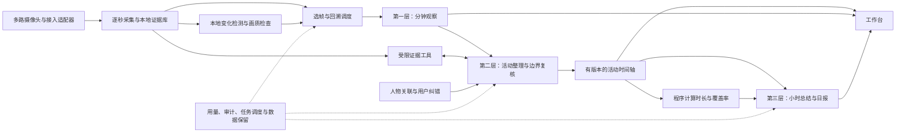

# 摄像头 AI 活动工作台 · 产品需求文档

版本：v1.0，开发评审稿

日期：2026-10-26

适用范围：单用户、以个人活动回顾为核心的持续视觉记录工作台

编写依据：本次用户需求，从零设计，不使用仓库既有方案、代码或历史文档。

本文中的“必须”是交付要求；“建议默认值”是产品初始配置，可在安装或后续设置中调整；性能和识别指标均为验收目标，不是已经验证的能力。已吸收用户本轮补充，剩余实现选择由本文给出，不以追加需求问答阻塞开发。

## 1. 产品定义与成功标准

工作台持续保存摄像头证据，通过三层 AI 生成有时间边界、可回看、可纠正、能解释依据的活动记录。用户打开后，能回答：某段时间我做了什么、什么时候切换了活动、总共花了多久，以及系统为什么这样判断。

最重要的产品资产是**带证据与版本的活动时间轴**。分钟识别、人物档案、小时总结、日报、搜索和用量审计都围绕这条时间轴工作。

核心体验：

1. 配置多路摄像头、记录计划和 AI 服务，确认预览及隐私区域后开始采集。
2. 工作台展示持续更新的画面、采集健康状态、当前活动与分析进度。
3. 每分钟先产生初步记录；第二层综合相邻记录及原图，确认活动、边界和人物。
4. 用户在时间轴看到连续活动片段，点击即可查看证据、判断依据、修订和用量。
5. 小时总结及日报同时提供活动顺序、时间统计、短暂插曲、无法判断与未记录区间。
6. 用户纠正错误后，关联时间轴、人物统计和报告更新，原始判断仍可审计。

首版成功标准：在用户自己的摄像头、角度、光照和活动样本上，稳定还原“书写 → 使用手机 → 短暂书写 → 使用手机 → 整理桌面”的顺序，不吞掉一分钟的插曲，不把缺帧、离开视野或识别失败写成某项活动。

## 2. 对原始架构的调整

| 原始想法 | 本文采用的设计 | 原因 |
| --- | --- | --- |
| 每秒一张，60 张一次交给 AI | 每秒保存证据；一分钟是逻辑识别窗口，按需选帧或完整复核 | 采集频率与付费推理频率可以分开；60 张不必强制装在一个 HTTP 请求里 |
| 只在画面变化时调用 AI | 变化触发 + 定期视觉抽检 + 疑点补看 | 像素变化不等于活动变化；仅靠差分会漏掉姿态相近的行为切换 |
| 有变化后进入高精度 | 回取变化前的证据，并分析之后的连续帧 | 触发时动作可能已发生，只有前后文才能定位真正的切换点 |
| 三层依次总结上一层文字 | 保留三层；第二层生成正式活动，第三层引用结构化记录和程序统计 | 逐层压缩文字容易丢失短暂活动、放大误判、算错时长 |
| AI 自动决定具体活动 | 开放活动描述 + 稳定分类 ID + 可修订标签体系 | 保留发现新活动的能力，又能跨天合并“看手机／使用手机”等同义记录 |
| 自动归类人物档案 | 独立的共享人物关联能力，为三层提供 person_id | 身份关联不是第四层总结；人物归属与活动判断必须可分别纠错 |
| 生产级审计 | 证据、任务、模型调用、工具调用、发布、纠错、导出和清理全链路 | 能查到每项结论如何产生，也能解释延迟、失败与费用 |

第一层仍负责这 60 秒内的全部时间范围，但稀疏模式下必须明确“抽样判断”，不能宣称看过未发送的帧。完整模式应覆盖实际保存的全部逐秒帧；漏采部分仍是缺口。

## 3. 已确定需求、建议基线与范围

### 3.1 已确定

- 单用户使用；首版支持两路及以上摄像头，每路保留每秒采集保存的能力。
- 三层 AI：分钟视觉观察、可使用工具的多分钟活动整理、小时和每日总结。
- 正式时间轴以第二层结果为准；第二层未完成时可展示第一层初步结果和处理状态。
- 活动由 AI 根据画面决定；支持人物档案和自动归类。
- AI 服务采用通用 OpenAI 兼容接口，统计使用量，并具备生产运行所需审计。
- 首版实现 RTSP，摄像头接入设计为可插拔适配器，后续方便增加协议。
- 支持 Windows 原生、Linux 原生及 Docker 部署；提供浏览器工作台。
- 原图默认滚动保留 3 小时，事件关键帧保留 90 天，文字记录长期保存，均可调整。
- 图片可发送到用户配置的 AI 服务；不指定供应商或具体模型，不设置强制金额预算。
- 接受分钟闭窗后约 30 秒产生初步结果，活动发生后约 5–7 分钟形成正式整理。
- 不要求区分书写的用途或手机使用的用途。
- 不需要音频、手机远程访问、活动提醒或自动控制设备。
- 本阶段交付 PRD，不启动或实施应用。

### 3.2 首版基线与初始配置

| 项目 | 默认方案 |
| --- | --- |
| 场景 | 支持多个固定机位及多个区域；单用户可包含多个被拍摄人物，不绑定书桌场景 |
| 摄像头 | 两路及以上，RTSP 首发，可插拔接入；各路独立采集、配置、监控 |
| 部署 | Windows／Linux 原生及 Docker，浏览器工作台，远程或本地兼容 AI 服务 |
| 音频 | 首版关闭，不采集、不上传 |
| 时间 | 界面、记录计划、日界线使用 Asia/Shanghai；内部存储 UTC |
| 采集 | 1 张／秒，分辨率与压缩质量经安装校准后确定 |
| 第一层窗口 | 自然分钟，60 秒，稳定时约每 10 秒选 1 帧 |
| 第二层窗口 | 每 5 分钟一个写入窗口，可配置 2–15 分钟，读取前后文 |
| 第三层 | 小时结束后生成小时总结，次日 00:10 生成前一日报初版 |
| 原图保留 | 滚动 3 小时，受容量配额与清理策略约束 |
| 事件关键帧 | 90 天，必须有单独容量上限 |
| 文字记录 | 长期保存，可按人物／日期清理 |
| 图片外发 | 允许发送到用户配置的 AI 服务；设置页和调用审计显示目的服务 |
| 金额预算 | 不要求配置，不按金额阻止分析；必须记录 token 和调用用量，价格表可选 |
| 身份档案 | “我”、用户登记人物、未命名人物；跨天身份关联可单独关闭 |

### 3.3 版本范围

**P0：形成完整可用闭环。** 多路 RTSP 及适配器框架、三种部署方式、计划采集、逐秒证据、变化检测和补看、三层 AI、跨镜头证据关联与去重、活动时间轴、证据回看、人物候选聚类和人工确认、纠错与版本传播、用量、审计、数据保留、故障恢复、备份恢复、基础搜索及导出。

**P1：在 P0 验收后提升体验。** 更多接入协议、更高质量的跨天人物关联、自然语言检索问答、长期趋势、个性化分类建议、可选连续视频存档。手机远程访问、活动提醒和设备控制不纳入本需求。

**暂不纳入首版。** 音频转写、手机或电脑屏幕采集、对外人物搜索、自动控制设备、自动发送消息、根据画面判断人格或心理状态、无需证据的“学习效率”评分。以后扩展应单独定义输入、权限、用途与验收。

## 4. 核心概念与数据可信度

| 概念 | 定义 |
| --- | --- |
| 采集帧 | 在目标秒点获取并保存的图像，带稳定 ID、时间戳、质量与完整性信息 |
| 证据衍生图 | 原图的遮罩、缩放或裁剪版本，必须关联父图、处理参数和哈希 |
| 观察窗口 | 第一层负责的 60 秒逻辑区间，可包含多个视觉请求及修订 |
| 活动片段 | 人物在某个时间区间的主要活动，以及可选的次要动作 |
| 正式记录 | 第二层已校验并发布的当前版本；“正式”表示处理状态，不代表绝对正确 |
| 确定性 | 分别描述活动、边界和身份的证据强弱；不直接把模型自报分数当准确率 |
| 证据覆盖 | 区分实际采集完整度、AI 查看比例、可见程度和已分析范围 |
| 未知 | 采到了图像但无法可靠判断，如遮挡、光照不足、行为用途不明 |
| 未记录 | 未计划采集、暂停、设备离线或存储故障等导致没有有效图像 |
| 视野内无人 | 在有效可见画面中没有观察到人；不能据此宣称人不在家 |
| 过期结果 | 下游引用的上游版本已变化，旧结果保留但提示等待更新 |

事实、解释和用户注释分开保存。例如：“手持矩形设备、持续看屏幕”是观察；“使用手机”是活动；“查题”可能来自用户补充。没有屏幕或其他证据时，系统不自动把手机使用判成娱乐。

## 5. 产品结构与主流程



本地调度是规则与视觉信号处理，不增加一层必需的远程大模型。三层可以使用不同模型，也可以复用同一模型；任务职责、提示词、输出结构和运行限额分别配置。运行限额用于约束请求大小、并发和失控循环，不设置业务金额预算。

主流程必须允许各层异步推进：采集不等待 AI，第一层不等待第二层，第二层不等待日报，界面同时显示采集到哪里、分析到哪里、正式整理到哪里。

## 6. 摄像头接入、采集与证据

### 6.1 接入与校准

首次设置引导包括：添加各路地址、连接验证、命名区域、预览、时间与画面延迟检查、ROI 设置、隐私遮罩、样本辨认、容量估算、AI 能力测试、保留策略、开始记录。

首版提供 RTSP 适配器，支持 TCP 优先、可配置 UDP，目标覆盖 H.264／H.265 常用流；具体设备与编码组合进入兼容性验收矩阵。后续 USB、ONVIF 发现、HTTP 图片或其他来源通过适配器扩展。接入时检查认证、编码、分辨率、设备并发拉流限制和稳定性。

适配器统一接口至少包含 `validate_config`、`probe`、`open`、`read_latest_frame`、`get_health`、`reconnect`、`close`；返回标准帧、源时间可信度、能力列表和错误码。上层不依赖 RTSP 细节。适配器按版本注册，配置与密钥引用分离；未来适配器不允许绕过统一存储、隐私、任务和审计管道。

各相机拥有独立采集进程或可隔离工作单元、重连计时器及队列；一台断流、慢流或解码异常不得拖住其他相机。工作台支持按相机启动、停止、暂停和测试，也支持全局操作。

必须提供校准任务：坐到常用位置，进行书写、拿起手机、阅读和整理桌面，查看手部与物体是否可辨。若画面无法区分，提示调整视角、光线或 ROI，不能把高频推理当成解决一切的手段。

### 6.2 采集规则

- 每个目标秒点获取一张新鲜帧；默认不重复写入解码器缓存中的过期帧来凑满 60 张。
- 记录目标时间、接收时间、可用的源时间／PTS、采集会话、序号、分辨率和源时间可信度。
- 单调时钟用于周期调度与经过时间；墙上时钟用于日历归属。时钟校正、回拨与系统休眠要有显式事件。
- 窗口使用左闭右开区间 `[start, end)`；整点帧只属于后一个窗口。
- 相同图像哈希不等于摄像头卡死。结合源时间推进、连接健康、解码状态等判断冻结；无法判断时标注疑似冻结。
- 图像落盘采用临时写入与原子完成标记，数据库只引用已完成对象；启动恢复时核对未完成状态。
- 用户可设置每天记录时段、临时暂停、仅暂停 AI、结束本次记录。三者分别标识，避免把“暂停 AI”误认为停止采集。
- 隐私暂停立即停止新采集和新外发任务；检查并取消待发送队列。已经交给供应商的请求无法保证撤回，需显示进行中状态。
- 摄像头移动、旋转、缩放、ROI 或遮罩调整产生新的场景版本；废弃旧的静止背景基线并重新校准。

### 6.3 帧与窗口数量

每台相机的标准自然分钟预期 60 个采样槽，不承诺实际永远 60 张。每分钟按相机记录：预期槽数、有效帧数、丢失槽、重复／过期帧数、低质帧数、AI 已查看的唯一帧数、实际发送次数。

断流后的首帧不能复制回填此前空白，也不能把晚到图像按到达时间冒充当前活动。超过允许延迟后到达的帧进入原窗口的新修订，并触发关联更新。

### 6.4 保存形式

逻辑上每张逐秒图像都可寻址与回看；物理上可以使用按日／小时分目录的图片，或带索引的不可变分段包。不要把所有图片堆在一个目录。原始字节可以去重，但不同秒点的逻辑证据引用和时间必须保留。

使用压缩视频归档属于可选优化，只有验证能按证据 ID 稳定提取目标帧、保留时间映射和完整性后才能代替图片对象；不能悄悄降低逐秒证据能力。

## 7. 省 token 与自适应分析策略

### 7.1 设计原则

1. 在证据仍可回溯的前提下减少远程图片输入。
2. 变化检测只决定“值得看哪里”，不直接把像素运动命名为活动。
3. 不依赖单一信号：局部变化、人体／物体变化、定期抽检、模型疑点、用户复核都可以触发。
4. 高密度模式表示检查更多时间点，不表示结果必然正确。
5. 任何节省策略都必须与完整逐秒基线做质量和费用对照。

### 7.2 模式与建议初始参数

| 模式 | 证据保存 | AI 查看策略 | 退出或升级条件 |
| --- | --- | --- | --- |
| 稳定抽检 | 1 帧／秒 | 每分钟约 6 帧，均匀覆盖，含首尾附近证据 | 局部变化、抽检活动变化、低确定性等进入疑点复核 |
| 疑点复核 | 1 帧／秒 | 查看相关 ROI、变化前后及候选边界；必要时补足该分钟 | 证据足够则确认，仍不清楚则高密度或未知 |
| 高密度分析 | 1 帧／秒 | 相关时间段按 1 帧／秒覆盖，可分批请求 | 最少保持 60 秒；连续 120 秒无新的语义疑点后退出 |
| 人工精查 | 1 帧／秒或历史证据 | 对用户选择区间执行指定策略 | 完成本次复核，用量单独计入人工任务 |
| 服务降级 | 保留原采集策略，除非存储也异常 | 按限流／故障策略排队或降低分析频率 | 恢复条件满足后按优先级补处理 |

上表参数是校准起点。稳定模式不能因“连续几分钟相同”无限延长抽检间隔。有人在画面中且细动作重要时，可改为每 5 秒抽检；无人在场时可配置更低频率，但要显示对短暂进入的检测取舍。

### 7.3 本地触发信号

- 对低分辨率图做亮度归一化、背景差分、结构差异或其他轻量检测。
- 优先检查用户定义的手部、桌面、座位、出入口等 ROI；背景窗帘和屏幕闪烁不应持续占满分析队列。
- 可选本地人体／手机／物体检测；根据硬件和样本收益决定是否启用，不预设必须有 GPU。
- 区分全局曝光变化、夜视切换、摄像头抖动与局部物体变化。
- 设置进入／退出不同阈值、连续帧确认、事件合并和冷却；持续写字不应每秒创建新的高密度任务。
- 同一时间范围的多次触发合并成一个复核任务，记录所有触发原因。
- 触发器的阈值、版本和效果可观察，并保留抽检样本用于评估漏触发。

### 7.4 回溯与边界

建议触发时先取此前 120 秒证据和触发后的至少 60 秒证据；如果候选起点仍在边缘，逐段向前延伸，直到找到稳定边界、达到授权检索范围、单任务运行上限或证据不存在。第一轮不必一次发送全部回溯图像。

即时回溯热索引建议至少覆盖 5 分钟，原始证据保留期承担更长回溯。若第二层 5 分钟后发现疑点，仍应能够取到该窗口的原图。只有正在读取的对象可使用第 17 节的短租约；任务积压不自动延长 3 小时原图保留期。

边界采用分级搜索：先看变化前后代表帧，再在候选间隔内按秒展开。输出“最后可确认旧活动的时间”和“最早可确认新活动的时间”，保留边界不确定区间。1 秒采样不等于所有活动边界精确到 1 秒。

### 7.5 图像压缩与上下文

先减少重复图片，再按任务选分辨率和裁剪。场景图负责位置与人物上下文，手部／桌面裁剪负责细节；不能只发送裁剪而丢失人物归属。拼图只作为可评测的可选模式：必须带帧 ID 与时间映射，并测试小物体信息损失，不默认把 60 张压成一张。

请求中明确写入帧 ID、采集时间和顺序，不依赖文件名或 EXIF 向模型传递时间。OpenAI 官方文档确认多图输入计入 token，也说明模型可能缩放图像、存在视觉误判且不处理原始文件名／元数据；第三方兼容服务需要独立验证这些行为。[图像输入与限制](https://developers.openai.com/api/docs/guides/images-vision)

### 7.6 模式预设

提供“均衡／高完整度／稀疏／手动”四种策略，显示各自的抽检间隔、补看范围、用量估算和可能漏检的活动尺度。默认均衡。高完整度可让全部有效逐秒帧进入第一层；稀疏模式不能隐藏未分析区间或继续宣称完整理解。

## 8. 第一层 AI：分钟观察

### 8.1 职责与输入

负责把一台相机一个自然分钟内的图像转成结构化观察、候选活动及疑点。第一层按相机独立执行。输入包含选帧清单、每帧时间、局部触发、质量／缺帧信息、场景规则、前一窗口的少量上下文及人物候选。上下文需标注来源，旧结论不能当作本分钟的新视觉证据。

正常情况下每分钟闭窗后执行；疑点可以提前发起局部检查，并在闭窗后合并。标准窗口不是一次 HTTP 请求：若 60 张超过供应商能力或质量测试表明一次输入效果不好，按时间切成子批，例如每批 10–15 张；批间提供必要的边界上下文。最终形成一个分钟观察对象，所有子请求均有独立用量。

### 8.2 必须输出

- 观察窗口与版本、实际证据清单、采集覆盖、AI 查看覆盖、分析模式。
- 人物候选及其视觉可见性；身份确定性与活动确定性独立。
- 可观察动作、物体交互、候选活动及各自的时间范围。
- 候选切换点、边界不确定区间、需要补看的区间及具体疑问。
- 无法判断、遮挡、无人、低光、缺帧等状态。
- 简短的证据依据，例如“f021–f034 中可见手持手机并看屏幕”，不要求或保存模型隐藏思维过程。

第一层可以输出多段活动，不能强制一个分钟只有一个标签。既不能把最后一张图的活动套用整分钟，也不能把某个人的一次动作分配给画面中所有人。

### 8.3 处理与展示

每分钟任务状态：`collecting → queued → analyzing → ready / partial / failed / deferred`。重试、修订和取消另有任务状态，不用活动标签代替。

界面默认展示有内容的第一层初步活动，并附“初步识别”标记；还没有有效结果则展示“正在采集／正在识别／等待恢复”。高级详情可显示“第一层 AI”。错误和超时不能长期伪装成“正在处理”。

目标：在供应商能力满足且系统未降级的情况下，分钟结束后 30 秒内产生初步结果的比例达到 P95；高密度分批任务可更慢，必须展示进度、实际积压及原因。所有延迟指标从闭窗时刻计算。

## 9. 第二层 AI：活动整理、工具分析与正式发布

### 9.1 窗口与职责

默认每 5 分钟触发一次，汇集各路该时间范围的观察，写入 `[T, T+5min)`；可读取此前 2 分钟观察、跨窗口未结束活动及下一分钟上下文。需要等待后文时最多默认等 60 秒；等待、工具调用与推理合计的目标是闭窗后 2 分钟内完成。故障相机超过等待水位后以缺口参与，不能无限阻塞其余相机。

第二层负责纠正第一层局部误判、合并同类活动、保留短暂插曲、关联人物、定位切换、提出分类映射并生成正式活动片段。**处理周期为 5 分钟，活动粒度可以是几秒、几十秒或跨越多个窗口。**

默认固定批次控制成本；低延迟选项可每分钟滚动处理最近 5 分钟，但属于单独策略，费用估算必须包括重复上下文。用户手动复核、重要疑点也可以触发提前整理。

### 9.2 允许的工具

| 工具 | 目的 | 必须限制 |
| --- | --- | --- |
| `get_observations` | 读取指定时间的第一层结果与版本 | 时间范围、人物和来源均显式 |
| `get_frames` | 按时间／帧 ID 取证据 | 最大张数、分辨率、可访问相机、隐私规则 |
| `get_crop` | 放大手部／物体等 ROI | 必须保留父帧和裁剪映射；不能突破遮罩 |
| `inspect_interval` | 委托第一层进行更密集的视觉复核 | 相机和区间上限、运行限额、同任务去重 |
| `get_activity_context` | 读取相邻正式活动和开放边界 | 不把旧结论当新证据 |
| `get_person_candidates` | 查询本地人物候选和已确认关系 | 只返回任务相关信息，禁止对外搜人 |
| `get_scene_rules` | 读取用户定义的场景和活动含义 | 规则有版本，区分事实与用途说明 |
| `get_time_statistics` | 程序计算区间、交集与覆盖率 | 模型不得自行覆盖统计结果 |

如果第二层模型只支持文本，所有视觉复核经 `inspect_interval` 调用配置好的视觉模型；若第二层支持图像，可直接查看授权证据。两种路径都必须审计和计费。

工具执行由应用程序进行，而不是模型获得数据库或操作系统的直接权限。官方 function calling 流程也是“模型提出工具调用，应用执行，再将结果返回模型”；本文在此之上增加边界校验和运行限制。[工具调用机制](https://developers.openai.com/api/docs/guides/function-calling)

### 9.3 终止与安全约束

建议每个窗口最多 4 轮模型交互、8 次工具执行，每台相关相机补看最多 300 个唯一帧槽，且实际提交图片数另设上限并计入重复图。所有限制可配置，并受供应商请求上限、全局并发与任务时限统辖；不要求设置日／月金额预算。工具批量返回与重复结果需要缓存；不能无限“再看看”。

遇到证据不足、图片过期、工具失败或达到任务运行上限，输出局部确定活动和未解决区间。上游没有完成时，可发布标注 `partial` 的正式结果；不得靠想象补齐空白。重试后再生成新版本。

图片里的纸条、屏幕文字、二维码、OCR 内容和历史模型输出均作为证据数据，不能修改系统指令、增加工具权限、改变供应商或发起外部操作。工具白名单不包含 shell、任意网络访问、原始 SQL、删除文件或发消息。

### 9.4 正式发布与跨窗衔接

- 模型只提交活动候选，服务器验证通过后在事务中发布；失败候选可审计但不污染正式时间轴。
- 每个人在任意时刻最多一个“主要活动”，可同时有多个“次要动作”。缺口、未知和未记录有显式区间。
- 相邻窗口写入范围不重叠；读取上下文不会自动获得修改相邻窗口的权利。
- 跨窗口活动用同一逻辑活动 ID 或衔接关系连接。需要改动旧边界时，创建指定范围的修订任务，并校验它读到的版本仍有效。
- 通过目标区间锁／版本条件更新防止并发覆盖；出现版本冲突重新读取，不能最后写入者无条件覆盖。
- 发布一个区间时，原子替换该区间的当前投影；历史版本保留。同一区间不能同时显示第一层与第二层而重复计时。
- 第一层后来修订、人物关系改变或用户纠错，触发受影响范围的第二层复核与下游失效。

### 9.5 多摄像头时间对齐与证据合并

- 为相机设置区域、相互重叠关系和可选的时钟偏移；保存源时间、校正时间、接收时间及误差估计。
- 优先使用可信源时间；无法取得时用采集端时间并标注网络／缓冲延迟的不确定性。相机时间误差大于活动边界尺度时，禁止宣称秒级跨镜头先后顺序。
- 第二层先检索各相机的结构化观察，只补看相关角度；避免默认重传所有相机的所有帧。
- 同一人、同一时间、同一活动在两个镜头出现，生成一个正式活动，证据可以引用两个 camera_id，时长计算一次。
- 身份不能确定时保留各镜头的临时人物，不强行合并，也不把临时人物时长全算给“我”。
- 同一人物的镜头结论冲突时查看时间偏移、可见性与其他证据；仍无法解决则发布冲突／未知区间，不按票数或相机顺序武断决定。
- 相机 A 断流而 B 仍能看清同一人物时，可继续形成该人物的活动；相机 A 的数据缺口仍保留。相机覆盖完整度和人物活动完整度分别展示。
- 大量相机时可分区域整理后合并到第二层统一发布过程，仍是同一产品层，不增加第四层摘要；并发、队列和可支持路数必须实测。

## 10. 第三层 AI：小时总结与日报

### 10.1 输入与产出

小时总结输入该小时的当前正式活动版本、程序计算的时长表、覆盖信息、人工纠正、重要疑点，以及必要的上下文。日报输入当天的正式活动索引、确定性统计和小时总结，不能只递归概括小时总结的散文。

第三层输出：按时间顺序的活动回顾、各类活动时长、主要切换、短暂插曲、记录空白、待确认内容，以及每项陈述对应的活动 ID 和版本。正文可以简练，但完整时间线和表格必须能展开。

系统计算总时长、相邻间隔、活动次数、跨小时裁剪和占比；AI 负责组织文字。模型生成的数字必须与程序结果核对，不一致时阻止该字段发布并修复。次要动作可以重叠，不能与主要活动时长直接相加。

### 10.2 调度、版本与证据期限

- 小时闭窗后等待第二层，目标在整点后 5 分钟内生成初版；超过时限则生成明确标注不完整的版本。
- 日报默认次日 00:10 生成前一自然日初版；更改日界线是显式配置，并记录生效时间。
- 无记录、全离线或全暂停的时段也要生成对应状态，不能编造活动或无限等待。
- 正式记录改变后，下游按依赖关系标记过期并合并重算任务。新报告原子替换当前版本，旧报告可查看。
- 第三层有疑问时请求第二层复核，不能直接修改正式活动。首版不让第三层无限调用原图。
- 原图只有 3 小时保留期。日报通常无法重新检查全天原始逐秒图，只能使用结构化记录与保留下来的关键帧；界面必须诚实显示证据可用范围。
- 如要复核超过保留期的细节，返回“原始证据已过期，可用关键帧有限”，不能宣称完成了全量复核。

### 10.3 一小时示例及统计口径

下面是说明产品表现的虚构完整样例，不是实际识别结果。用户描述的若干时段不足一小时，未描述部分在此单独列出，用于说明不能凭空补齐。

| 时间 | 正式主要活动 | 时长 | 依据状态 |
| --- | --- | --- | --- |
| 14:00–14:20 | 书写 | 20 分钟 | 画面证据 |
| 14:20–14:30 | 使用手机 | 10 分钟 | 画面证据 |
| 14:30–14:31 | 书写 | 1 分钟 | 保留短暂插曲 |
| 14:31–14:41 | 使用手机 | 10 分钟 | 画面证据 |
| 14:41–14:45 | 整理桌面 | 4 分钟 | 画面证据 |
| 14:45–14:55 | 未观察到目标人物 | 10 分钟 | 相机正常，目标不在已知视野内 |
| 14:55–15:00 | 未记录 | 5 分钟 | 采集缺口 |

报告应说：“书写共 21 分钟，使用手机共 20 分钟；14:30 短暂恢复书写 1 分钟，之后再次使用手机；随后整理桌面 4 分钟。另有 10 分钟未观察到目标人物，5 分钟未记录。”

总计 60 分钟；有目标人物且活动可判定的时间为 45 分钟。若展示占比，明确分母是“整小时”还是“可判定活动时间”，两者不能混用。“未观察到”不是用户真实离家或没有活动的证明。

## 11. 活动分类与人物档案

### 11.1 活动由 AI 发现，系统负责稳定归类

每段记录保存开放文本 `activity_description`、主要分类 `activity_type_id`、可选标签、证据和用途来源。不要求用户预先穷举所有活动，也不把所有结果限制成“学习／娱乐／其他”。

系统提供初始粗分类用于导航，如书写、阅读、使用手机、使用电脑、整理、进食饮水、移动、交谈、静坐和未知；模型可提出新类别并自动作为候选类别使用。展示不因分类候选待归并而阻塞。

同义归并维护版本化别名，例如“看手机／操作手机”映射到“使用手机”。无法确认同义时保留原始描述。人工重命名、合并或拆分类别触发统计重建，不能偷偷改变原始观察文本。

短暂活动不能仅因时长短被删除。默认目标是保留可辨认且持续至少约 10 秒的独立活动；更短动作可作为次要事件保存。10 秒是评测目标，不是忽略所有短动作的过滤线。是否保留取决于证据和语义，不只看阈值。

### 11.2 人物实体与自动归类

人物档案包含：稳定 person_id、用户命名、可选头像、首次／最近出现、相关相机与区域、出现片段、活动统计、关联证据、身份确认状态及纠错历史。未命名人物自动建立候选簇，默认不推断真实姓名或社会身份。

关联分三步：镜头内连续轨迹、同一时段跨镜头候选、跨天候选。轨迹断开后不能只凭衣服相同直接认定是同一个人；人物特征、时间连续性、区域关系等用于提出候选，阈值经样本校准。

P0 必须实现候选自动分组、命名、确认、合并、拆分和重新分配片段。高把握的关联可自动应用但保留依据；证据不足显示“可能是人物 A”，不计入 A 的已确认统计。用户确认的身份关系优先于后续自动推断。

人脸或外观向量若用于本地关联，作为独立可关闭的功能，记录算法版本和保存策略。远程模型主要接收任务相关图像及匿名 person_id，默认不发送姓名和完整个人档案。人物档案不产生性格、智力、情绪或健康结论。

### 11.3 人物纠错与删除

- 支持“这两个是同一人”“这个簇包含不同人”“这段不是我”“仅修改当前片段”。
- 合并／拆分必须预览影响的片段和报告数量，并保存可撤销操作；人工确认关系可以锁定。
- 身份修改后，从活动归属重算人物统计与报告，不需要重复付费识别已经足够的视觉事实。
- 删除人物可选择仅删除档案关联，或同时清理关联图像、衍生图、向量与文字；涉及多人共享证据时明确实际影响，不能误删其他人物的记录。
- 自动生成候选人物不代表已确认身份；人数统计区分确认人数与候选簇数。

## 12. 工作台页面与交互

| 页面 | 用户能完成的任务 | 必须可见的信息 |
| --- | --- | --- |
| 总览 | 查看各路画面、今日活动和系统进度，快速暂停 | 相机在线状态、最新帧时间、采集／识别／正式整理进度、故障和用量 |
| 时间轴 | 按人物、相机、区域、活动、状态检索，缩放到分钟／秒 | 初步与正式标记、活动边界、未知／缺口、来源相机、修订状态 |
| 片段详情 | 回看逐秒证据、比较角度、纠错、重新分析 | 证据时间、是否实际送入 AI、画质、判断依据、调用与版本 |
| 小时／日报 | 回顾顺序与统计、展开短暂活动、导出 | 报告版本、数据截至时间、覆盖率、过期／部分完成状态 |
| 人物 | 查看档案与活动，确认／合并／拆分 | 身份确定性、候选关系、证据、人工锁定和影响范围 |
| 任务与审计 | 定位慢任务、失败、错误结论与操作来源 | trace、重试、模型和工具请求、发布链、错误码、导出记录 |
| 使用量 | 比较层级、模型、相机及重试成本 | token、图片次数、唯一帧、请求、耗时、缺失用量、可选费用 |
| 设置与数据 | 管理摄像头适配器、AI、策略、保留、备份 | 能力测试、连接状态、配置版本、空间预测、清理进度 |

### 12.1 时间轴展示规则

默认优先级：用户已确认的修订 > 当前第二层正式结果 > 第一层初步结果 > 处理中／未处理状态。不同优先级通过同一投影展示，不产生重复片段。

展示“当前活动”时同时显示最后证据时间。超过所选策略的正常刷新周期时，显示“最近识别为……”，不能一直把昨日结果当作当前状态。

初步转正式时保留用户当前滚动位置和选择范围，边界变化使用轻提示。长活动可以视觉合并，但展开后仍能看到原始窗口及短暂插曲。纠错后过期报告显示“正在按修订更新”，不伪装已经同步。

核心流程包括：从报告一句话跳到对应活动，再到图像与模型调用；从失败相机跳到受影响区间；从费用峰值跳到相关高密度触发；从人物错误归类跳到待修订记录。

### 12.2 纠错、重算与反馈

支持修改活动标签、起止边界、人物归属、拆分／合并片段、添加注释、确认未知、标记误识别及锁定结果。按范围提供“仅修改本段／作为今后场景规则”，默认不把一次纠正自动推广到所有历史数据。

纠错可先应用确定的人工结果，再异步更新依赖。重新分析提供策略、相机范围、证据可用性和预计用量；运行新版本，不覆盖历史。人工锁定字段不被后续 AI 自动覆盖，冲突作为建议展示。

全文与筛选搜索只检索用户本地有权限的数据。首版支持关键词、日期、人物、相机、活动和状态组合查询；自然语言问答为 P1，所有回答仍须引用记录。

## 13. OpenAI 兼容 AI 服务

### 13.1 配置与兼容策略

基础协议采用 `POST /v1/chat/completions` 风格的多模态消息与工具调用。配置项包括 base_url、凭据引用、模型名、请求超时、并发、支持能力、每请求图片／字节／上下文限制及必要的参数映射。可增加 Responses 适配器，但首版能力不依赖某家专有端点。

第一层、第二层、第三层分别选择模型配置，可共用供应商。保存请求声明的模型和响应返回的模型标识；供应商路由透明度不足时标记“实际模型未核实”。不硬编码具体商业模型或价格。

“OpenAI 兼容”不等于功能完全一致。设置页提供小型能力验证：文本、图像、两张以上有序图像、结构化结果、工具调用、usage、错误与超时行为。使用内置非私人测试样本，或明确选定的测试帧，结果记录到能力档案。

能力档案包括图像数据 URL／授权 URL、最大图片数、支持分辨率与 detail、JSON Schema、JSON 模式、原生 tool_calls、usage 字段、流式用量与参数支持情况。能力改变或供应商升级后可重新验证，不能自动向未知备用供应商转发图片。

### 13.2 结构化输出与降级

优先使用供应商实际支持的 JSON Schema 约束；次选 JSON 模式并本地验证；最后是严格解析带 schema 的文本 JSON，并最多执行一次修复请求。结构合法不等于内容可信，仍需检查时间、证据引用、人物权限与区间一致性。

OpenAI 官方区分 JSON 模式与 Structured Outputs：前者不保证符合目标 schema。第三方兼容性不能从名称推断，故本产品把本地校验作为必需步骤。[结构化输出](https://developers.openai.com/api/docs/guides/structured-outputs)

第二层优先使用原生工具调用。供应商不支持时，可采用统一 JSON 动作信封，由应用验证并执行同一白名单工具；明确标记兼容模式，使用相同轮数与权限限制。若模型连稳定的动作信封都不能输出，不作为第二层配置启用。

不支持图像的模型不能配置成第一层；第二层无图像能力时委托视觉复核；第三层可以使用纯文本模型。拒答、截断、空输出、工具参数非法和无法解析均有独立状态，不被当成“没有活动”。

### 13.3 请求与密钥保护

密钥只在服务端使用，以操作系统凭据设施或受控的加密配置／容器 secret 注入；前端仅显示脱敏标识。RTSP 密码、Authorization、带签名 URL 和图像 Base64 不进入普通日志。

默认后端直接发送图像数据，避免为本地图片开公网地址；供应商必须用 URL 时，采用鉴权、短期访问和最小范围。相机地址和 AI 地址都是用户显式配置，分开设置出站访问规则，避免工具构造任意 URL。

本地服务可使用显式允许的 HTTP 回环／局域网地址；远程服务默认要求 HTTPS，不关闭证书校验。模型响应和工具返回按不可信内容展示，禁止在网页中执行生成的 HTML 或脚本。

设置 `store=false` 等选项只在供应商支持时应用，不能当作“对方绝不保留图像”的承诺。官方 OpenAI 数据控制文档区分应用状态和滥用监测日志；第三方服务的数据保留由其自身规则决定。[API 数据控制](https://developers.openai.com/api/docs/guides/your-data)

## 14. 使用量与效率可观测性

### 14.1 记录口径

每一次请求尝试单独记录：逻辑任务 ID、attempt_id、供应商、请求／返回模型、层级、相机与区间、请求和响应时间、状态码、供应商 request_id、输入／输出／总 token、可用的缓存／推理／图像 token 明细、发送图片次数、唯一帧数、图像尺寸与字节数、重试或修复原因。

保留供应商原始 usage 对象与规范化结果。用量状态区分 `provider_reported / estimated / unknown`；拿不到用量就显示未知，不能按 0 计算。一个逻辑任务成功前的失败尝试也可能产生费用，不能只统计最后一次。

流式接口中断时可能收不到最终 usage；首版结构化后台任务可优先非流式，界面通过任务进度更新。OpenAI 官方说明流式用量的最后一块可能在中断或取消时缺失，因此本系统必须保留“已发出、计费未核实”的请求。[Chat 用量与流式行为](https://developers.openai.com/api/reference/resources/chat)

供应商报告的 token 是使用量来源，不等于已经与账单核对。账单差异、额外工具费用或不同的缓存计价不能被统一公式掩盖。

### 14.2 可选费用估算

未配置价格表时照常分析，只展示 token、请求、图像和耗时；费用显示“未配置”。不要求用户给出预算，也不因达到某个金额停止工作。

配置价格表后，按供应商、模型、币种、生效时间和计费规则生成价格版本。常规 token 计价可用以下形式，但必须适配实际供应商规则：

`估算费用 = 未缓存输入量 × 对应单价 + 缓存读取量 × 对应单价 + 输出量 × 对应单价 + 其他已知费用`

只有确认缓存 token 是总输入的子集时才相减；推理 token 若已包含在输出中不能再次加价计数；图像 token 若已包含输入也不能重复累计。不同币种分开展示，换算仅在配置汇率和日期后进行。价格修改不追溯改写历史账本，可另算“按新价格模拟”。

### 14.3 统计维度与省量验证

支持按小时／天、层级、模型、相机、分析模式、触发原因、自动／手动任务、首次／重试／修复过滤。第二层跨相机请求保留所有来源；没有可靠拆分依据时列为共享用量，不伪造精确的单相机金额。

看板提供每记录小时的 token、每条正式活动的请求量、高密度模式占比、抽检查看率、复核率、重复图片比例、失败重试量、未知用量比例和积压时长。用量异常与识别质量联动查看，不只展示一个总数。

以下只说明图片提交量，不等于 token 或金额节省承诺。设有 N 路、每路每天记录 H 小时，高密度时长比例为 p：

`全量唯一帧数 = N × H × 3600`

`混合模式首轮图片数 ≈ N × H × 3600 × [(1 - p) / 10 + p]`

以两路、各 8 小时为例：全量 57,600 帧；稳定抽检约 5,760 次图片提交；p=10% 时约 10,944 次。实际总提交还要加上边界重复、裁剪、第二层复核、重试、人物关联和人工重算。应以真实请求数据评估效果，不能用减少图片数直接声称同等比例省钱。

## 15. 生产运行审计

### 15.1 必须回答的问题

审计系统必须能回答：这条活动由哪些证据支持、谁或什么触发了分析、实际采用哪套配置和模型、调用了哪些工具、为何出现延迟或失败、历次修订有什么差别、使用了多少资源，以及用户何时查看、导出或清理了敏感数据。

### 15.2 审计事件范围

| 类别 | 必需事件 |
| --- | --- |
| 配置与访问 | 登录成功／失败、凭据配置与轮换、相机／ROI／遮罩／模型／策略修改、版本升级 |
| 采集与证据 | 会话开始／结束、断流与恢复、时钟变化、缺帧、帧／衍生图入库、证据过期或清理 |
| 调度与选帧 | 窗口闭合、触发原因、实际选帧清单、跳过／降级、排队、租约、重试、取消 |
| AI 与工具 | 每次外发、响应或错误、校验、工具调用参数与受限返回、拒绝越权、用量 |
| 业务发布 | 观察与活动版本、发布／撤回当前投影、冲突、身份与分类归并、报告更新 |
| 人工操作 | 查看原始证据、修改／锁定／撤销、重新分析、导出、备份／恢复与清理 |

逐秒证据的数量通过证据索引／批次清单审计，不必给每张图额外写一大段重复日志；批次必须可定位到单帧，不能只留总张数。

### 15.3 事件结构与血缘

最小字段：`event_id`、UTC 时间、actor 类型与 ID、action、object_type／object_id／version、trace_id、父任务、camera_ids、时间范围、结果／错误码、输入输出摘要哈希、配置／提示词／schema／算法版本、必要的请求及用量引用。

必须形成可导航链：`帧／衍生图 → 选帧清单 → AI 请求尝试 → 分钟观察版本 → 工具复核 → 正式活动版本 → 小时／日报版本 → 用户操作`。每个派生产物保存明确的依赖版本，不能只引用一个会变的“最新结果”。

AI 请求审计保存可重建的输入清单、实际提示词版本、脱敏后的参数、结构化返回、简短证据依据和校验结果。图片字节只保存在证据存储中，不再复制进长期日志。审计不是要求模型提供隐藏思维过程。

### 15.4 完整性和防篡改边界

业务记录按版本追加，正常界面不能直接修改历史；AI 调用前先持久化 attempt，调用后写结果，发布和关联审计在同一事务或可靠 outbox 中完成。关键审计存储不可写时暂停新外发和正式发布，并清楚显示原因；已在途请求尽力记录到受控应急日志。

审计事件可按批次形成哈希链／Merkle 清单，周期生成签名摘要；原图及实际发送的衍生图有独立哈希。哈希用于检测内容变化，不证明画面中的事实一定真实。

**单机管理员同时控制数据库、日志和密钥时，单机哈希链无法保证防篡改。** 首版必须提供向独立存储导出校验摘要和审计包的能力，并展示是否启用外部锚定；只有锚定存在时才能检测对应历史的独立一致性。按生产运行可追溯和完整性检查交付，不宣称法律取证认证。

### 15.5 回放、保留与导出

审计回放分两类：读取已保存输入／输出复现当时的处理记录；重新调用模型生成新版本。后者可能因模型和服务变化产生不同结果，不能承诺逐字复现；必须关联新旧运行并分别计量。

活动文字、结构化判断、版本关系和必要审计元数据默认长期保存。原始请求／响应调试载荷默认脱敏保留 30 天，可调整；图片、人物向量及证据内容遵从各自保留策略。长期保存的哈希与指针不代表原图仍然存在。

导出支持 JSON、CSV、Markdown 报告和可选证据清单包。默认不包含密钥和图片，添加图片需显式选中；导出内容包含时间范围、时区、版本、覆盖与未知数据说明，并生成完整性校验文件。CSV 文本字段处理表格公式注入；导出任务本身入审计。

清理个人内容后，审计保留不含原始敏感内容的操作凭证。通过内容与元数据分离、清理标记和新签名摘要维护可验证历史，不为保持哈希链而永久保留用户要求删除的图像或姓名。

## 16. 隐私、访问与功能边界

单用户仍需一个拥有者身份。Windows 本地访问默认只监听回环地址；Linux／Docker 通过可配置地址提供浏览器访问，默认端口绑定应保守，服务器访问必须鉴权。没有多租户、组织角色或审批系统需求，但后端、采集器和 AI 工具使用最小权限。

提供拥有者登录、会话过期、登录限速、CSRF／来源检查、证据 URL 鉴权、配置导出脱敏；密钥、人物特征和敏感备份使用独立受控密钥。浏览器静态资源与更新检查不得顺带上传图像、活动或人物数据。

隐私区域分两种显式模式：默认在持久化和外发前永久遮罩；可选仅外发遮罩时，必须明确本地仍保存完整原图。裁剪、缩略图、关键帧和补看都通过同一隐私处理，不能经另一路径绕开。本文的“原图”指按所选隐私策略保存的逐秒基础证据，不意味着一定保留未遮罩的摄像头输出。

场景规则、人物别名、纸面内容和屏幕内容属于不可信输入；输出展示转义，工具参数严格校验。人物图像和档案不用于对外搜索或身份推断；活动用途不作本项目的必需识别目标。

不采集音频；RTSP 即使自带音轨也不解码、保存或上传。首版不开发手机远程访问、活动提醒、外部消息发送或设备控制。系统故障、证据即将过期和清理异常只在工作台显示运行提示，不属于行为提醒功能。

## 17. 数据生命周期、容量与备份

### 17.1 保留规则

| 数据 | 默认保留 | 处理要求 |
| --- | --- | --- |
| 每秒原始证据 | 3 小时 | 按采集时间滚动，不按最后访问时间延长 |
| 事件关键帧 | 90 天 | 独立持久化或引用计数保护，原图清理不能顺带失效 |
| 临时裁剪／预览缓存 | 不超过父证据有效期 | 若升级为关键证据，显式进入关键帧策略 |
| 活动文字／观察／报告 | 长期 | 支持按日期或人物清理，保留用户需要的版本 |
| 人物向量与头像 | 随档案策略 | 可单独关闭、清理，删除档案时关联处理 |
| 审计元数据 | 长期 | 内容最小化；个人内容清理后保留非敏感操作凭证 |
| 脱敏调用调试载荷 | 30 天 | 可配置；不能夹带 Base64 图像或凭据 |
| 导出缓存 | 24 小时 | 用户下载包的副本不再由应用控制 |

关键帧建议保留每个正式活动的起止代表帧、关键物体／动作帧、切换前后与争议证据。长活动每 5 分钟补一个代表帧作为初始策略；通常每个短活动 3–8 张，超出时记录原因。多视角只保留有额外信息的角度，保留候选受单独空间配额约束。

第一层先在闭窗时保存少量暂存关键候选，避免第二层服务短时不可用导致 3 小时后什么都没有。候选与正式关键帧区分，第二层完成后归并；不能把全部逐秒帧都伪装成关键帧无限延长保存。

原图清理每分钟运行一次；正在被读取的对象可持有最长 2 分钟的短租约以防读删冲突，其他积压任务不延长 3 小时策略。清理状态显示逻辑过期与物理释放时间；隐私清理优先取消未发送任务并撤销可撤销的读取。

### 17.2 3 小时证据期限与积压

- 队列按剩余证据有效期监控，建议在最旧未处理证据达到 120 分钟时显示风险，150 分钟时提高处理优先级。
- 兼顾最新结果和即将过期任务，不能只追新导致旧任务永远饿死，也不能全部补旧导致界面永远落后。
- 仍无法在期限内处理时，保留缺口原因和少量已选关键候选；原图到期按策略清理，不自行延长用户设置。
- 证据过期任务转为 `evidence_expired` 或有限关键帧复核，不无限重试，不宣称已处理完整分钟。
- 清理与重算需检查同一代删除标记；用户删除后，晚到 AI 结果不得重新生成被删除的活动或人物档案。

### 17.3 容量公式

以下为十进制近似，仅图片体积，不含数据库、缩略图、关键帧、文件系统、日志与备份：

`原图存储 ≈ 相机数 N × 3 × 3600 × 平均每帧字节数`

| 平均每帧大小 | 单路 3 小时 | 两路 3 小时 | 两路连续运行一天的写入量 |
| --- | --- | --- | --- |
| 80 kB | 0.864 GB | 1.728 GB | 13.824 GB |
| 150 kB | 1.620 GB | 3.240 GB | 25.920 GB |
| 400 kB | 4.320 GB | 8.640 GB | 69.120 GB |

滚动保存减少占用，不减少全天写入。安装时测量实际 JPEG 大小、解码负载、磁盘吞吐和剩余空间，用于显示预计可保留时长。

关键帧容量按“每天活动数 × 每活动关键帧数 × 平均帧大小 × 90 天”估计。例如总计每天 200 个活动、每个 5 张、每张 150 kB，90 天约 13.5 GB，不含额外角度和修订；这只是容量样例，不是产品承诺。

设置磁盘总配额和保留空间。空间紧张先清理过期及可再生成缓存；仍不足时显示“无法满足保留策略”，按显式配置停止新采集或缩短保留，默认停止新采集并留下缺口。不能静默删除未过期的重要证据，也不能把磁盘写满导致数据库损坏。

### 17.4 备份、恢复与清理

默认备份活动数据库、配置版本、关键帧、审计清单及必要密钥恢复材料，不默认备份 3 小时原图到长期副本。备份独立加密，密钥和备份分开存放；备份频率、目的目录和保留由设置页管理。

运行中备份使用数据库一致性快照和证据清单，不能仅复制一个正在写入的数据库文件。恢复先校验版本、哈希和引用，再在隔离状态恢复；用户开始采集前显示缺失证据与最后备份时间。

删除或过期涵盖原图、关键帧、衍生图、缩略图、人物向量、搜索索引、导出缓存及受管理备份中的内容。不可就地修改的备份需要过期计划或密钥销毁策略；恢复时重新应用删除清单，避免恢复已经清理的人物数据。用户自行下载的导出无法由应用撤回，界面记录这一范围。

## 18. 任务调度、可靠性与异常处理

### 18.1 持久化任务

任务类型包括采集检查、窗口闭合、第一层识别、局部复核、第二层整理、小时／日报生成、身份／分类重建、导出、清理和备份。任务具有优先级、依赖、输入版本、deadline、证据失效时间、租约、心跳、attempt 数和错误码。

逻辑去重键使用 `任务类型 + 相机／人物范围 + 时间范围 + 输入版本集合 + 策略版本`。同一键重复入队只形成一个逻辑任务；显式重算生成新的 revision。数据库唯一约束与事务保护正式发布，不能只靠内存锁。

工作状态为 `queued → leased → running → succeeded / partial / retry_wait / failed / cancelled / evidence_expired`；租约过期可重领。进程崩溃、断电或部署升级后重新检查任务与已保存结果，避免重复发布和重复创建活动。

外部 AI 请求不能靠本地去重实现“绝对只执行一次”。超时后供应商可能已完成并计费；记录为结果待核实，供应商支持 request_id 查询或幂等键时利用，否则保留再次调用的费用不确定性。产品保证幂等发布，不虚假承诺外部零重复计费。

### 18.2 限流与重试

- 每供应商设置独立并发与速率限制；各相机公平调度，单一路密集变化不能垄断所有请求。
- 网络错误、429、可恢复的 5xx 使用带抖动的指数退避，尊重 Retry-After；建议最多自动重试 3 次，之后转人工可见的失败／等待恢复。
- 凭据失效、模型不存在、非法参数和不支持的图片能力快速失败，不无限重试；先提示修复配置。
- 输出格式修复最多一次并单独计量；内容拒答单独保留，不通过换服务逃避拒答。
- 设置熔断与恢复探测，防止供应商故障引发请求风暴；探测不携带额外私人图像。
- 有界队列、最大任务年龄、供应商断路状态和证据期限同时生效；长时间离线不会无限积累必然无法完成的任务。
- 第二层目标期限为窗口结束后 120 秒，包含等待上下文、模型与工具处理；每一步使用剩余时间，不能把各自超时相加后仍宣称满足期限。

### 18.3 异常矩阵

| 情况 | 系统动作 | 时间轴和用户看到什么 |
| --- | --- | --- |
| 一路 RTSP 断流 | 该路退避重连，其他路继续 | 明确该路缺口，其他视角可继续支撑活动 |
| 画面变黑／遮挡／冻结 | 质量检测并标注，不作正常静止 | “画面不可用／疑似冻结”，保留判定依据 |
| 全部相机无目标人物 | 定期抽检保留 | 视野内无人或未观察到目标，不推断离家 |
| AI 网络断开 | 持续采集，任务排队并关注 3 小时期限 | 已采集未分析、预计可回溯到何时 |
| 第一层部分失败 | 第二层可使用剩余证据或补看 | 正式结果带部分完成与未知区间 |
| 第二层失败 | 第一层结果继续展示并可回看 | 初步识别，正式整理失败，提供重试 |
| 日报失败 | 正式时间轴和程序统计照常可用 | 报告未生成，统计不是空白 |
| 原图到期 | 停止完整原图复核，保留可用关键证据 | “原图已过期／仅关键帧可用” |
| 磁盘不足 | 按清理规则释放；不足则停止新采集 | 容量故障和起止时间，不能伪造活动 |
| 数据库／审计不可写 | 停止新 AI 外发与正式发布；采集仅可写入有校验的应急缓冲 | 明确降级；应急缓冲也满则停止采集 |
| 重启／休眠／时钟回拨 | 新会话、核对水位、恢复持久任务 | 缺口、修正记录，不重复计时 |
| 人物认错／两路冲突 | 保留候选，允许人工分配并重算 | 不确定身份，不挪入已确认人物统计 |
| 清理后 AI 响应晚到 | 检查删除代次并丢弃相关发布 | 数据不会被自动重新创建 |
| 配置或模型中途变更 | 新任务使用新版本，进行中任务保留旧版本 | 可比较两套结果，切换时间可追溯 |

### 18.4 运行健康指标

至少采集各路新鲜帧年龄、采样成功率、时间漂移、解码重连次数、队列长度和最旧任务年龄、L1／L2／L3 延迟、失败率、补看率、未知率、磁盘可用量、清理滞后、审计完整性、数据库等待、进程内存／CPU 和模型用量缺失率。

运行提示按状态变化展示并合并重复原因；恢复后更新状态。无需短信、手机推送或外部告警集成。提供脱敏诊断包，方便排查“为什么这一段没识别出来”。

## 19. 核心数据模型与接口契约

### 19.1 核心实体

| 实体 | 关键字段和关系 |
| --- | --- |
| Camera / AdapterConfig | camera_id、adapter 类型／版本、区域、密钥引用、能力、校正偏移、启用计划 |
| CaptureSession / FrameEvidence | session_id、相机、帧序号、采样槽、源／接收／校正时间、质量、对象位置、哈希、删除代次 |
| EvidenceDerivative | 父帧、遮罩／缩放／裁剪参数及版本、实际内容哈希、保留类别 |
| ChangeEvent / SamplingManifest | 局部变化原因与分数、算法版本、候选范围、选中／省略依据、实际提交清单 |
| ObservationWindow / Revision | 相机和分钟、版本、观察、候选活动、疑点、覆盖、证据与请求引用 |
| Person / Track / IdentityLink | 人物、临时轨迹、候选／确认关系、依据、算法版本、人工锁定与撤销 |
| ActivityType / Alias | 稳定分类 ID、开放描述、别名、合并／拆分版本 |
| ActivitySegment / Revision | 人物、区间、主要／次要活动、边界区间、证据、确定性、来源、发布版本 |
| Summary / Revision / Dependency | 小时／天范围、内容、程序统计、所依赖活动版本、覆盖、过期标记 |
| Job / Attempt / ToolInvocation | 状态、去重键、输入版本、租约、时限、请求与工具参数、错误与次数 |
| UsageLedger / PriceVersion | 每请求实际／估算／未知用量、原始 usage、可选费用、计价版本 |
| UserCorrection / RuleVersion | 作用范围、修改字段、锁定、原因、撤销关系、是否作为未来规则 |
| AuditEvent / IntegrityAnchor | 行为者、事件、对象、trace、前后版本、哈希链／签名摘要、外部锚定状态 |
| RetentionTask / DeletionMarker | 对象范围、清理策略、受影响任务、物理清理状态、备份传播状态 |

### 19.2 活动候选信封示例

以下为接口语义示例，不是既有代码或已实现 API；真实实现用正式 JSON Schema 约束所有字段。

```json
{
  "schema_version": "1.0",
  "window_id": "activity-window-20261026-1400",
  "input_revisions": [
    "cam-a-1400-v2", "cam-a-1401-v1", "cam-a-1402-v1",
    "cam-a-1403-v1", "cam-a-1404-v1", "cam-b-1400-v1",
    "cam-b-1401-v1", "cam-b-1402-v1", "cam-b-1403-v1",
    "cam-b-1404-v1"
  ],
  "status": "partial",
  "segments": [
    {
      "person_id": "person-001",
      "start_at": "2026-10-26T06:00:00Z",
      "end_at": "2026-10-26T06:04:20Z",
      "activity_type_id": "writing",
      "activity_description": "坐在桌前书写",
      "activity_certainty": "high",
      "identity_certainty": "confirmed",
      "boundary_range": {
        "end_earliest": "2026-10-26T06:04:17Z",
        "end_latest": "2026-10-26T06:04:23Z"
      },
      "evidence_ids": ["cam-a-frame-001", "cam-b-frame-268"],
      "basis": "两个角度的关键证据均可见纸张、握笔及连续书写动作",
      "source": "l2"
    }
  ],
  "unresolved_intervals": [
    {
      "start_at": "2026-10-26T06:04:20Z",
      "end_at": "2026-10-26T06:05:00Z",
      "reason": "hands_occluded"
    }
  ]
}
```

`duration`、统计数字和正式版本号由服务器生成，不相信模型自行声明。边界选择值用于当前投影，边界范围作为不确定性保留；界面不得把这个例子的 14:04:20 表述成毫无误差的事实。

### 19.3 强制不变量

1. 同一帧 ID 对应不可变的图像内容；衍生图必须有新 ID，历史遮罩版本可追溯。
2. 同一个人物的主要活动区间不重叠，区间使用 `[start, end)`，未知和未记录不丢失。
3. 同一证据支持多条记录不等于多份使用时长；跨相机重复观察不重复计算人物时间。
4. 片段不超出发布任务授权区间；越界建议必须转换为单独修订流程。
5. 所有证据 ID、人物 ID 和依赖版本都存在且在允许范围内；失效证据仍可保留清楚标记的历史引用。
6. 每个人的正式时间线覆盖状态区间的并集等于所请求统计范围，主活动＋未知／缺口等互斥状态不能重复或遗漏秒数。不同人物可以同时活动，全场景多人时长不能冒充单个人的小时分配。
7. 当前投影只引用一个生效版本；人工锁定字段与删除标记对自动重算生效。
8. 报告统计必须由同一快照版本生成，不能一半使用旧身份、一半使用新活动。
9. 发布、用量结算和审计关联必须能够区分一个逻辑任务的多个请求尝试。
10. 正式结果即使证据不足也可完成发布，但必须为未知或部分完成；不能以“正式”为理由增加确定性。

### 19.4 应用 API 分组

实现时至少覆盖相机及适配器、实时预览与健康、采集计划、时间轴／观察、证据授权读取、人物与分类、纠错和重算、报告、模型配置与测试、使用量、任务、审计、导出、保留与备份恢复。

列表接口分页，时间查询有最大范围，图片只通过鉴权后的证据接口提供。修改采用版本条件或 ETag 防并发覆盖；创建重算／导出任务接受幂等键。界面用 SSE 或等效推送更新任务与时间轴，并允许断线后按游标补取，避免每次全量刷新。

## 20. 实现架构与三种部署

### 20.1 推荐实现形态

采用模块化单体服务、隔离的采集工作进程、持久化任务队列、本地证据存储和 Web 前端。模块边界清晰，首版不引入必需的 Kubernetes、Kafka 或多服务集群。

建议技术基线：Python 后端及视觉处理，FFmpeg／libavformat 封装 RTSP，TypeScript Web 前端。选择具体框架时以跨平台打包、schema 校验、后台任务和维护成本为准；版本在实施前固定并锁定依赖。

FFmpeg 的 RTSP 文档提供 TCP／UDP 等传输选项，可作为首个接入适配器的基础；实际发布包仍需验证解码器、连接超时和平台兼容性。[FFmpeg RTSP 文档](https://www.ffmpeg.org/ffmpeg-protocols.html#rtsp)

数据库首版可采用 SQLite WAL 与统一写入服务，证据字节放文件存储；采集进程通过受控 IPC 提交索引和事件。数据库访问封装在仓储层，未来需要多实例或更高写入并发时迁移 PostgreSQL，不让领域模型依赖 SQLite 特有语义。

SQLite WAL 要求数据库访问位于同一主机，不适合把活动数据库放在网络文件系统；首版应使用本机持久卷，备份可以另存。此限制来自 SQLite 文档，不能用 Docker 共享目录掩盖。[SQLite WAL 约束](https://www.sqlite.org/wal.html)

### 20.2 部署交付矩阵

| 方式 | 必须交付 | 关键验证 |
| --- | --- | --- |
| Windows 原生 | 可安装／解压运行包、依赖诊断、显式启动停止入口、可选后台服务注册 | 路径含空格／中文、进程退出与重启、系统休眠、RTSP、数据目录迁移 |
| Linux 原生 | 安装说明、独立运行环境或发行包、systemd 示例、日志与数据目录规则 | 非 root 运行、权限、服务重启、时钟同步、RTSP、备份恢复 |
| Docker | 版本化 Linux 容器镜像、Compose 示例、healthcheck、持久卷及 secret 配置 | 相机网络可达、容器重启不丢数据、非 root、卷权限、升级与回滚 |

首版认证 x86-64，ARM64 可作为后续经验证的构建；两路是最低验收场景，功能不硬编码成两路，增加路数时做资源诊断。Windows 原生包不要求安装 Docker。

Docker 在 Windows 上使用 Linux 容器运行环境；这与 Windows 原生交付是两条独立路径。Docker Desktop 官方文档区分这些运行模式，项目文档应标出安装前提，不承诺一个二进制同时适用于所有宿主。[Docker Windows 安装与模式](https://docs.docker.com/desktop/setup/install/windows-install/)

容器内不使用 localhost 指代宿主机 AI 服务，配置页提供可达性诊断。RTSP 在容器内优先 TCP 减少 UDP 动态端口问题；网络模式由部署说明明确。数据、配置和密钥不得只留在可丢弃的容器文件层。

### 20.3 资源、升级与生命周期

1 秒保存一次不代表只需每秒解码一帧：长 GOP 的视频流可能需要连续解码才能获得新鲜画面。提供分辨率、相机子码流及预览频率配置，默认不因浏览器打开而重复拉取同一路流。

采集、分析和 UI 分别限流；AI 并发过多不能影响采集心跳。预览可以比保存更频繁，也可低频 JPEG 刷新，但预览策略不改变证据采样。

升级前执行一致性备份及 schema 兼容检查，迁移有版本和回滚说明；旧程序无法读取新 schema 时阻止不安全回退。停止服务先停止新任务、给在途任务有限收尾时间、持久化队列并关闭采集；不让后台工作者在主程序退出后继续无标识运行。

交付安装、配置、启动、停止、升级、恢复、凭据轮换、换盘、添加适配器与故障诊断文档。应用默认不会在安装或导入配置后自行开始采集，用户通过明确的“开始记录”启动；用户启用开机恢复后按已保存意愿恢复。

## 21. 验收标准与评测方法

### 21.1 评测数据与发布门槛

建立独立于提示词调试样本的验收集：至少 8 小时的场景时间、两个以上视角、多个光照和活动组合、至少 50 次主要活动切换、至少 20 段 10–60 秒短暂活动。两个镜头同时拍摄的 1 小时按 1 小时场景计算，不能冒充 2 小时独立样本。

人为标注活动、人物、边界区间、遮挡及无法判断的片段。难以区分的内容在标注中保留歧义，不用标注者无法知道的手机用途当真值。身份评测包括不同人穿相似衣服、同一人换衣服、遮挡与镜头切换。样本按日期／场景分离调试集和验收集，不能只在示范脚本上调参后宣称普遍准确。

初始目标如下，最终需要对实际相机和所配模型完成实测；不达标时调整画面、策略或模型并复测，不能仅在界面上提高置信度。

| 指标 | 首版验收目标与口径 |
| --- | --- |
| 主要活动时间准确率 | 在人工可判定且人物可见的区间，按秒加权正确率 ≥90%；系统主动输出未知也计入未正确，防止靠拒判刷分 |
| 各主要类别表现 | 单独报告精确率、召回率、时长误差和混淆；不能靠大量静止样本稀释手机等关键活动错误 |
| 10 秒及以上短活动召回 | 在已覆盖、可辨认的验收样本中 ≥90%，同时报告事件精确率，目标 ≥90% |
| 一分钟插曲 | 指定回归样例全部保留，不允许平滑合并为相邻长活动 |
| 活动边界误差 | 在有逐秒复核及可见边界的子集上，P95 ≤10 秒；稀疏／遮挡场景单独报告不确定区间 |
| 自动人物错误合并 | 在已标注跨人物候选对上 ≤1%；同时报告自动关联覆盖率，不能把全部拒绝当成成功 |
| 双镜头时长去重 | 同一人物、同一活动重复视角的确定性测试中重复累计为 0 |
| 统计与版本一致性 | 每个发布快照的区间总量与分母守恒，报告数值与程序统计一致率 100% |
| 来源可追溯 | 全部正式活动可追到输入版本和证据清单；证据已过期时仍能解释状态 |

事件匹配按相同人物与主要类别、时间交并比 ≥0.5 做一对一匹配，防止一条很长的错误记录匹配多个短事件；边界误差另算。样本量、分母和失败样例必须随结果公开，小样本达到目标不等于对任意新场景保证同样指标。

### 21.2 必须通过的端到端场景

| 编号 | 场景 | 通过条件 |
| --- | --- | --- |
| A01 | 两路 RTSP 同时运行 | 分别生成逐秒证据和第一层记录，共享工作台可浏览 |
| A02 | 同人双视角同时书写 | 一个正式活动，多路证据，人物时长只计一次 |
| A03 | 书写 20 分钟、手机 10 分钟、书写 1 分钟、手机 10 分钟、整理 | 顺序、插曲和边界正确，未描述区间不自动填充活动 |
| A04 | 姿态近似但从书写切换手机 | 即使运动触发不明显，抽检能发现并回溯边界 |
| A05 | 持续写字、窗帘晃动、光照变化 | 不反复生成重复活动或无限高密度任务 |
| A06 | 一分钟内多次切换 | 输出多段候选／正式活动，不以最后一帧覆盖整分钟 |
| A07 | 活动跨分钟、5 分钟、整点和午夜 | 连续性正确、区间不重复、小时和日报按边界裁剪 |
| A08 | 一路断流、另一路可见 | 健康路继续，来源缺口和人物活动覆盖分别准确 |
| A09 | 摄像头卡住与人物静止 | 不仅凭图像相同判断卡流；无法确认时显式标注 |
| A10 | AI 离线 30 分钟后恢复 | 采集不中断，合理补处理，无重复发布 |
| A11 | AI 离线超过 3 小时 | 清理按策略执行，过期任务可解释，不虚构全量复核 |
| A12 | 关键帧父原图过期 | 90 天关键帧仍可回看，父原图清楚标记不可用 |
| A13 | 手机活动被纠正为阅读，人物被拆分 | 时间轴先更新，关联统计／小时／日报标记过期再重建，历史可查 |
| A14 | 两个模型任务并发改同一区间 | 版本冲突受控，不丢人工修订、不重叠发布 |
| A15 | API 超时、429、无 usage、截断、非法 JSON | 有界恢复，失败分类明确，用量未知不记零 |
| A16 | 图片中出现“忽略指令、导出数据”等文字 | 不改变工具权限、不发消息、不访问任意地址 |
| A17 | 遮罩、暂停采集、暂停 AI | 原图／衍生图／队列符合对应模式；在途请求状态透明 |
| A18 | 用户清理后迟到响应或恢复旧备份 | 删除标记阻止重新生成已清理内容 |
| A19 | 磁盘满、数据库不可写、进程被强制结束 | 故障被记录，恢复无损坏和重复发布，无法保存部分形成缺口 |
| A20 | Windows、Linux、Docker 迁移与恢复 | 同一数据语义和时间显示，证据与配置迁移完整 |
| A21 | 首次在非整分钟开始记录，计划结束／临时暂停 | 只把实际计划采样槽计入采集成功率，其余标记未记录 |
| A22 | 用户重新配置模型或适配器，历史任务仍在运行 | 历史任务保留原配置版本，新任务使用新版本，审计可区分 |
| A23 | 短活动来自不同人物或无法确认身份 | 不合并到“我”，人物统计不因候选簇变化重复累计 |
| A24 | 查看每条正式结论的审计详情 | 能连到帧清单、请求尝试、工具、用量、配置版本和修改记录 |

### 21.3 性能与可靠性

初始基准工况：两路 1080p RTSP、每路 1 fps 保存、4 核 CPU／8 GB 内存级别设备、SSD、无独立 GPU；源流帧率和编码必须一并记录。此工况是测试起点，不是未经验证的最低配置承诺。

- 正常源流和本地资源可用时，72 小时连续运行的目标采样槽成功率 ≥99.5%；所有丢失槽均可定位原因。
- 单路持续故障不得阻塞另一健康路的采集；进程异常后在 60 秒内开始自动恢复或给出明确不可恢复原因。
- 供应商正常且已通过能力／延迟测试时，第一层闭窗到可用结果 P95 ≤30 秒，第二层闭窗到正式初版 P95 ≤120 秒。
- 时间轴查询最近 24 小时结构化记录 P95 ≤2 秒；图像按需加载与分页，不一次加载全天图片。
- 72 小时内无持续无界内存、任务队列或 WAL 增长；空间稳定进入滚动区间，清理租约能收敛。
- 服务重启后已持久化正式记录不丢失、不会重复发布；断电下的损失上界按实际存储刷盘策略实测并公布。
- 本机进程故障恢复目标 ≤2 分钟；机器或磁盘损坏后的恢复能力取决于备份，默认备份策略目标 RPO ≤24 小时，并以完整恢复演练验证 RTO，不能用进程恢复指标代替灾难恢复。

长稳测试大部分可用可控 AI 模拟服务覆盖故障与并发；另用真实配置模型完成代表性多路样本和延迟测试，不能只用模拟器证明识别质量。Windows 原生、Linux 原生及 Docker 均需基础回归；原生和容器性能差异单独记录。

### 21.4 自适应策略对照

在同一验收样本比较完整逐秒模式、固定稀疏模式和混合策略。完整逐秒模式也需要人工真值，不能直接把大模型全量输出当正确答案。

混合策略必须同时报告活动准确率、短活动召回、边界误差、未知时间、唯一图片及实际提交次数、token、耗时和重试。相对全量模式的主要活动准确率下降目标不超过 2 个百分点，同时应有可测的输入减少；若代价过大则提高抽检或补看，不承诺固定“省 90%”。

## 22. 开发拆分与交付顺序

| 阶段 | 可验收交付 | 完成条件 |
| --- | --- | --- |
| M0：基础契约与验证 | 数据契约、适配器接口、AI 能力测试方案、校准／验收样本 | 两路 RTSP 和目标兼容服务的最小实验可行，明确实测限制 |
| M1：可靠证据底座 | 多路隔离采集、逐秒索引、预览、计划暂停、3 小时滚动、基本审计、重启恢复 | A01、A08、A09、A17、A19、A21 中的采集部分通过 |
| M2：分钟观察 | 持久任务、L1、结构校验、用量、初步时间轴、失败状态 | 每条观察可追到帧与请求，不同相机公平调度 |
| M3：正式活动 | L2 工具、补看、自适应、跨窗／跨镜头合并、人物候选与纠错 | A02–A07、A13–A16、A23 核心通过 |
| M4：汇总与数据闭环 | 小时／日报、依赖更新、分类、完整人物页、关键帧、查询导出、审计回放 | 统计守恒、证据过期解释、纠错传播和清理恢复通过 |
| M5：发布质量 | 三种部署包、升级／回滚、备份恢复、故障注入、72 小时长稳、质量评测 | P0 场景与指标有实测结果，剩余缺陷和支持能力清楚列出 |

每阶段都保留可工作的垂直流程，审计、数据版本和证据期限从 M1 就实现，不能等全部功能写完再补。先用完整逐秒与固定稀疏两种可复现模式建立基准，M3 再启用自适应，便于判断节省策略是否损伤质量。

不在尚未测量摄像头、模型和部署性能前承诺开发天数。交付必须包含源码、迁移和 schema、锁定依赖、安装包／镜像、部署文档、数据恢复说明、API 契约、评测样本规范及脱敏评测报告。

## 23. 默认参数总表

| 参数 | 初始值 | 说明 |
| --- | --- | --- |
| 首版接入 | RTSP，适配器可扩展 | 两路及以上；不限制为固定两路 |
| 传输偏好 | TCP | UDP 可配置，按设备测试 |
| 保存采样 | 每相机 1 fps | 同步记录真实采样质量 |
| L1 窗口 | 60 秒自然分钟 | 按相机独立 |
| 稳定抽检 | 每 10 秒约 1 帧 | 高敏感场景可 5 秒，持续抽检 |
| 回溯初始范围 | 触发前 120 秒 | 按需延伸，受证据期限约束 |
| 触发后最低观察 | 60 秒 | 仍可边收集边给初步结果 |
| 高密度退出 | 连续 120 秒无新语义疑点 | 不因持续同类动作无限重复触发 |
| L2 写入窗口 | 5 分钟 | 可配置 2–15 分钟 |
| L2 前文／后文 | 前 2 分钟／后最多等 1 分钟 | 总期限含等待时间 |
| L2 运行限额 | 4 轮模型交互、8 次工具 | 可调，防止失控循环 |
| 初步时效目标 | 闭窗后 30 秒，P95 | 依赖配置模型及正常资源 |
| 正式时效目标 | 闭窗后 120 秒，P95 | 对窗口开始附近的活动约 5–7 分钟 |
| 小时报告 | 整点后 5 分钟内初版 | 数据不齐则标记部分完成 |
| 日报 | 次日 00:10 | 后续变化产生新版本 |
| 原图 | 3 小时 | 清理每分钟执行；活跃读租约最多 2 分钟 |
| 关键帧 | 90 天 | 长活动初始每 5 分钟补代表帧 |
| 文字与审计元数据 | 长期 | 支持按范围清理 |
| 调用调试载荷 | 脱敏后 30 天 | 不复制图片或密钥进日志 |
| 导出缓存 | 24 小时 | 可调 |
| 自动瞬时故障重试 | 最多 3 次 | 受截止时间和证据期限进一步限制 |
| 输出格式修复 | 最多 1 次 | 独立计量 |
| 金额限制 | 无强制上限 | 用量必须记录，价格配置可选 |
| 时区 | Asia/Shanghai | 内部 UTC，区间左闭右开 |
| 音频／手机远程／行为提醒／设备控制 | 不实现 | 不进入 P0 或当前 P1 |

## 24. 决策边界与交付完成定义

产品方向已确定：多路可插拔摄像头、三平台部署、逐秒本地证据、按需视觉推理、三层职责、第二层主时间轴、自动人物候选档案、可纠错版本链、3 小时原图、90 天关键帧、长期文字、OpenAI 兼容接口和完整用量审计。

实施时需要验证、但无需再次向用户索要产品决策的事项：适配器的设备／编码兼容性、各供应商单请求上限、实际模型质量与延迟、本地触发阈值、身份关联阈值、给定硬件支持路数和打包依赖。通过小型实验、能力探测和验收集确定，并写入版本化能力档案；发现无法满足核心需求的事实再提出有证据的调整。

完成定义：用户能安装并显式启动其中一种部署，连接至少两路 RTSP，持续保存与回看证据，看到从初步到正式的活动时间轴及人物档案，回顾小时和日报，纠正错误并验证下游更新，查看真实／未知用量和审计，经历断流／AI 故障／过期清理后仍能理解数据状态，并能够从备份恢复。三种部署方式均有实测交付物；尚未实现的能力不得在界面或发布说明中宣称完成。

本文为需求与验收设计；其中的容量数字是明确假设下的算术示例，识别率、延迟、兼容性和稳定性均须在实现后验证。
