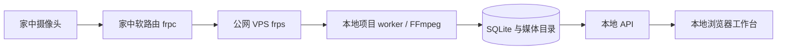

# 摄像头 AI 工作台

把摄像头画面整理为可追溯的活动、分钟记录和小时／日报。每条记录可回到来源分钟与现场图；活动时长由后端计算，无法判断、未分析和采集缺口分别保留。现场图按保存期限到期，文字记录继续可读。业务时间统一为北京时间。

## 功能与运行结构

- 摄像头：RTSP over TCP 取流、连接测试、周计划与临时启停、ROI 检测区域、浏览器实时预览。
- 活动与记录：按秒采样、运动触发、分钟分析、活动时间线、人工修正及小时／日报。
- 档案：人物与物品、参考图片、身份匹配以及来源证据。
- 运行管理：AI 服务配置与能力测试、任务队列、用量、存储配额、图片自动到期和故障恢复。

前端使用 React、TypeScript、Vite；后端使用 Python 3.11+、FastAPI、SQLite WAL 和 FFmpeg。API 与独立 worker 共享本机数据目录；浏览器通过同源 API 访问图片和 HLS，不直接连接 RTSP。AI 分析需要另外配置兼容服务的地址、模型和 API Key。



这条直连链路的穿透服务运行在软路由和 VPS。开发电脑运行工作台，通过 VPS 端口取流；无需在开发电脑安装 frp。现有本机 visitor 入口也可使用，主机和端口均由后端部署白名单控制。

## 从零启动：Windows 本机开发

先安装 Python 3.11 或更新版本、Node.js 24、FFmpeg，并让 `python`、`node`、`npm`、`ffmpeg` 可在终端运行。若 FFmpeg 未加入 PATH，可在根目录 `.env` 中填写 `CAW_FFMPEG` 的完整路径。

```powershell
git clone https://github.com/zhuchenyu2008/Camera-AI-Workbench.git
cd Camera-AI-Workbench
python --version
node --version
ffmpeg -version
.\start-local.ps1 -Install
```

脚本会创建 `.venv`、按锁文件安装后端和前端依赖、从 `.env.example` 创建 `.env`、生成仓库外主密钥、迁移数据库，并启动 API、worker 和前端。首次运行会要求设置 `admin` 的密码（至少 12 字符）；再次启动保留账户、摄像头和历史数据。

如果 PowerShell 的执行策略阻止运行脚本，可仅对本次进程使用：

```powershell
powershell -NoProfile -ExecutionPolicy Bypass -File .\start-local.ps1 -Install
```

启动后打开 **<http://127.0.0.1:5173>**，使用 `admin` 和首次设置的密码登录。此开发配置只监听本机回环地址，不会创建开机自启任务或安装 Windows 服务。

| 组件 | 地址／位置 |
| --- | --- |
| 工作台 | `http://127.0.0.1:5173` |
| API | `http://127.0.0.1:8000`，由前端代理 `/api` |
| API 存活检查 | `http://127.0.0.1:8000/health/live` |
| 数据库 | `data/local/db/workbench.sqlite3` |
| 运行日志 | `data/local/logs/local-api.log`、`local-worker.log`、`local-frontend.log` |
| 业务日志 | `data/local/logs/api.log`、`worker.log` |
| 主密钥 | 默认 `%LOCALAPPDATA%/Camera-AI-Workbench/master.key`，在仓库外 |

后续启动、停止：

```powershell
.\start-local.ps1
# 在启动终端按 Ctrl+C，或在另一个终端执行：
.\start-local.ps1 -Stop
```

停止会先让 worker 关闭 FFmpeg 采集管道，再停止 API 和前端。修改 `.env` 后需要停止并重新启动；依赖锁文件更新后使用 `-Install`。

## 接入已经配置好的内网穿透

在根目录 `.env` 中把 VPS 的 IPv4 加入允许清单，端口与 frp 的 `remotePort` 保持一致。例如，下面的 `203.0.113.10` 需要换成自己的 VPS 地址：

```dotenv
CAW_RTSP_ALLOWED_HOSTS=127.0.0.1,203.0.113.10
CAW_RTSP_ALLOWED_PORTS=15554
```

登录工作台，在「摄像头 → 添加摄像头」保存来源：

| 字段 | 填写内容 |
| --- | --- |
| RTSP 主机 | VPS 的 IPv4 地址 |
| RTSP 端口 | `15554`，以实际映射为准 |
| RTSP 路径 | 主码流 `/live/ch00_0`，或子码流 `/live/ch00_1` |
| 摄像头用户名 | 摄像头自己的账户，例如 `admin` |
| 摄像头密码 | 摄像头原密码，单独填写 |
| 周计划 | 希望自动采集的时段 |

先保存草稿并测试。启用持续采集前，需要在「AI 服务」中配置并测试视觉、摘要服务，再到「分析与保存」中选用；之后完成摄像头启用预检。如果暂时没有 AI 配置，可以保留已通过取流测试的草稿，稍后继续。每台机位选一路码流；子码流适合先验证链路，主码流适合需要看清细节的场景。不要把包含密码的完整 RTSP URL 填到「路径」字段。

摄像头密码和 AI Key 在数据库中加密保存，前端只显示「已配置」。`.env`、`data/`、主密钥和本地数据库不提交到 Git；README 和示例文件不含真实凭据。备份数据库时需要独立保管主密钥。

## 配置与环境边界

根目录 `.env` 由本机启动脚本读取，已有进程环境变量优先。配置样例见 [`.env.example`](.env.example)。

| 配置 | 用途 |
| --- | --- |
| `CAW_LOCAL_DEV` | `1` 显式启用本机开发；允许回环 HTTP，保留登录、同源与 CSRF 检查 |
| `CAW_ALLOWED_ORIGIN` | 本机入口固定为 `http://127.0.0.1:5173`；正式部署填写 HTTPS 来源 |
| `CAW_DATA_DIR` | 数据与日志目录，默认 `data/local` |
| `CAW_MASTER_KEY_FILE` | 仓库外主密钥路径；本机脚本可自动生成默认文件 |
| `CAW_RTSP_ALLOWED_HOSTS` | 允许取流的精确 IPv4 地址，逗号分隔，默认仅 `127.0.0.1` |
| `CAW_RTSP_ALLOWED_PORTS` | 允许取流的端口，逗号分隔 |
| `CAW_FFMPEG` | FFmpeg 可执行文件名或完整路径 |
| `CAW_PROVIDER_ALLOWED_HOSTS` | AI HTTPS 服务的主机白名单；服务的模型与 Key 在工作台中配置 |
| `CAW_PROVIDER_LOCAL_ENDPOINTS` | 明确允许的本地兼容服务，按 `主机:端口` 填写 |

正式部署使用独立 API、worker、HTTPS 反向代理和前端构建产物，不启用 `CAW_LOCAL_DEV`。正常部署仍强制 HTTPS 和 Secure Cookie，部署模板见 [Linux 部署与回退](backend/deploy/README.md)。本机脚本不操作 VPS，也不部署任何服务器业务程序。

## 验证与常见问题

在依赖已经安装后，可分别执行：

```powershell
cd backend
../.venv/Scripts/python -m pytest -q
../.venv/Scripts/python -m scripts.build_contracts --check
cd ../frontend
npm test
npm run build
```

- **端口被占用**：先执行 `start-local.ps1 -Stop`，检查占用 `8000`、`5173` 的其他程序；脚本不会主动结束无关进程。
- **登录来源被拒绝**：使用 `http://127.0.0.1:5173`，不要替换为局域网 IP；检查 `.env` 的 Origin 与本机开发开关。
- **摄像头主机／端口不被允许**：把实际 VPS IPv4 和映射端口加入 `.env` 白名单，再重启。
- **测试任务一直排队**：检查 worker 日志与「运行状态」心跳；仅启动 API 不会执行采集或分析任务。
- **摄像头测试超时**：检查软路由与 VPS 的 frp 服务、端口、摄像头账号和路径。取流固定使用 TCP。
- **有画面但没有 AI 结果**：先配置模型服务并完成能力测试，再在分析设置中选择视觉与摘要服务。没有配置 AI 时不会生成模拟分析结果。

正式应用没有 Demo 数据入口。自动验收使用的合成摄像头、模型响应与临时数据库仅存在于测试脚本中。

## 进一步阅读

- [后端运行与部署](backend/README.md) · [前端运行与构建](frontend/README.md)
- [产品需求](docs/01-摄像头AI工作台-PRD.md) · [远程接入方案](docs/02-监控视频流远程接入与部署方案.md)
- [后端接口契约](docs/04-后端详细设计与接口契约.md) · [后端验收](docs/05-后端实现与验收清单.md)
- [视觉与交互设计](DESIGN.md) · [前端验收与截图](docs/06-前端实现与验收清单.md)
