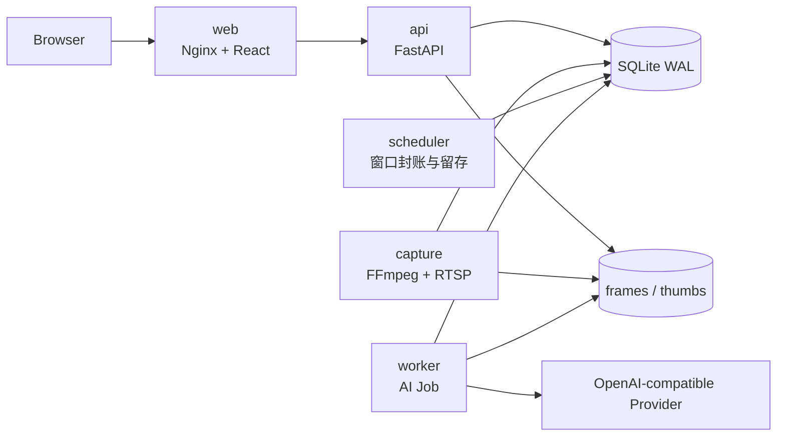

# Camera AI Workbench

> 面向固定摄像头的本地优先 AI 观测工作台：把 RTSP 画面、活动时间轴、分钟观察、小时/日报总结和原始证据放在同一个可追溯工作区中。

Camera AI Workbench（摄像头 AI 总结工作台）适合个人或小规模本地部署。系统先记录摄像头实际采集到的画面，再由可配置的 OpenAI-compatible 视觉模型生成结构化观察、活动段和周期总结；当证据不足时，明确显示“未知”“采集缺口”或“处理中”，不会把推断伪装成事实。

## 项目状态

当前仓库是首版实现基线，已经包含可运行的前端、后端、持久化任务、采集与分析服务，以及 Docker Compose 部署文件。适合继续开发、联调和内部验收；真实摄像头数量、RTSP 编码、外部模型延迟和长期运行能力仍应在目标机器上单独压测，不应把默认配置视为性能保证。

### 已实现的主要能力

- **工作台 UI**：工作台首页、时间轴、总结、AI 使用量与任务状态。
- **摄像头管理**：RTSP 来源配置、连接测试、重连、启用/停用和采集状态。
- **证据链**：帧与缩略图落盘、时间戳、帧差/稳定性信号、证据帧引用和收藏。
- **分层分析**：分钟观察（L1）、5 分钟活动时间轴（L2）、小时/日报总结（L3）任务链路。
- **时间轴编辑**：活动段修订、拆分、合并、重新分析和版本冲突保护。
- **AI Provider**：OpenAI-compatible Chat Completions 子集、模型绑定、连接测试、工具调用和用量记录。
- **后台服务**：API、Worker、Scheduler、Capture 四类进程，可通过同一镜像分别启动。
- **安全与运维**：单用户会话、HttpOnly Cookie、CSRF、Argon2 密码哈希、凭据加密、SQLite WAL、健康检查、备份与备份校验。
- **留存与隐私**：普通帧、事件帧和收藏帧可设置不同留存策略；图片过期后，仍可保留文字时间轴和总结。

### 当前边界

- 首版使用 **SQLite WAL + 本地文件存储**，定位是单实例部署；不要在未压测前横向扩展多个写入实例。
- AI 分析需要在设置中配置可用的 OpenAI-compatible Provider；没有 Provider 时，采集和浏览基础数据仍可运行，但 AI 任务无法完成。
- 摄像头采集依赖 FFmpeg 和可访问的 RTSP 服务；浏览器不会直接连接摄像头。
- 系统只做匿名人物簇和活动分析，不做 OCR、人脸真实身份识别或“效率/专注度”评分。

## 架构概览



Compose 默认包含以下服务：

| 服务 | 职责 |
| --- | --- |
| `web` | 托管 React 静态资源，并反向代理 `/api` 与 `/health` |
| `api` | REST API、SSE、认证、配置和查询 |
| `capture` | RTSP 解码、抽帧、落盘、断流/采集状态维护 |
| `worker` | 领取持久化 AI Job，执行 L1/L2/L3 分析并记录用量 |
| `scheduler` | 创建分析窗口、触发周期任务和留存清理 |

## 技术栈

- **前端**：React 19、TypeScript、Vite、React Router、TanStack Query、Vitest
- **后端**：Python 3.11+、FastAPI、Pydantic、SQLAlchemy、Alembic
- **数据与采集**：SQLite WAL、JPEG 文件存储、FFmpeg、RTSP
- **AI**：可配置的 OpenAI-compatible Chat Completions 接口
- **部署**：Docker Compose；后端镜像同时承载 API、Worker、Scheduler、Capture 命令

## 快速开始：Docker Compose（推荐）

### 前置条件

- Docker Desktop 或 Docker Engine + Compose v2
- 能够访问摄像头 RTSP 地址和所配置的 AI Provider

### 1. 准备配置

在仓库根目录执行：

```powershell
Copy-Item .env.example .env
```

编辑根目录 `.env`。**Compose 容器内的数据卷路径是 `/data`**，因此至少将下面两项改为容器路径；不要直接使用样例里的相对路径：

```dotenv
APP_MASTER_KEY_FILE=/data/master.key
APP_BOOTSTRAP_PASSWORD_FILE=/data/bootstrap_password
```

常用配置：

```dotenv
APP_ENV=development
WEB_PORT=8080
API_PORT=8000
APP_ALLOWED_ORIGIN=http://localhost:8080
APP_TIMEZONE=Asia/Shanghai
```

生产环境还应设置 `APP_ENV=production`，并通过 Docker Secret 或受限挂载文件提供主密钥和初始管理员密码。**当前 `docker-compose.yml` 未声明 Secret 挂载**；采用 Secret 时，需要将同一主密钥挂载给 `api`、`worker`、`scheduler`、`capture`，并把初始密码提供给 `api`。不要把真实密钥、RTSP 密码或 Provider API Key 提交到 Git。

### 2. 初始化数据卷和管理员

```powershell
docker compose run --rm api init --with-password
docker compose run --rm --entrypoint sh api -c "cat /data/bootstrap_password"
```

请保存命令输出的初始密码。默认用户名为 `admin`；只有数据库中还没有管理员时，bootstrap password 才会被写入管理员账户。

### 3. 启动完整服务

```powershell
docker compose up --build -d
```

访问：

- 前端：<http://localhost:8080>
- API 文档：<http://localhost:8000/docs>
- 存活检查：<http://localhost:8000/health/live>
- 就绪检查：<http://localhost:8000/health/ready>

查看日志：

```powershell
docker compose logs -f api worker scheduler capture web
```

停止服务（不会删除数据卷）：

```powershell
docker compose down
```

> `docker compose down -v` 会删除 Compose 数据卷，请在确认已有备份后再执行。

## 本地开发：一键启动

Windows 本地开发无需 Docker。仓库根目录运行（也可以双击 `start-local.cmd`）：

```powershell
.\start-local.ps1
```

脚本会自动：

1. 首次运行时创建 Python 虚拟环境并安装后端依赖；依赖清单更新后再自动更新。
2. 在缺少 `backend/.env` 时从根目录 `.env.example` 复制一份，不会覆盖已有本地配置。
3. 初始化本地密钥和 SQLite 数据库；全新数据库会生成初始管理员密码并在终端显示。
4. 首次运行时安装前端依赖，然后启动 API、Worker、Scheduler、Capture 和 Vite 前端。
5. 等待 API 与前端就绪后自动打开浏览器，地址为 <http://localhost:5173>。

前置条件：Python 3.11+、Node.js 20.19+ 或 22.12+、npm。若要接入真实摄像头，还需要 FFmpeg 并加入 `PATH`。首次安装依赖需要网络；之后再启动会直接复用已准备好的环境。

停止所有由脚本启动的进程：

```powershell
.\start-local.ps1 -Stop
```

启动日志保存在 `.local-dev/logs/`；如浏览器未自动打开，可手动访问 <http://localhost:5173>。首次打印的 `admin` 初始密码只在管理员尚未初始化时显示，请妥善保存，不要分享终端输出。脚本默认使用 5173（前端）和 8000（API）端口；重启时只会停止进程清单中身份匹配的旧进程。若端口仍被其他程序占用，脚本会停止启动并提示，不会关闭该程序。API 和前端会等待 HTTP 就绪；Worker、Scheduler、Capture 只记录进程已创建，不做服务级健康探测。依赖安装失败时可检查网络和日志；`-NoBrowser` 可仅启动服务而不打开浏览器，`-SkipInstall` 可跳过依赖安装（依赖检查仍会执行，且需要有效的依赖标记）。

脚本创建的本地配置位于 `backend/.env`，可按需修改；下次启动不会覆盖它。更细粒度的手动启动方式如下。

### 手动开发（可选）

安装后端依赖、初始化数据库：

```powershell
Set-Location backend
py -3 -m venv .venv
.\.venv\Scripts\python -m pip install -e ".[dev]"
Copy-Item ..\.env.example .env
.\.venv\Scripts\python -m app.cli init --with-password
.\.venv\Scripts\python -m app.cli migrate
```

启动 API：

```powershell
.\.venv\Scripts\python -m uvicorn app.main:app --env-file .env --host 127.0.0.1 --port 8000
```

另开终端，在 `frontend/` 安装并启动前端：

```powershell
npm install --no-audit --no-fund
npm run dev
```

需要真实采集和自动分析时，再在 `backend/` 目录分别运行：

```powershell
.\.venv\Scripts\python -m app.cli worker
.\.venv\Scripts\python -m app.cli scheduler
.\.venv\Scripts\python -m app.cli capture
```

没有后台进程时，对应的任务、周期总结和实时采集不会自动推进。

## 配置说明

配置通过环境变量读取，完整样例见 [`.env.example`](.env.example)。重要变量如下：

| 变量 | 默认值/示例 | 说明 |
| --- | --- | --- |
| `APP_ENV` | `development` | `production` 会强制要求主密钥和管理员密码 |
| `APP_DATA_DIR` | `./data` | 数据根目录；包含数据库、图片、备份和临时文件 |
| `APP_DB_URL` | `sqlite:///./data/app.sqlite3` | 数据库地址，首版按 SQLite 设计 |
| `APP_TIMEZONE` | `Asia/Shanghai` | UI 和周期窗口的显示/业务时区；数据库仍保存 UTC 毫秒时间戳 |
| `APP_ALLOWED_ORIGIN` | `http://localhost:5173` | 允许的前端 Origin，可用逗号分隔多个值 |
| `APP_MASTER_KEY_FILE` | `./data/master.key` | AES-256 主密钥文件；丢失会导致加密凭据无法解密 |
| `APP_BOOTSTRAP_PASSWORD_FILE` | `./data/bootstrap_password` | 首次启动时创建管理员账户的密码文件 |
| `APP_PROVIDER_ALLOWED_HOSTS` | 空 | 生产环境建议显式配置 Provider 主机白名单 |
| `APP_RTSP_ALLOWED_HOSTS` | 空 | 生产环境必须把摄像头主机加入允许列表 |
| `APP_RTSP_ALLOWED_PORTS` | `554,8554` | 允许的 RTSP 端口列表 |
| `CAPTURE_DEFAULT_INTERVAL_MS` | `1000` | 默认采样间隔 |
| `WORKER_CONCURRENCY` | `2` | Worker 并发数；SQLite 写入压力较大时不要盲目调高 |
| `LOG_LEVEL` | `INFO` | 日志级别 |

Provider 的 API Key 和摄像头 RTSP 凭据只在后端保存，并使用主密钥加密。修改或丢失主密钥会使历史密文无法解密；备份时必须把主密钥作为受限 Secret 单独保存。

## 数据目录与留存

本地一键启动脚本默认使用 `backend/data/`；Docker Compose 容器内使用 `/data`。默认数据目录结构如下：

```text
backend/data/
├─ app.sqlite3          # 本地开发默认 SQLite 数据库
├─ db/                  # Compose 或自定义配置可使用的数据库目录
├─ frames/              # 原始 JPEG 帧
├─ thumbs/              # 缩略图
├─ backups/             # 备份包
├─ tmp/                 # 临时文件
├─ master.key           # 应用主密钥，不要提交
└─ bootstrap_password   # 初始密码，不要提交
```

采集帧先以临时文件写入，再原子重命名；数据库只保存元数据和相对路径，不把完整图片写进 SQLite。留存清理会优先尊重收藏和仍被任务引用的证据。图片过期后，活动段、分钟观察和总结是否保留由留存配置决定，默认保留文字时间轴。

## API 与实时事件

- REST 基础路径：`/api/v1`
- OpenAPI：`/openapi.json`
- Swagger UI：`/docs`
- ReDoc：`/redoc`
- SSE 事件流：`GET /api/v1/events`
- 健康检查：`/health/live`、`/health/ready`、`/health/dependencies`

时间接口使用 UTC RFC3339；前端按用户设置的 IANA 时区显示。所有区间按左闭右开 `[start, end)` 解释。

## 备份与恢复校验

创建 SQLite 一致性备份：

```powershell
# 在 backend 目录执行
.\.venv\Scripts\python -m app.cli backup `
  --output .\data\backups\camera-ai-backup.zip `
  --include-images
```

校验备份包：

```powershell
.\.venv\Scripts\python -m app.cli verify-backup .\data\backups\camera-ai-backup.zip
```

备份策略建议：数据库、图片和主密钥分开保护；定期在另一台环境执行校验和恢复演练，不要只检查压缩包是否存在。

## 测试与质量检查

后端：

```powershell
Set-Location backend
.\.venv\Scripts\python -m pytest -q
.\.venv\Scripts\python -m ruff check app tests
```

前端：

```powershell
Set-Location frontend
npm test
npm run build
```

## 常见问题

### 页面显示“工作台服务暂不可用”

确认 API 已启动，并检查：

```text
http://127.0.0.1:8000/health/ready
```

本地前端必须使用 `http://localhost:5173`，并且后端的 `APP_ALLOWED_ORIGIN` 包含该 Origin；Compose 部署则通常使用 `http://localhost:8080`。

### 登录失败或没有管理员账户

确认初始化命令已经执行，并检查 `bootstrap_password` 文件是否存在。生产环境不会自动生成密码，必须通过 `APP_BOOTSTRAP_PASSWORD` 或 `APP_BOOTSTRAP_PASSWORD_FILE` 注入长度不少于 12 个字符的初始密码。

### 摄像头连接测试被拒绝

确认地址是 `rtsp://` 或 `rtsps://`，端口在 `APP_RTSP_ALLOWED_PORTS` 中；生产环境还必须将主机加入 `APP_RTSP_ALLOWED_HOSTS`。摄像头应能从 **capture 容器/进程所在机器**访问，而不是只在浏览器所在电脑可访问。

### AI 任务一直排队

确认已经配置 AI Provider 和 L1/L2/L3 模型绑定，并且 `worker` 服务正在运行。若 Provider 地址被拒绝，检查 `APP_PROVIDER_ALLOWED_HOSTS`、本地端点配置和 Provider 是否符合 OpenAI-compatible Chat Completions 约定。

### 时间轴出现采集缺口或证据已过期

这表示系统没有把旧画面复制成新的视觉证据，或者帧已按留存策略清理。请先检查 `capture` 日志和磁盘空间；不要把“没有画面”理解为“没有活动”。

## 文档索引

- [产品需求：摄像头 AI 总结工作台](docs/PRD-摄像头AI总结工作台-v1.0.md)
- [后端详细设计](docs/implementation/backend-design-v1.0.md)
- [前端详细设计与交互约定](docs/implementation/frontend-design-v1.0.md)
- [后端运行说明](backend/README.md)
- [前端运行说明](frontend/README.md)

## 许可证

当前仓库尚未声明开源许可证。除非项目维护者另行授权，请不要将本项目或其中的模型提示、摄像头数据和生成结果作为第三方产品发布。
