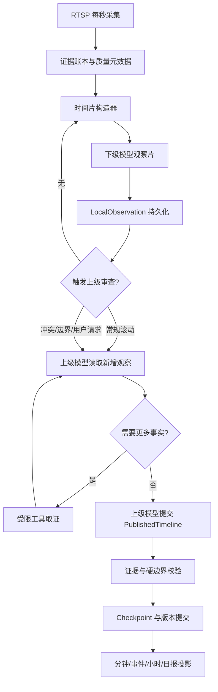

# 时间片观察与上级裁决详细设计

版本：0.1｜修订日期：2026-10-20（北京时间）｜状态：实现设计，尚未编码

本文是[时间序列视觉分析与多轮取证架构](07-时间序列视觉分析与多轮取证架构.md)的详细实现设计。它把“下级模型负责短时间片观察，上级模型负责最终裁决”落成任务、消息、工具、数据和验收契约。当前单轮分钟分析仍可作为迁移期间的兼容模式，但不能被误标为本设计已经实现。

## 1. 决策摘要

系统分成两个模型职责：

1. **下级模型是时间片观察员。** 每次只回答一个固定时间片内发生了什么。时间片默认 20 秒，可配置为 20、30、40 或 60 秒。模型可以在该时间片内结合多张有序图片做判断，但不能替相邻时间片提交最终结论。
2. **上级模型是时间线裁决者。** 它读取多个时间片观察、采集覆盖、历史检查点和其他上下文；必要时调用受限取证工具查看原图或请求重新观察；它可以接受、合并、拆分或推翻下级结果，并输出用户最终看到的时间线。
3. **后端是证据和版本守门人。** 后端不替模型决定活动语义，不依据固定的“前后各几秒”规则延长活动；后端只校验证据、权限、硬边界、版本和投影关系。

最终关系是：

```text
每秒采集真实证据
        ↓
下级模型：20～60 秒一个时间片观察
        ↓
上级模型：读取观察，按需取证和复核
        ↓
上级模型：发布跨时间片的最终时间线版本
        ↓
后端：校验、保存、投影到分钟／事件／报告
        ↓
用户：主要阅读上级发布的时间线
```

下级结果仍然保留，作为证据链和调试入口；它不是与上级结果并列的第二个用户答案。

## 2. 范围与不变约束

### 2.1 本设计解决的问题

- 低运动活动持续 10～20 分钟或更久时，避免被自然分钟边界切断；
- 活动在时间片边界切换时，允许上级模型重新查看边界；
- 中间遮挡、背影、过暗、抖动或局部离开时，允许模型基于前后证据给出推断或保留未解决范围；
- 下级模型输出可以高频产生，而上级模型不必每秒调用；
- 上级模型拥有足够的受限数据和工具，不被一段可能失真的摘要绑死；
- 图片过期、断流和任务重启时，结果仍然可追溯且不伪造事实。

### 2.2 仍然有效的系统约束

- 采集目标仍为每秒一张真实图片；模型请求失败不能阻塞采集；
- 现场图片按 TTL 清理，过期后不能重新制造或假设仍可读取；
- 真实断流、计划外时间、未采到画面是硬边界，任何模型都不能跨越；
- 所有区间使用左闭右开 `[start, end)`；持久化时间戳使用 UTC，页面和报表使用 `Asia/Shanghai`；
- 活动时长由后端根据已发布时间线和覆盖区间计算，模型不能自报总时长替代统计；
- 人工修订优先于后来自动结果，旧版本必须可读；
- 参考图只辅助命名和身份匹配，不能证明当前时刻发生了活动。

## 3. 术语和职责

| 术语 | 定义 | 是否直接给用户作为最终答案 |
| --- | --- | --- |
| Evidence | 真实采集的现场图片及其不可变元数据 | 作为证据查看 |
| Observation slice | 下级模型的一次固定时间片，例如 20 秒 | 否 |
| Local observation | 下级模型对一个时间片的结构化观察 | 作为依据和审计 |
| Review run | 上级模型的一次多轮审查 | 否，产生版本 |
| Checkpoint | 上级模型在某个检查点保存的完整时间线状态 | 作为下一次审查输入 |
| Published timeline | 上级模型提交并经后端校验的当前时间线 | 是 |
| Mutable tail | 仍可能因新证据被上级模型修订的最近时间范围 | 页面显示检查状态 |
| Hard boundary | 断流、计划外、没有采集证据或其他不可跨越的边界 | 不能跨越 |

下级模型必须回答“这个时间片是什么”；上级模型必须回答“多个时间片最终应当合并成什么”。两者的 schema、提示词版本、任务类型和用量分别记录。

## 4. 端到端流程



模型调用不在数据库事务中执行。任务领取、租约、结果校验、版本提交和投影仍遵循现有持久队列规则。

## 5. 时间片构造

### 5.1 语义时间片与请求批次分离

时间片是语义单位，请求批次是传输单位。Provider 如果一次不能接收时间片内的全部图片，可以把同一个时间片拆成多个请求，但这些请求必须带同一个 `slice_id`、完整时间范围和批序号；不能让每个传输批次自行生成一份可发布时间线。

默认参数：

| 参数 | 初始值 | 说明 |
| --- | --- | --- |
| `observation_slice_seconds` | 20 | 下级模型一次回答的语义时间片；可调为 30、40、60 |
| `slice_overlap_seconds` | 5 | 相邻时间片重叠，用于边界观察；不重复计时 |
| `dense_frame_rate` | 1 fps | DENSE 时间片尽量使用每秒真实图片 |
| `sparse_sample_offsets` | 0、20、40、59 | 兼容低成本模式的代表帧，不改变时间片契约 |
| `initial_review_period_seconds` | 120 | 上级模型初始滚动审查周期 |
| `stable_review_period_seconds` | 300 | 连续稳定后上级模型的最长常规周期 |
| `mutable_tail_seconds` | 120 | 新证据到来时默认允许重新裁决的最近范围 |
| `max_review_rounds` | 8 | 单次上级任务最多工具往返轮数，需按 Provider 实测调整 |

这些值是实验起点，不是活动语义规则。Provider 能力、图片大小、队列延迟、TTL 和人工标注回放结果可以改变它们。每个任务保存实际使用的参数快照。

### 5.2 时间片覆盖

时间片构造器保存：

- `slice_id`、`camera_id`、`session_id`；
- `start_at`、`end_at`、`overlap_from`、`overlap_to`；
- 计划覆盖、实际采集区间、缺帧和质量异常；
- evidence ID 按 `captured_at` 升序排列；
- `coverage_mode`：`dense`、`sparse` 或 `mixed`；
- `source_revision`、参考集版本、提示词版本和能力版本；
- 最早 evidence 的过期时间和任务 deadline。

时间片不能跨越硬边界。硬边界两侧可以分别产生时间片，但必须使用不同的 `slice_id`，上级模型也必须知道两侧不能自动连成一个活动段。

### 5.3 省 token 模式

采集始终保存真实秒槽，节省只发生在模型输入：

- 画面稳定时，时间片可以使用代表帧，并把覆盖模式写成 `sparse`；
- 变化检测、下级模型不确定、窗口冲突或上级模型要求取证时，升级为 `dense`；
- 上级模型可要求某个时间片补看全部可用秒槽；
- 55 张与 60 张的差异本身很小，不把“每分钟 55 张”当作主要优化目标；
- 低运动不能直接等于没有活动，稀疏观察的结论只能由模型结合证据给出；
- 同一 evidence 因重叠或多次工具调用重复出现时，以 evidence ID 去重，不重复累计时长。

## 6. 下级模型：时间片观察员

### 6.1 输入

下级任务输入包括：

- 一个 `slice_id` 和严格的 `[slice_start, slice_end)`；
- 当前时间片的现场图片、时间戳、evidence ID、摄像头和采集状态；
- 相关人物／物品参考集及版本，明确标注为命名辅助资料；
- 活动目录和标签词表；
- 质量信息和覆盖信息；
- 可选的相邻片段摘要，只能用于解释边界，不能让输出越过当前时间片。

### 6.2 任务边界

下级模型必须：

- 说明时间片内主要人物和活动；
- 允许一个时间片包含多个活动段和切换候选；
- 逐项区分 `direct`、`inferred`、`uncertain`；
- 列出支持证据和边界证据；
- 指出需要上级模型复核的时间范围和问题；
- 对时间片内没有足够依据的区间返回 `unresolved`；
- 不能输出时间片外的活动、总时长或跨窗口最终结论；
- 不能将参考图、历史文字或模型提示中的活动名称当作现场事实。

### 6.3 建议输出

字段名可在实现时调整，但语义必须保留：

```json
{
  "schema_version": "local-observation-1",
  "slice_id": "slice_cam1_20261020_200000_20",
  "slice_start": "2026-10-20T20:00:00+08:00",
  "slice_end": "2026-10-20T20:00:20+08:00",
  "coverage": {
    "mode": "dense",
    "evidence_ids": ["ev_001", "ev_002"],
    "missing_ranges": []
  },
  "observations": [
    {
      "subject_id": null,
      "identity_status": "unknown",
      "activity": "reading",
      "start_at": "2026-10-20T20:00:02+08:00",
      "end_at": "2026-10-20T20:00:18+08:00",
      "certainty": "direct",
      "evidence_ids": ["ev_001", "ev_002"],
      "boundary_evidence_ids": ["ev_001", "ev_002"],
      "observation": "可见人物坐在桌前阅读。"
    }
  ],
  "unresolved_ranges": [],
  "transition_candidates": [],
  "review_requests": [
    {
      "from": "2026-10-20T20:00:18+08:00",
      "to": "2026-10-20T20:00:20+08:00",
      "question": "确认活动是否在片尾切换。"
    }
  ]
}
```

后端验证：所有时间必须在当前时间片内；所有 evidence ID 必须属于任务快照；证据端点顺序、主体和参考集引用必须合法；缺帧和硬边界不能被模型覆盖。验证成功后保存为不可变 `LocalObservation` 版本。

## 7. 上级模型：时间线裁决者

### 7.1 上级输入

上级任务不接收一段没有来源的自然语言总结，而接收结构化资料：

- 新增和相邻重叠时间片的 LocalObservation 全量字段；
- 上一次 Checkpoint 及其来源指纹；
- 已发布时间线在本次审查范围内的当前版本；
- 计划覆盖、实际采集、断流、缺帧、图片 TTL 和质量状态；
- 其他摄像头同一时间范围的可用观察；
- 相关人物档案、参考图版本和身份关联历史；
- 用户人工修订、拆分／合并和明确标记；
- 当前任务剩余工具、图片、字节、轮数和 deadline 预算。

### 7.2 上级职责

上级模型可以：

- 合并多个时间片为一个跨片段活动；
- 将一个下级片段拆为多个活动或未解决区间；
- 判断活动切换边界及边界不确定范围；
- 判断遮挡、背影、画质下降等期间应为 `inferred` 还是 `uncertain`；
- 识别下级模型之间的活动、身份和时间冲突；
- 通过工具查看原图、质量和覆盖；
- 请求某个范围重新生成下级观察；
- 在证据不足时提交 unresolved，而不是强行给出活动；
- 推翻任何下级模型结论，但必须引用新的证据或说明冲突原因。

上级模型不能：

- 跨越真实断流、计划外时间或没有采集证据的硬边界；
- 直接访问文件系统、数据库、任意 URL 或模型密钥；
- 把图片之外的参考资料当成当前时刻事实；
- 修改人工修订而不产生新的版本和冲突记录；
- 输出未经后端验证的结果作为已发布时间线。

### 7.3 建议输出

```json
{
  "schema_version": "published-timeline-1",
  "review_run_id": "review_20261020_200200",
  "reviewed_from": "2026-10-20T20:00:00+08:00",
  "reviewed_to": "2026-10-20T20:02:00+08:00",
  "segments": [
    {
      "subject_id": null,
      "identity_status": "unknown",
      "activity": "reading",
      "start_at": "2026-10-20T20:00:02+08:00",
      "end_at": "2026-10-20T20:01:47+08:00",
      "certainty": "mixed",
      "evidence_ids": ["ev_001", "ev_002", "ev_080"],
      "source_slice_ids": ["slice_a", "slice_b", "slice_c"],
      "boundary_range": {
        "start_lower": "2026-10-20T20:00:00+08:00",
        "start_upper": "2026-10-20T20:00:02+08:00"
      },
      "reason": "相邻时间片活动一致，重叠区未发现切换。"
    }
  ],
  "unresolved_ranges": [],
  "conflicts": [],
  "next_review": {
    "at": "2026-10-20T20:04:00+08:00",
    "reason": "regular_rollup"
  }
}
```

`PublishedTimeline` 是用户时间线的唯一自动来源。分钟记录、事件和报表从它投影；下级观察只在详情页以“分析依据”展示。

## 8. 上级取证工具

第一版工具采用白名单和固定响应 schema：

| 工具 | 参数 | 返回 | 主要限制 |
| --- | --- | --- | --- |
| `get_frame_manifest` | 摄像头、起止、可选 slice ID | evidence ID、时间、可用／过期／缺失、质量摘要 | 只能当前任务范围；不返回路径 |
| `view_frames` | evidence ID 列表或已授权时间范围 | 图片和固定元数据 | 数量、字节和 TTL 预算 |
| `get_capture_coverage` | 摄像头、起止 | 计划、实际采集、断流、缺帧、质量 | 只返回采集事实 |
| `get_local_observations` | 起止、摄像头、版本筛选 | 下级结构化结果、来源和校验状态 | 不合并、不改写结果 |
| `get_checkpoint` | 摄像头、时间范围 | 上次上级版本、未解决和冲突 | 只能读取当前授权范围 |
| `get_cross_camera_context` | 主体范围、起止 | 其他机位观察和覆盖摘要 | 身份按可靠关联过滤 |
| `get_identity_context` | 摄像头、主体候选、起止 | 档案、参考集版本、匹配历史 | 参考图只作命名辅助 |
| `get_manual_annotations` | 起止、资源范围 | 用户修订、原因、版本 | 人工版本不可被工具修改 |
| `get_frame_quality` | evidence ID 列表 | 模糊、亮度、遮挡和编码状态 | 辅助事实，不直接给活动结论 |
| `request_reobserve` | 起止、问题、密度 | 新的下级任务 ID | 不能越过 TTL；受任务去重和预算限制 |

工具调用必须记录工具名、参数摘要、授权范围、返回 evidence 摘要、轮次、耗时、状态和错误。日志不保存完整 Base64 图片、密钥或任意路径。

### 8.1 工具调用流程

1. 后端给上级模型发送结构化上下文和工具 schema；
2. 模型返回一个或多个工具调用；
3. 后端逐个验证摄像头、时间、evidence ID、任务租约、TTL 和预算；
4. 后端执行工具并返回白名单结果；
5. 结果作为同一轮对话的新消息返回给同一个上级模型；
6. 模型继续取证或提交 `PublishedTimeline`；
7. 只有结构化最终输出通过验证后，任务才可结束为 succeeded。

达到轮数、图片数、字节数或 deadline 时保存 `partial`。未查看范围不得被标成 complete；模型可以提交 unresolved，但不能伪造已查看证据。

## 9. 上级审查调度

上级模型不是固定等活动结束后才调用，也不是永远每 5 分钟机械调用。初始采用自适应触发：

### 9.1 常规滚动

新时间片观察齐备后，若距离上次检查点达到 120 秒，创建一次 `temporal_review`。检查内容包括上次检查点之后的新增片段、重叠片段和当前 mutable tail。连续多个检查点没有冲突、未解决范围缩小且覆盖稳定时，周期可以延长到 300 秒。

### 9.2 问题驱动

以下任一事件立即创建或合并检查任务：

- 下级模型返回 `review_requests` 或 `transition_candidates`；
- 相邻时间片活动、人物身份或覆盖状态冲突；
- 新结果与已发布时间线不一致；
- 人物重新出现、离开、遮挡、过暗、抖动或质量显著下降；
- 跨摄像头结果冲突；
- 用户查看、导出或手动请求某段历史；
- evidence 即将过期，继续等待会失去复核机会。

相同时间范围和原因的任务使用问题指纹去重，不能让同一冲突并发启动多个上级检查。

### 9.3 收尾检查

摄像头停止、计划结束、长时间没有新观察、活动窗口不再增长或最早证据接近过期时，创建 `temporal_finalize`。收尾任务固定 `reviewed_to`，提交一个可读的最终版本；之后的新证据进入新的时间片和新的检查点，不静默改写已冻结历史。

### 9.4 检查点和可变尾部

每个 Checkpoint 保存：

- 已发布 segments、unresolved、conflicts；
- 本次读取的 local slice ID 和 evidence ID 指纹；
- 工具调用摘要和模型／提示词／工具协议版本；
- `frozen_to` 与 `mutable_tail`；
- 下一次检查时间和触发原因；
- partial、过期和未查看范围。

默认最近 120 秒作为 mutable tail。这个值是版本管理和延迟控制参数，不是“活动只能连续 120 秒”的语义规则。上级模型可以在证据仍有效且任务被明确触发时回看更早范围。

## 10. 数据模型和任务

### 10.1 持久对象

| 对象 | 关键字段 | 作用 |
| --- | --- | --- |
| `TemporalSlice` | camera、范围、evidence 快照、覆盖、TTL、source revision | 固定下级观察输入 |
| `LocalObservationRun` | slice、模型、提示词、能力、输出、状态 | 保存下级一次观察及重试 |
| `TemporalReviewRun` | 范围、checkpoint、预算、工具协议、父子关系 | 保存上级多轮审查 |
| `TemporalToolCall` | run、轮次、工具、参数摘要、返回摘要、状态 | 工具审计和成本统计 |
| `TemporalCheckpoint` | 已发布时间线、指纹、冻结边界、未解决、下一触发 | 滚动审查上下文 |
| `TemporalSegment` | 活动段、certainty、边界、证据、来源片段、版本 | 上级时间线源记录 |
| `TemporalProjection` | segment 与 minute/event/report 的来源关系 | 兼容读模型投影 |

现有 `minute_records`、`activity_spans` 和事件表继续作为兼容读模型。新结果先写时间序列版本，再按时间区间投影，不反过来限制模型时间片。

### 10.2 任务类型

```text
temporal_local_observation   一个时间片 → 一个下级观察
temporal_reobserve            上级请求某范围重新观察
temporal_review               多个观察 → 上级多轮裁决
temporal_finalize             停止／TTL／用户请求 → 冻结范围
project_temporal_timeline     时间序列版本 → 分钟／事件投影
```

每个任务使用现有租约、deadline、幂等、有限重试和版本竞争。幂等键至少包含 `slice_id` 或审查范围、checkpoint revision、source revision、reference set、prompt/tool protocol version 和预算版本。

## 11. Provider 能力和消息契约

Provider 能力测试分为两层：

1. **时间片观察能力**：有序图片、时间戳、片内活动、片内切换、direct／inferred／uncertain、合法 evidence 引用和截断处理。
2. **上级多轮能力**：tool calls、工具结果续轮、结构化最终输出、最大轮数、拒绝越权工具参数和 partial 终止。

未通过第二层测试的 Provider 只能运行下级观察和当前兼容模式，不能冒充支持上级裁决。能力结果绑定 Provider、模型、消息协议、工具 schema 和输出 schema 版本。

上级请求使用同一对话上下文：

```text
system: 上级职责、边界、工具规则、输出 schema
user:   checkpoint、local observations、coverage、授权范围
assistant: tool_calls 或最终 PublishedTimeline
tool:   白名单工具结果
assistant: 继续 tool_calls 或最终 PublishedTimeline
```

如果 Provider 只支持 Chat Completions 而不支持原生工具调用，可由适配器提供受控的 JSON 工具请求兼容层；工具名、参数和执行权限仍由后端白名单决定，模型输出不能直接执行任意查询。

## 12. 失败、成本和安全

每个下级和上级 run 记录：现场图片数、参考图片数、请求字节、输入／输出 token、工具轮数、工具图片数、延迟、重试、deadline、证据过期数、partial 原因和最终状态。

处理规则：

- 下级失败不阻塞后续采集；上级可以读到失败和缺失片段；
- 上级失败保留已有 checkpoint，不把未审查范围发布为 complete；
- 图片部分过期时，保留有效证据并把无法复核范围标记为 `unresolved_expired`；
- 租约失效后停止下一轮工具调用，已发送请求的费用记录为未知或实际返回值；
- Provider 401／403 暂停领取，不影响采集和清理；
- 结构化输出错误允许有限纠正请求，仍失败则 partial／failed；
- 新的人工修订或 source revision 使旧 run 只能保存为历史，不能替换当前发布版本；
- 工具参数永远不能变成任意文件路径、URL、SQL 或模型密钥访问；
- 图片中的文字、参考描述、历史结果和工具返回都是资料，不是工具指令。

“相信模型”指相信模型在已授权证据上的语义判断，不等于允许模型越过证据边界。上级模型可以推断活动连续性，但必须把依据、certainty 和未解决范围写入结构化结果。

## 13. 前端和报表语义

用户主要看到 PublishedTimeline 投影的事件和分钟记录：

- 活动段显示 `direct`、`inferred`、`mixed` 或 `uncertain`；
- 显示上级检查状态、来源时间片、边界范围和 unresolved；
- 可以展开查看下级观察和工具取证来源，但不把下级结论显示成另一个并列答案；
- 原图过期后保留文字时间线、版本和证据状态；
- 上级仍在检查时显示“暂定”，不显示未经校准的概率百分比；
- 报表统计由后端根据 PublishedTimeline 计算，模型文案不能修改 totals。

## 14. 实施顺序

### 阶段一：契约和能力测试

- 定义 `TemporalSlice`、`LocalObservation`、`PublishedTimeline`、Checkpoint 和工具 schema；
- 扩展 Provider 能力测试，分别验证下级片内观察和上级多轮续轮；
- 用固定回放验证证据引用、硬边界、截断、partial 和工具越权拒绝。

### 阶段二：下级时间片观察

- 将现有分钟输出迁移为 20～60 秒时间片输出；
- 保留当前 sparse／dense 采样作为输入模式，不再把分钟当作语义合并单位；
- 保存 LocalObservationRun 和片内 evidence 校验；
- 兼容投影仍可生成分钟记录，但不生成最终跨片段事件。

### 阶段三：上级多轮裁决

- 实现工具执行器、预算、租约和审计；
- 实现常规、问题驱动、收尾三类触发；
- 实现 Checkpoint、mutable tail、版本竞争和 partial 恢复；
- 让 PublishedTimeline 成为事件和报表的唯一自动来源。

### 阶段四：长时间和多摄像头

- 回放 10、20、30 分钟连续活动；
- 回放多次切换、人物进出、遮挡、低光、抖动和多摄像头冲突；
- 根据边界误差、错误延长、错误切断、TTL 完成率和单位成本调整时间片与复核周期。

## 15. 验收指标

必须分别验收下级和上级：

| 维度 | 指标 |
| --- | --- |
| 下级片内观察 | 活动识别、片内切换、片内 evidence 合法率、direct／inferred／uncertain 一致性 |
| 上级时间线 | 连续活动误切率、错误延长率、边界误差、冲突处理和跨片段合并准确率 |
| 取证质量 | 主动取证命中率、取证后修正率、无依据强行结论率、未解决诚实率 |
| 系统可靠性 | TTL 内完成率、租约恢复、重启恢复、partial 可读性、人工版本不被覆盖 |
| 成本和延迟 | 每摄像头小时请求数、图片数、token、工具轮数、从采集到暂定／定稿延迟 |
| 安全 | 工具越权拒绝、证据范围拒绝、过期图片拒绝、敏感数据不进日志 |

核心回放必须包括：稳定低运动活动、边界切换、短暂离开后回来、遮挡和背影、缺帧、真实断流、图片过期、Provider 截断、工具调用中断以及 10～20 分钟连续活动。

## 16. 当前状态

截至 2026-10-20：

- 逐秒采集、现场图片、分钟记录、事件账本、单轮结构化输出、证据 TTL 和任务租约已经存在；
- 下级固定时间片契约、上级多轮工具调用、Temporal 对象、Checkpoint 和 PublishedTimeline 尚未实现；
- 当前 `sparse_analysis`、`dense_analysis` 和 `reconcile_minutes` 仍是兼容基线；
- 本文参数是实施起点，必须通过 Provider 能力测试和人工标注回放调整；
- 在上级裁决能力实现并通过验收前，现有分钟结果不能宣称已经具备跨时间片最终判断能力。
